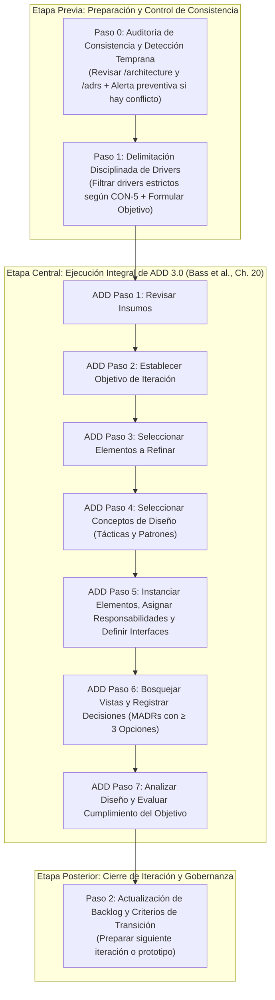

# SPEC-001: Especificación y Marco de Ejecución para el Diseño Arquitectónico (ADD 3.0 + SDD)

**Proyecto:** Trotamundos  
**Versión del Documento:** 2.0 (Refinadas)  
**Audiencia:** Equipo de Desarrollo de Software y Agentes de IA Generativa  
**Metodología Base:** Spec-Driven Development (SDD) & Attribute-Driven Design (ADD 3.0)  
**Referencia Teórica Principal:** SKILL `bass-software-architecture` (*Software Architecture in Practice*, 4th Edition — Len Bass, Paul Clements, Rick Kazman)

---

## 1. Propósito y Filosofía del Marco

Este documento constituye la **Especificación Rectora (Spec)** para guiar el proceso de diseño y documentación arquitectónica del sistema **Trotamundos**.

Su propósito es proporcionar un **meta-modelo de proceso repetible**, un conjunto de **guardrails metodológicos** y directivas explícitas de razonamiento diseñadas para que tanto el equipo humano como la **IA Generativa** colaboren de forma rigurosa, disciplinada y sinérgica a lo largo de las **4 iteraciones de ADD** definidas para el proyecto.

### Principio de Especificación como Fuente de Verdad (SDD)
En cumplimiento estricto con **CON-1**, todo diseño, decisión técnica y estructura debe originarse, validarse y documentarse formalmente a partir de especificaciones antes de proceder a la fase de prototipado (**CON-4**).

---

## 2. Insumos Exclusivos del Sistema (Drivers de Entrada)

El diseño arquitectónico debe sustentarse **única y exclusivamente** en los 5 archivos formalizados en el directorio `./drivers`:

1. **Propósito del Diseño (`./drivers/design-purpose.md`):**
   - Construir la próxima generación de un panel de gestión de viajes en línea (web y móvil).
   - Servir como único punto de verdad centralizado para reservas (hoteles, autos, vuelos, trenes, autobuses).
   - Eliminar la fricción de gestionar múltiples aplicaciones y bandejas de correo, orquestando información de proveedores externos en una interfaz unificada centrada en el viaje.

2. **Requisitos Funcionales y Actores (`./drivers/func-rqmts.md`):**
   - **Actores:** Usuarios (web y móvil), aplicaciones externas de transportes y alojamientos, agencias de viaje/hospedaje, proveedores de correo (Mail provider), analistas de datos, proveedores de redes sociales.
   - **Requisitos:** Cruce de reservas multicanal vía APIs estándar (FR-1), captura automática de reservas desde email (FR-2), lista blanca de remitentes seguros (FR-3), gestión manual de reservas (FR-4), agrupación por viaje y auto-archivado al finalizar (FR-5), recopilación analítica de viajes (FR-7), compartir itinerario en redes sociales con control de permisos (FR-8).

3. **Escenarios de Calidad — QA (`./drivers/QA.md`):**
   - **Modifiability:** QA-11 (extensibilidad para soportar nuevos medios de transporte futuros sin fricción estructural).
   - **Availability:** QA-8 (disponibilidad global 24/7 con tolerancia máxima de 5 minutos de caída mensual), QA-3 (mitigación de picos extremos ante cancelaciones o eventos masivos).
   - **Performance:** QA-5 (refresco de datos en Trotamundos < 5 min tras cambios en terceros), QA-6 (tiempo de respuesta web < 800 ms), QA-7 (primer despliegue en móvil < 1.4 s).
   - **Scalability:** QA-1 (2M de usuarios activos semanales), QA-2 (15M de cuentas creadas), QA-15 (soporte para consultas analíticas pesadas sin degradar la operación transaccional).
   - **Interoperability:** QA-4 (integración heterogénea: APIs de terceros, sondeo de correos y redes sociales).
   - **Security:** QA-9 (acceso seguro, cifrado y autorizado a correos del usuario), QA-10 (permisos granulares de visualización al compartir itinerarios).
   - **Usability:** QA-13 (interfaz sencilla y funcional, geolocalización GPS móvil), QA-14 (canales dedicados web y móvil).
   - **Testability:** QA-12 (alta trazabilidad y observabilidad para pruebas y auditorías futuras).

4. **Restricciones del Negocio y Entorno (`./drivers/constraints.md`):**
   - Equipo de desarrollo pequeño.
   - Tiempo de desarrollo reducido (Time-to-Market crítico).
   - Presupuesto económico estrictamente limitado.

5. **Inquietudes y Directivas de Proceso — Concerns (`./drivers/concerns.md`):**
   - **CON-1:** Realizar un proceso de ADD de 4 iteraciones para Trotamundos usando Spec-Driven Development (SDD).
   - **CON-2:** Generar el Diagrama de Contexto en la primera iteración para fijar el alcance (*Scope*).
   - **CON-3:** Documentar mediante vistas arquitectónicas y Architectural Decision Records (ADRs) bajo formato **MADR**.
   - **CON-4:** Presentar la implementación del prototipo tras finalizar la cuarta iteración.
   - **CON-5:** Foco temático obligatorio por iteración:
     - *Iteración I:* Arquitectura de referencia y estilos arquitectónicos.
     - *Iteración II:* Funcionalidad primaria y selección de tecnologías.
     - *Iteración III:* Trade-offs de atributos de calidad (QA), tácticas y refinamiento.
     - *Iteración IV:* Decisiones complementarias, mejoras y preparación del prototipo.

---

## 3. Reglas de Oro y Guardrails de Diseño

### Regla 1: Selección Disciplinada de Drivers ("No adelantarse")
> [!IMPORTANT]
> **Prohibición Estricta de Sobrecarga Temprana:** No deben incorporarse drivers que correspondan a etapas posteriores de refinamiento. Seleccionar drivers en exceso de forma prematura diluye el foco, incrementa el acoplamiento y contradice el principio incremental de ADD 3.0 (*Bass et al., Ch. 20*).
- En la **Iteración I**, solo se abordan los drivers globales estructurales, el contexto del sistema y los estilos macro.
- Persistencia secundaria detallada, tácticas finas de resiliencia o algoritmos de analítica pertenecen a iteraciones posteriores (**CON-5**).
- Todo driver seleccionado debe estar estrictamente justificado dentro del objetivo formal de la iteración.

### Regla 2: Coherencia y Detección Temprana de Inconsistencias ("Revisar antes de proponer")
> [!CAUTION]
> **Guardrail Obligatorio de Alerta Temprana para Equipo e IA:**
> Antes de diseñar, documentar o incorporar cualquier funcionalidad requerida por el prompt engineer o los desarrolladores:
> 1. Es mandatorio revisar la línea base: vistas arquitectónicas consolidadas (`/architecture`), ADRs aceptados (`/adrs`) y restricciones del sistema (`constraints.md`).
> 2. **Si se detecta cualquier inconsistencia, contradicción o violación de restricciones:** la IA o el arquitecto **DEBE DETENERSE Y ADVERTIR EXPLÍCITAMENTE EL CONFLICTO ANTES DE AGREGAR LA FUNCIONALIDAD O MODIFICAR LA DOCUMENTACIÓN**.
> 3. No se permite continuar ni redactar propuestas que colisionen en silencio con decisiones previamente ratificadas.

### Regla 3: Sobriedad Operativa frente a Restricciones (`constraints.md`)
- Toda decisión técnica debe calibrarse frente a la realidad del proyecto: equipo pequeño, poco tiempo y presupuesto limitado.
- Se descarta cualquier sobre-ingeniería que demande esfuerzos desproporcionados de infraestructura o mantenimiento operativo.
- Aplicar rigurosamente el principio de *Just Enough Architecture* [Fairbanks 10] y *YAGNI*.

### Regla 4: Evaluación Rigurosa de Alternativas en ADRs (Mínimo 3 Opciones Viables)
- Para cada decisión arquitectónica significativa, es obligatorio formular y evaluar con honestidad técnica **al menos 3 alternativas razonables y viables** en la industria antes de seleccionar la opción ganadora.
- Se prohíbe el uso de alternativas triviales o ficticias (*strawman arguments*). Cada alternativa debe representar un patrón o tecnología real evaluada bajo criterios homogéneos de idoneidad, costo y complejidad.

---

## 4. Modelo de Proceso Repetible por Iteración

El modelo integra la preparación contextual, el ciclo canónico de ADD 3.0 (*Bass et al., Ch. 20*) y el cierre de gobernanza, **evitando duplicaciones** al embeber el registro de decisiones y vistas dentro de los pasos naturales de ADD:



---

### Etapa Previa: Preparación y Control de Consistencia (Pre-ADD)

#### Paso 0: Auditoría de Consistencia y Detección Temprana de Inconsistencias
* **Propósito:** Evitar desvíos y contradicciones antes de comenzar a formular soluciones.
* **Actividades:**
  1. Inspeccionar el repositorio de decisiones (`/adrs`) y las especificaciones de vistas consolidadas (`/architecture`).
  2. Evaluar la instrucción del prompt engineer o del equipo frente al estado actual y a las restricciones de `./drivers/constraints.md`.
  3. **Activación de Alerta Temprana (Gate Preventivo):** Si la funcionalidad o tecnología solicitada contradice un ADR previo, viola una restricción de negocio o rompe un invariante de las vistas, **se debe emitir un informe de advertencia de inconsistencia de inmediato**. La resolución del conflicto debe acordarse antes de iniciar el diseño.

#### Paso 1: Delimitación Disciplinada de Drivers y Definición del Objetivo
* **Propósito:** Proteger el alcance y evitar la sobrecarga cognitiva.
* **Actividades:**
  1. Contrastar el backlog de drivers con el hito temático correspondiente a la iteración según **CON-5**.
  2. Filtrar y seleccionar *únicamente* los drivers esenciales para este hito.
  3. Formular una declaración formal, concisa y falsificable del **Objetivo de la Iteración** (e.g., *"Definir la arquitectura de referencia macro y delimitar las fronteras de integración externa para garantizar disponibilidad 24/7"*).

---

### Etapa Central: Ejecución Integral de ADD 3.0 (*Bass et al., Ch. 20*)

El núcleo del diseño técnico se ejecuta mediante los 7 pasos canónicos de ADD 3.0, donde la generación de vistas y el registro de decisiones (ADRs) suceden de forma orgánica:

| Paso ADD 3.0 | Actividad Metodológica | Referencia en SKILL `bass-software-architecture` |
|---|---|---|
| **ADD 1: Revisar Insumos** | Verificar que los drivers seleccionados en el Paso 1 y las restricciones de `constraints.md` estén claros, vigentes y priorizados. | Consultar [ch19-architecturally-significant-requirements.md](file:./.agents/skills/bass-software-architecture/chapters/ch19-architecturally-significant-requirements.md) para priorización de ASRs. |
| **ADD 2: Establecer Objetivo** | Confirmar formalmente el objetivo derivado del Paso 1 que guiará el criterio de parada de la iteración. | [ch20-designing-an-architecture.md](file:./.agents/skills/bass-software-architecture/chapters/ch20-designing-an-architecture.md) (*"An iteration without a driver subset has no stopping condition"*). |
| **ADD 3: Seleccionar Elementos a Refinar** | Determinar los elementos arquitectónicos objeto de atención: descomposición (top-down), combinación (bottom-up) o mejora de elementos previos. | En Iteración I se refina el sistema global como un todo (caja negra a blanca). En II-IV se refinan subsistemas y conectores específicos. |
| **ADD 4: Seleccionar Conceptos de Diseño** | Identificar y seleccionar patrones arquitectónicos, tácticas de calidad o tecnologías comerciales que satisfagan los drivers. | Consultar capítulos de tácticas ([ch04](file:./.agents/skills/bass-software-architecture/chapters/ch04-availability.md) a [ch14](file:./.agents/skills/bass-software-architecture/chapters/ch14-working-with-other-quality-attributes.md)). |
| **ADD 5: Instanciar Elementos, Asignar Responsabilidades y Definir Interfaces** | Transformar conceptos abstractos en elementos concretos dentro de las 3 estructuras fundamentales: **Módulos**, **C&C** y **Asignación**, asegurando alta cohesión y bajo acoplamiento. | [ch01](file:./.agents/skills/bass-software-architecture/chapters/ch01-what-is-software-architecture.md) (Tres categorías de estructuras) y [ch15](file:./.agents/skills/bass-software-architecture/chapters/ch15-software-interfaces.md) (Diseño contractual de interfaces). |
| **ADD 6: Bosquejar Vistas y Registrar Decisiones (MADR)** | **Documentación activa y unificada:**<br>1. *Vistas:* Actualizar diagramas conceptuales y tablas de responsabilidades de las estructuras refinadas ([Ch 22](file:./.agents/skills/bass-software-architecture/chapters/ch22-documenting-an-architecture.md)).<br>2. *ADRs:* Registrar cada decisión clave en formato **MADR** evaluando obligatoriamente **≥ 3 alternativas razonables** (ver Sección 5). | [ch22-documenting-an-architecture.md](file:./.agents/skills/bass-software-architecture/chapters/ch22-documenting-an-architecture.md) (Reglas de documentación sana) y plantilla MADR. |
| **ADD 7: Analizar Diseño y Evaluar Cumplimiento del Objetivo** | Realizar el control de calidad intrínseco de la iteración: verificar si el diseño satisface los drivers seleccionados y detectar riesgos o trade-offs no mitigados. | [ch03](file:./.agents/skills/bass-software-architecture/chapters/ch03-understanding-quality-attributes.md) (Cuestionarios de tácticas) y [ch21](file:./.agents/skills/bass-software-architecture/chapters/ch21-evaluating-an-architecture.md) (Evaluación de riesgos y sensibilidades). |

---

### Etapa Posterior: Cierre de Iteración y Gobernanza (Post-ADD)

#### Paso 2: Actualización de Backlog y Criterios de Transición
* **Propósito:** Consolidar el progreso y transferir el conocimiento formalmente al siguiente ciclo.
* **Actividades:**
  1. **Registrar Deuda Técnica y Dudas Residuales:** Catalogar cualquier compromiso deliberado de deuda técnica ([Ch 23](file:./.agents/skills/bass-software-architecture/chapters/ch23-managing-architecture-debt.md)) para su tratamiento posterior.
  2. **Verificación de Transición:**
     - Si estamos al final de la Iteración I, II o III: confirmar que los cimientos requeridos para el siguiente hito de **CON-5** están listos.
     - Si estamos al final de la **Iteración IV**: verificar que las vistas, contratos e interfaces poseen el nivel de detalle necesario para dar inicio a la construcción del prototipo ejecutable (**CON-4**).

---

## 5. Estándar de Documentación de Decisiones (MADR con ≥ 3 Alternativas)

En cumplimiento de **CON-3**, toda decisión arquitectónica significativa generada en el **Paso 6 de ADD** debe formalizarse en un archivo independiente dentro de `/adrs` respetando la siguiente estructura estandarizada:

```markdown
# ADR-[Número]: [Título conciso de la decisión]

* **Estado:** [Propuesto | Aceptado | Superado]
* **Fecha:** [YYYY-MM-DD]
* **Decidido por:** [Equipo de Arquitectura / Rol]
* **Iteración ADD:** [Iteración I | II | III | IV]

## Contexto y Planteamiento del Problema
[Descripción clara del problema técnico o de negocio que exige una decisión y el estado actual del sistema].

## Drivers de Decisión
* [Driver 1, e.g., QA-8 (Disponibilidad 24/7)]
* [Driver 2, e.g., CON-2 (Diagrama de Contexto)]
* [Driver 3, e.g., Restricción de Presupuesto y Equipo Pequeño]

## Opciones Consideradas (Mínimo 3 Alternativas Razonables)
* **Opción 1:** [Nombre claro de la alternativa 1]
* **Opción 2:** [Nombre claro de la alternativa 2]
* **Opción 3:** [Nombre claro de la alternativa 3]

## Evaluación Comparativa de Alternativas

### Opción 1: [Nombre de la Alternativa 1]
* **Ventajas:** [Pros técnicos y de negocio]
* **Desventajas:** [Contras técnicos, costos, fricción operativa]
* **Impacto en Restricciones:** [Compatibilidad con equipo pequeño y presupuesto]

### Opción 2: [Nombre de la Alternativa 2]
* **Ventajas:** [Pros técnicos y de negocio]
* **Desventajas:** [Contras técnicos, costos, fricción operativa]
* **Impacto en Restricciones:** [Compatibilidad con equipo pequeño y presupuesto]

### Opción 3: [Nombre de la Alternativa 3]
* **Ventajas:** [Pros técnicos y de negocio]
* **Desventajas:** [Contras técnicos, costos, fricción operativa]
* **Impacto en Restricciones:** [Compatibilidad con equipo pequeño y presupuesto]

## Decisión Adoptada y Justificación
Se elige la **Opción [X]** porque [justificación técnica rigurosa basada en el equilibrio de drivers de calidad y restricciones de recursos].

## Consecuencias
* **Impacto Positivo:** [Beneficios inmediatos logrados]
* **Trade-offs y Riesgos Aceptados:** [Cualidades comprometidas deliberadamente]
* **Deuda Arquitectónica / Acciones Futuras:** [Puntos de atención para iteraciones subsiguientes]

```

---

## 6. Directivas Específicas de Comportamiento para la IA Generativa

Cuando un modelo de IA Generativa participe en el análisis, diseño o documentación de la arquitectura de Trotamundos, debe adherirse rigurosamente a las siguientes directivas:

> [!CAUTION]
> ### 1. Guardrail de Alerta Preventiva ante Inconsistencias (Pre-Execution Audit)
> **Directiva Mandatoria:** Antes de procesar una solicitud de diseño o añadir documentación solicitada por el prompt engineer:
> 1. La IA debe verificar activamente si la petición colisiona con:
>    - Las vistas ya consolidadas en `/architecture`.
>    - Las decisiones ya aprobadas en los archivos de `/adrs`.
>    - Las limitaciones de `constraints.md` (equipo pequeño, presupuesto acotado, tiempo escaso).
>    - El orden temático de las iteraciones establecido en `concerns.md` (**CON-5**).
> 2. **Si se detecta cualquier conflicto, contradicción o desvío:** la IA **NO DEBE AÑADIR LA FUNCIONALIDAD NI DOCUMENTARLA A CIEGAS**. En su lugar, **DEBE DETENERSE Y ADVERTIR EXPLÍCITAMENTE AL USUARIO**, indicando:
>    - *El conflicto exacto:* Qué elemento existente colisiona con la nueva propuesta.
>    - *La causa del choque:* Por qué resulta incompatible técnicamente o inviable bajo las restricciones.
>    - *Caminos de resolución:* Proponer cómo conciliar la propuesta, o solicitar confirmación para revocar la decisión anterior mediante un nuevo ADR formal.

> [!TIP]
> ### 2. Prohibición de Diseños Fantasma (Anti-Hallucination)
> La IA no debe inventar tecnologías, protocolos no justificados ni componentes periféricos que no tengan un origen comprobable en los 5 archivos de `/drivers` o en un ADR previo.

> [!TIP]
> ### 3. Trazabilidad Explícita
> Todo elemento instanciado, conector o táctica propuesta por la IA debe llevar asociada explícitamente su justificación hacia los drivers (e.g., *"El componente de Ingesta Asíncrona responde a FR-2 y a la táctica de amortiguamiento de carga de QA-3"*).

> [!TIP]
> ### 4. Aprovechamiento de la SKILL `bass-software-architecture`
> La IA debe emplear el vocabulario formal, las definiciones de estructuras (Módulos, C&C, Asignación) y los catálogos de tácticas detallados en la skill del libro de Bass et al. disponible en el entorno.

---

## 7. Recomendaciones Basadas en la Industria de Software

1. **C4 Model (Nivel 1 Contexto) para CON-2:**  
   En la Iteración I, plasmar el Diagrama de Contexto siguiendo el estándar C4 Nivel 1 (o caja y línea con límites claros), ubicando a Trotamundos como el sistema central en interacción con sus 6 actores externos ([func-rqmts.md](file:./drivers/func-rqmts.md#L1-L7)).
2. **Diseño Orientado a Interfaces y Contratos (API-First):**  
   Dado el ecosistema heterogéneo de proveedores ([FR-1](file:./drivers/func-rqmts.md#L11), [QA-4](file:./drivers/QA.md#L19)), definir contratos contractuales explícitos (OpenAPI/JSON Schema) antes de acoplar la lógica de integración (*Bass et al., Ch. 15*).
3. **Capa Anti-Corrupción (Anti-Corruption Layer - ACL):**  
   Implementar adaptadores que aíslen el modelo de dominio interno de las variaciones y fallas de las APIs externas de transporte y hotelería ([QA-11](file:./drivers/QA.md#L2), [QA-4](file:./drivers/QA.md#L19)).
4. **Segregación de Cargas Operativas (CQRS / Task Separation):**  
   Separar físicamente o lógicamente los flujos de lectura de ultra baja latencia para el viajero (< 800 ms web en [QA-6](file:./drivers/QA.md#L10) y < 1.4 s en móvil [QA-7](./drivers/QA.md#L11)) de las cargas batch o analíticas pesadas ([QA-15](file:./drivers/QA.md#L16), [FR-7](file:./drivers/func-rqmts.md#L16)).
5. **Prototipo Desechable Enfocado (Throwaway Prototype - CON-4):**  
   Tras la Iteración IV, el prototipo debe orientarse estrictamente a despejar la mayor incertidumbre técnica (como la ingesta y parseo automatizado de reservas vía correo electrónico bajo [FR-2](file:./drivers/func-rqmts.md#L12) y [QA-9](file:./drivers/QA.md#L22)), sin pretender ser el producto terminado (*Bass et al., Ch. 20*).

---

## 8. Matriz de Gobernanza de las 4 Iteraciones (Alineación con CON-5)

| Iteración | Hito Temático Principal (**CON-5**) | Entregables Mínimos Esperados | Drivers de Entrada Clave |
|---|---|---|---|
| **Iteración I** | *Choose reference architecture (architectural styles)* | • Diagrama de Contexto (**CON-2**)<br>• Estilo de arquitectura macro (C&C)<br>• ADRs de estilo arquitectónico (≥3 opciones) | Propósito, CON-2, QA-4, QA-8, QA-1 |
| **Iteración II** | *Primary functionality & technology selection* | • Módulos principales y responsabilidades<br>• Contratos de datos preliminares<br>• ADRs de stack tecnológico y persistencia (≥3 opciones) | FR-1, FR-2, FR-4, FR-5, QA-14, Constraints |
| **Iteración III** | *QA trade-offs, tactics & refinement* | • Tácticas de disponibilidad, rendimiento y resiliencia<br>• Tácticas de seguridad y desacoplamiento analítico<br>• ADRs de tácticas de calidad (≥3 opciones) | QA-3, QA-5, QA-6, QA-7, QA-9, QA-10, QA-15 |
| **Iteración IV** | *More decisions, improvements & prototype readiness* | • Extensibilidad para nuevos transportes (**QA-11**)<br>• Trazabilidad y observabilidad (**QA-12**)<br>• Especificación y arquitectura del prototipo (**CON-4**) | QA-11, QA-12, FR-7, FR-8, CON-4 |
