# Vista de Componentes y Conectores (C&C — Concurrencia y Runtime)

Esta vista describe los elementos en tiempo de ejecución (*runtime*), los procesos concurrentes, las goroutines de Go, los canales, los buffers y los conectores de red del sistema **Trotamundos**, en alineación con el patrón **Publisher-Subscriber sobre NATS JetStream** ([ADR-002](file:///home/pinacho/gitTrotamundos/trotamundos/main/adrs/adr-002.md)) y el **Monolito Modular Hexagonal** ([ADR-001](file:///home/pinacho/gitTrotamundos/trotamundos/main/adrs/adr-001.md)).

---

## 1. Diagrama de Concurrencia y Procesos en Runtime

```mermaid
graph LR
    %% CLIENTES EXTERNOS
    CLIENTS["🌐 Web Browser / 📱 Apps Móviles"]

    %% PROCESO NGINX
    subgraph PROC_NGINX ["Proceso: Nginx (Proxy Reverso & TLS)"]
        NG_SSL["Terminación TLS Let's Encrypt<br/>(:80 -> :443 HTTPS)"]
        NG_PROXY["Reverse Proxy a localhost:8080"]
        NG_SSL --> NG_PROXY
    end

    %% PROCESO MONOLITO GO
    subgraph PROC_GO ["Proceso Principal en Runtime: Trotamundos (Go 1.23+ Monolith)"]
        
        %% SUBGRAFO HTTP & BORDE
        subgraph RT_HTTP ["Servidor HTTP & Borde (Chi)"]
            GW_HTTP["net/http Server<br/>(1 Goroutine por petición entrante)"]
            GW_AUTH["Validador JWT (HS256)<br/>(Stateless en memoria < 0.1 ms)"]
            GW_RATE["Rate Limiter Token Bucket<br/>(En memoria RAM de Go)"]
            WEB_RENDER["Renderizado templ SSR<br/>+ SSE Handler (1 goroutine/stream)"]
            
            GW_HTTP --> GW_AUTH --> GW_RATE --> WEB_RENDER
        end

        %% SUBGRAFO EMAIL INGEST
        subgraph RT_EMAIL ["Módulo Email Ingest (Goroutines & Canales)"]
            IMAP_W["Workers IMAP IDLE<br/>(1 goroutine por cuenta activa)"]
            GMAIL_W["Handler Gmail Push Webhook<br/>(1 goroutine por callback)"]
            EMAIL_CHAN["Canal Go con Buffer:<br/>chan RawEmail (cap 500)"]
            PARSE_POOL["Pool de Parseo Regex<br/>(10 a 20 Goroutines concurrentes)"]
            EI_PUB["NATS Producer<br/>(nats.PublishMsg: booking.discovered)"]

            IMAP_W --> EMAIL_CHAN
            GMAIL_W --> EMAIL_CHAN
            EMAIL_CHAN --> PARSE_POOL
            PARSE_POOL --> EI_PUB
        end

        %% SUBGRAFO INTEGRATION
        subgraph RT_INT ["Módulo Integration (Conectores Resilientes)"]
            INT_SUB["NATS Consumer JetStream<br/>(Queue Group: int-provider-sync)"]
            INT_WORKER["Sync Worker Goroutines<br/>(cron y webhooks)"]
            CB["Circuit Breaker (sony/gobreaker)<br/>(Trip: 5 fallos · Open: 30s)"]
            RETRY["Retry con Jitter (go-retryablehttp)<br/>(3 intentos · backoff 1s, 2s, 4s ±20%)"]
            TIMEOUT["Context Timeout<br/>(Vuelos: 5s · Hoteles: 8s · Autos: 3s)"]
            INT_PUB["NATS Producer<br/>(booking.confirmed, trip.disrupted)"]

            INT_SUB --> INT_WORKER
            INT_WORKER --> CB --> RETRY --> TIMEOUT
            INT_WORKER --> INT_PUB
        end

        %% SUBGRAFO ITINERARY
        subgraph RT_ITIN ["Módulo Itinerary (Gestión de Viajes & CQRS)"]
            IT_SUB["NATS Consumer JetStream<br/>(Queue Group: itin-booking-sync)"]
            IT_EXEC["Use Case Processor Goroutine<br/>(Transición de estados y reglas)"]
            IT_CACHE["Cache In-Memory (ristretto)<br/>(Lecturas calientes < 50 ms)"]

            IT_SUB --> IT_EXEC
            WEB_RENDER -->|"Lectura en memoria"| IT_CACHE
            IT_EXEC -->|"Invalidación/Escritura"| IT_CACHE
        end

        %% SUBGRAFO ANALYTICS
        subgraph RT_ANA ["Módulo Analytics (Batch Ingest & Monetización)"]
            ANA_SUB["NATS Consumer JetStream<br/>(Wildcard: booking.>, trip.>)"]
            ANA_BUF["Buffer en Memoria RAM<br/>(sync.Mutex, max 500 rows)"]
            ANA_TICK["time.Ticker Goroutine<br/>(Disparo cada 5s o 500 rows)"]
            ANA_FLUSH["Flush Goroutine<br/>(Batch Insert a PostgreSQL)"]

            ANA_SUB --> ANA_BUF
            ANA_BUF --> ANA_FLUSH
            ANA_TICK --> ANA_FLUSH
        end
    end

    %% BROKER NATS JETSTREAM
    subgraph PROC_NATS ["Proceso: NATS JetStream 2.10+ (Broker Pub/Sub ~30 MB RAM)"]
        NATS_STREAM["Streams Durables:<br/>• BOOKINGS (booking.>)<br/>• TRIPS (trip.>)<br/>• DEAD_LETTER (deadletter.>)<br/>(Deduplicación por Nats-Msg-Id)"]
    end

    %% BASE DE DATOS POSTGRESQL
    subgraph PROC_PG ["Base de Datos: PostgreSQL 16 (DigitalOcean Managed)"]
        PG_POOL["pgxpool (Pool de conexiones TCP)"]
        PG_TABLES["Tablas Relacionales (trips, bookings, users)"]
        PG_JSONB["Columnas JSONB con índices GIN"]
        PG_MV["Vistas Materializadas Analíticas (Monetización FR-9)"]
        
        PG_POOL --> PG_TABLES
        PG_POOL --> PG_JSONB
        PG_POOL --> PG_MV
    end

    %% SISTEMAS EXTERNOS
    EXT_APIS["✈️ APIs Externas de Proveedores<br/>(Aerolíneas, Hoteles, Autos)"]

    %% ENLACES DE RED
    CLIENTS -->|"HTTPS :443"| NG_SSL
    NG_PROXY -->|"HTTP localhost:8080"| GW_HTTP

    %% ENLACES AL BROKER NATS
    EI_PUB -->|"TCP :4222"| NATS_STREAM
    INT_PUB -->|"TCP :4222"| NATS_STREAM
    NATS_STREAM -->|"TCP :4222"| INT_SUB
    NATS_STREAM -->|"TCP :4222"| IT_SUB
    NATS_STREAM -->|"TCP :4222"| ANA_SUB

    %% ENLACES A POSTGRESQL (pgxpool)
    IT_EXEC -->|"SQL ACID"| PG_POOL
    ANA_FLUSH -->|"Batch SQL"| PG_POOL

    %% LLAMADAS RESILIENTES SALIENTES
    TIMEOUT -->|"HTTPS con Circuit Breaker"| EXT_APIS

    %% ESTILOS
    style PROC_GO fill:#1e1e2f,stroke:#7c6ff7,stroke-width:2px,color:#fff
    style PROC_NATS fill:#1a3a2a,stroke:#4caf50,stroke-width:2px,color:#fff
    style PROC_PG fill:#3a2a1a,stroke:#ff9800,stroke-width:2px,color:#fff
    style PROC_NGINX fill:#2a1a3a,stroke:#ba68c8,color:#fff
```

---

## 2. Tipos de Conectores y Semántica de Comunicación

| Conector | Origen $\rightarrow$ Destino | Naturaleza | Protocolo / Tecnología | Semántica de Garantía |
|---|---|:---:|---|---|
| **Conector de Borde** | Navegador / Móvil $\rightarrow$ Nginx | Síncrono | HTTPS / TLS 1.3 (puerto `:443`) | Cifrado punto a punto, terminación TLS segura. |
| **Conector Proxy Local** | Nginx $\rightarrow$ Monolito Go | Síncrono | HTTP/1.1 (puerto `:8080`) | Tráfico interno no expuesto a internet. |
| **Conector de Canal Go** | Workers Correo $\rightarrow$ Parser Pool | Asíncrono local | `chan RawEmail` (memoria de Go) | Buffer de 500 correos en memoria; previene bloqueo del receptor. |
| **Conector Bus de Eventos** | Módulos Go $\leftrightarrow$ NATS JetStream | Asíncrono | TCP binario nativo (puerto `:4222`) | *At-least-once delivery*, ACK explícito, deduplicación nativa por `Nats-Msg-Id`. |
| **Conector de Base de Datos** | Módulos Go $\rightarrow$ PostgreSQL 16 | Síncrono agrupado | TCP con `pgxpool` (puerto `:5432`) | Transaccional ACID, pool limitado a 25 conexiones concurrentes. |
| **Conector Resiliente Saliente** | Integration $\rightarrow$ APIs de Proveedores | Síncrono protegido | HTTPS con Circuit Breaker + Retry | Aislamiento de fallos, timeout estricto y backoff exponencial con jitter. |

---

## 3. Dinámica de Concurrencia y Aislamiento de Picos (QA-3)

1. **Absorción de Ráfagas Masivas de Correos**:
   - Una avalancha de correos de cancelación entra por webhook o conexiones IMAP IDLE y se deposita en el canal `chan RawEmail` en nanosegundos.
   - El pool de parseo acota el consumo de CPU a un número fijo de goroutines (10 a 20), impidiendo que ráfagas de 500.000 mensajes saturen los núcleos del servidor.
   - Cada correo parseado se publica en NATS JetStream bajo el subject `booking.discovered`.
2. **Protección de la Base de Datos Transaccional**:
   - `Itinerary` consume los eventos de reserva uno a uno o en micro-lotes y persiste los cambios de estado en transacciones ACID cortas.
   - `Analytics` no ejecuta una inserción por cada evento: acumula los eventos en un buffer de memoria (`ANA_BUF`) protegido por un mutex y realiza inserciones en lote cada 500 eventos o 5 segundos, reduciendo el I/O en un 95%.
3. **Respuesta Inmediata del Panel de Usuario (QA-6)**:
   - Las consultas de viajes leen directamente de la caché en memoria de Go (`ristretto`). Si la clave existe, la respuesta se entrega en $< 1\text{ ms}$, completamente aislada de la actividad de los workers de correo o del broker.
