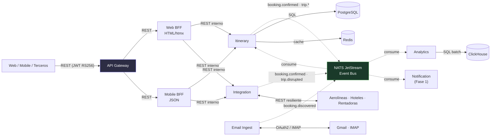
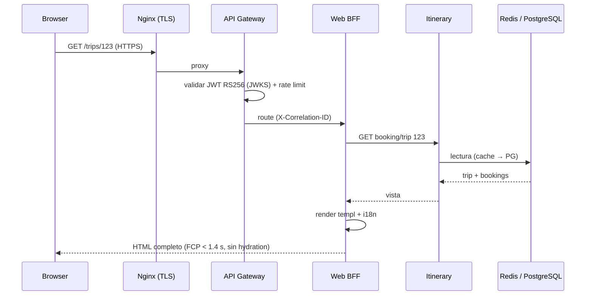
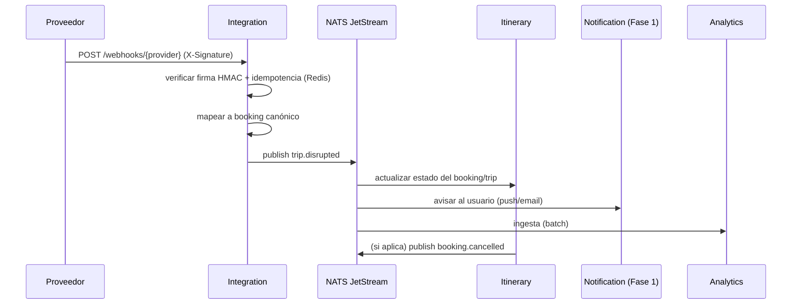
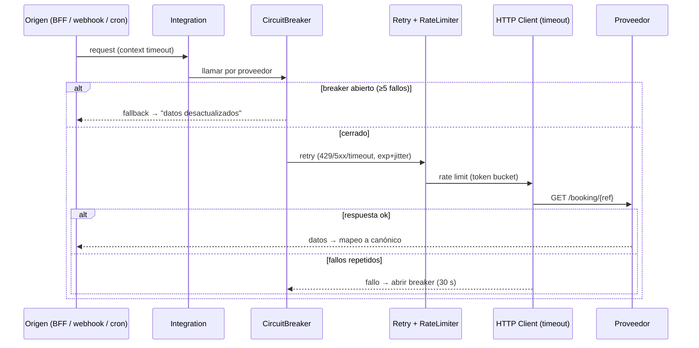

## Propósito de esta vista (component-and-connector, Bass ch.1/22)

Vista de **Componentes y Conectores (C&C)**: estructura de **runtime**. Muestra **cómo interactúan los
componentes dinámicamente** para ejecutar los escenarios del sistema. Conectores usados:

- **REST** (síncrono, request-response): cliente→Gateway→BFF→servicios de dominio.
- **NATS JetStream** (asíncrono, event-driven): propagación de hechos; cada consumidor reacciona por
  su cuenta (invertir responsabilidad, Newman ch.4).
- **SQL** (servicio→su base de datos) y **REST externo resiliente** (Integration→proveedores).

## Escenario 1 — Reserva descubierta por email (flujo event-driven)

```mermaid
sequenceDiagram
    participant M as Mail (Gmail/IMAP)
    participant EI as Email Ingest
    participant N as NATS JetStream
    participant IT as Itinerary
    participant IN as Integration
    participant AN as Analytics
    M->>EI: correo nuevo (IDLE / webhook)
    EI->>EI: dedup SHA256 + whitelist
    EI->>EI: parse (regex → template)
    EI->>N: publish booking.discovered
    N->>IT: booking.discovered
    N->>IN: booking.discovered
    N->>AN: booking.discovered
    IT->>IT: crea/actualiza booking (tx ACID local)
    IN->>IN: fetch detalle al proveedor (resiliente)
    IT->>N: publish booking.confirmed
    IN->>N: publish booking.confirmed (con detalle)
    Note over IT,AN: Cada servicio reacciona de forma independiente; sin tx distribuida (Newman ch.6)
```

## Escenario 2 — Usuario ve su itinerario en la web (síncrono)



## Escenario 3 — Disrupción de proveedor (webhook → notificación)



## Escenario 4 — Llamada resiliente a proveedor (cadena de protección)



## Leyenda

- **Flecha sólida** = llamada síncrona (request-response, con timeout). · **Flecha punteada** = evento
  NATS JetStream (asíncrono; el productor publica, el consumidor es dueño de su reacción).
- Cada escenario usa **correlation-id** propagado (OTel) para trazabilidad de extremo a extremo.
- Los servicios **no comparten base de datos**; solo se comunican por REST (síncrono) o eventos
  (asíncrono). Ver detalle por servicio en `microservices/02..05`.
