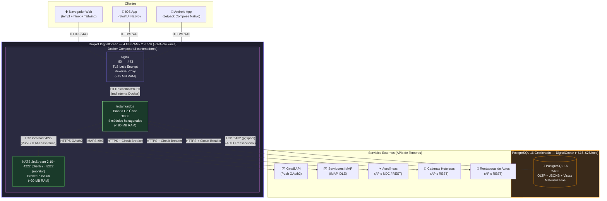
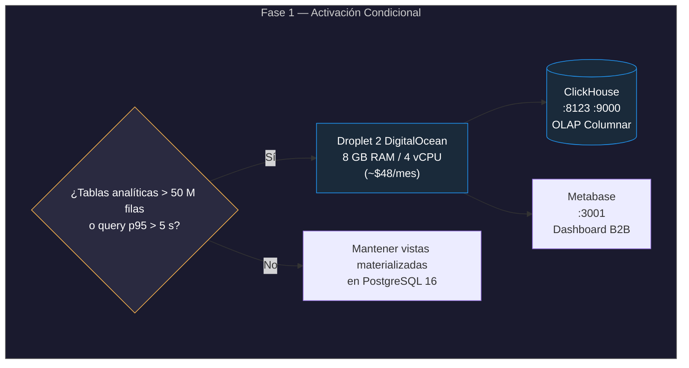

# Vista de Despliegue (Topología Física y Red)

Esta vista describe la topología de despliegue en producción del sistema **Trotamundos** en su **Fase 0 (MVP)**: la asignación de artefactos de software a nodos físicos, los protocolos de red entre ellos, y la estimación de costos operativos. Se alinea con las decisiones de [ADR-001](file:///home/pinacho/gitTrotamundos/trotamundos/main/adrs/adr-001.md) (Monolito Modular), [ADR-002](file:///home/pinacho/gitTrotamundos/trotamundos/main/adrs/adr-002.md) (NATS JetStream), [ADR-003](file:///home/pinacho/gitTrotamundos/trotamundos/main/adrs/adr-003.md) (PostgreSQL 16 Unificado), [ADR-005](file:///home/pinacho/gitTrotamundos/trotamundos/main/adrs/adr-005.md) (Caché In-Memory) y [ADR-011](file:///home/pinacho/gitTrotamundos/trotamundos/main/adrs/adr-011.md) (Docker Compose en DigitalOcean).

---

## 1. Diagrama de Despliegue Fase 0

---

## 2. Descripción de Nodos y Artefactos Desplegados

### 2.1 Droplet DigitalOcean (Nodo de Cómputo Único)

| Contenedor | Imagen | Puertos Expuestos | RAM Estimada | Función |
|---|---|---|---|---|
| **nginx** | `nginx:alpine` | `:80`, `:443` | ~15 MB | Terminación TLS (Let's Encrypt / certbot), proxy reverso hacia `:8080`, compresión gzip, rate-limiting de capa L7. |
| **trotamundos** | Build multi-stage Go (`FROM scratch`) | `:8080` (interno) | < 80 MB | Binario estático Go que contiene los 4 módulos hexagonales (`itinerary`, `emailingest`, `integration`, `analytics`), router Chi, middleware JWT, vistas `templ`+`htmx`, handlers JSON móvil, y caché in-memory `ristretto`. |
| **nats** | `nats:2.10-alpine` | `:4222`, `:8222` | ~30 MB | Broker Pub/Sub JetStream con streams durables (`BOOKINGS`, `TRIPS`, `DEAD_LETTER`), deduplicación nativa por `Nats-Msg-Id`, y entrega at-least-once con ACK explícito. |

**RAM total estimada del Droplet**: ~125–150 MB de los 4 GB disponibles.  
**Headroom libre**: ~3.8 GB para picos de tráfico, buffers del SO y crecimiento futuro.

### 2.2 PostgreSQL 16 Gestionado (DigitalOcean Managed Database)

- **Especificación**: 1 GB RAM / 1 vCPU, almacenamiento SSD de 10 GB (autoescalable).
- **Contenido**: Tablas relacionales (`trips`, `bookings`, `users`, `email_whitelist`), columnas JSONB con índices GIN para datos semi-estructurados, y **vistas materializadas** para analítica y monetización B2B ([ADR-010](file:///home/pinacho/gitTrotamundos/trotamundos/main/adrs/adr-010.md)).
- **Acceso**: Conexión TCP cifrada vía `pgxpool` con pool limitado a 25 conexiones concurrentes.
- **Backups**: Automáticos diarios gestionados por DigitalOcean (retención 7 días incluida).

### 2.3 Componentes Eliminados en Fase 0

| Componente | Motivo de Eliminación | Referencia |
|---|---|---|
| **Redis** | Reemplazado por caché in-memory del proceso Go (`ristretto`/`ccache`) tras interfaz `CacheStore`. Evita un contenedor adicional y su coste de RAM. | [ADR-005](file:///home/pinacho/gitTrotamundos/trotamundos/main/adrs/adr-005.md) |
| **ClickHouse** | Reemplazado por vistas materializadas de PostgreSQL 16. Se introduce condicionalmente en Fase 1 si las tablas analíticas superan 50 M de filas o las queries exceden 5 s de latencia p95. | [ADR-010](file:///home/pinacho/gitTrotamundos/trotamundos/main/adrs/adr-010.md) |
| **API Gateway separado** | El enrutamiento, la autenticación JWT y el rate-limiting se ejecutan dentro del binario Go como middleware de Chi. | [ADR-001](file:///home/pinacho/gitTrotamundos/trotamundos/main/adrs/adr-001.md) |
| **Mobile BFF separado** | Los handlers JSON para móvil se sirven desde `internal/api/mobile` dentro del mismo binario. | [ADR-001](file:///home/pinacho/gitTrotamundos/trotamundos/main/adrs/adr-001.md) |

---

## 3. Protocolos y Seguridad de Red

| Enlace | Protocolo | Cifrado | Notas |
|---|---|---|---|
| Clientes → Nginx | HTTPS (TLS 1.3) | ✅ Certificado Let's Encrypt auto-renovado | Puerto `:443` expuesto; `:80` redirige a HTTPS. |
| Nginx → Trotamundos | HTTP/1.1 | No (red interna Docker) | Comunicación localhost, no expuesta a internet. |
| Trotamundos ↔ NATS | TCP binario nativo | No (red interna Docker) | Puerto `:4222` solo accesible dentro de `docker-compose`. |
| Trotamundos → PostgreSQL | TCP con `sslmode=require` | ✅ TLS gestionado por DigitalOcean | Conexión cifrada obligatoria fuera de la red interna. |
| Trotamundos → Gmail API | HTTPS OAuth2 | ✅ TLS 1.3 | Push notifications + polling selectivo. |
| Trotamundos → IMAP | IMAPS `:993` | ✅ TLS implícito | Conexiones IMAP IDLE persistentes. |
| Trotamundos → Proveedores | HTTPS con Circuit Breaker | ✅ TLS 1.3 | Protección: `sony/gobreaker` + `go-retryablehttp` ([ADR-006](file:///home/pinacho/gitTrotamundos/trotamundos/main/adrs/adr-006.md)). |

---

## 4. Estimación de Costos Fase 0

| Recurso | Especificación | Costo Mensual (USD) |
|---|---|---|
| Droplet DigitalOcean | 4 GB RAM / 2 vCPU | $24 – $48 |
| PostgreSQL 16 Gestionado | 1 GB RAM / 10 GB SSD | $15 – $25 |
| Dominio + DNS | DigitalOcean DNS (gratuito) + dominio | ~$1 |
| TLS | Let's Encrypt (gratuito) | $0 |
| **Total Fase 0** | | **~$40 – $75 USD/mes** |

> Cumple la restricción presupuestaria CON-C3 del [SPEC_ARQUITECTURA](file:///home/pinacho/gitTrotamundos/trotamundos/main/SPEC_ARQUITECTURA.md): máximo $100 USD/mes.

---

## 5. Evolución Planeada: Fase 1 (Condicional)

La migración a ClickHouse **solo se ejecuta** cuando se cumplen los criterios objetivos definidos en [ADR-010](file:///home/pinacho/gitTrotamundos/trotamundos/main/adrs/adr-010.md). Hasta entonces, PostgreSQL 16 con vistas materializadas cubre toda la funcionalidad analítica y de monetización B2B.

---

## 6. Principales Cambios Respecto a la Versión Previa

1. **De 8 contenedores a 3**: Se eliminaron Gateway, Web BFF, Mobile BFF, Itinerary, Email Ingest, Integration y Analytics como servicios separados. Todo reside en el binario `trotamundos` ([ADR-001](file:///home/pinacho/gitTrotamundos/trotamundos/main/adrs/adr-001.md)).
2. **Eliminación de Redis**: La caché opera en memoria del proceso Go, sin contenedor adicional ([ADR-005](file:///home/pinacho/gitTrotamundos/trotamundos/main/adrs/adr-005.md)).
3. **Eliminación de ClickHouse y Metabase en Fase 0**: La analítica se resuelve con vistas materializadas de PostgreSQL ([ADR-010](file:///home/pinacho/gitTrotamundos/trotamundos/main/adrs/adr-010.md)).
4. **Reducción de costo**: De ~$144+/mes (2 Droplets + Redis + ClickHouse) a **~$40–$75/mes** (1 Droplet + PostgreSQL gestionado).
5. **Reducción de superficie de ataque**: Solo el puerto `:443` de Nginx está expuesto a internet. NATS, el binario Go y PostgreSQL no son accesibles externamente.
