# Vista de Módulos (Estructura Estática de Código y Puertos)

Esta vista describe la organización estática del código fuente, las dependencias en tiempo de compilación y las fronteras de los módulos de dominio bajo el **Estilo Arquitectónico Monolito Modular Hexagonal en Go** ([ADR-001](file:///home/pinacho/gitTrotamundos/trotamundos/main/adrs/adr-001.md)), conforme a las directivas de [SPEC_ARQUITECTURA.md](file:///home/pinacho/gitTrotamundos/trotamundos/main/SPEC_ARQUITECTURA.md).

---

## 1. Diagrama Estructural de Módulos (Monolito Modular Hexagonal)

Todo el backend se compila y ejecuta como un **único binario estático en Go**, donde cada Bounded Context se organiza como un módulo interno desacoplado mediante **Arquitectura Hexagonal (Puertos y Adaptadores)**. Los módulos no se invocan por HTTP en Fase 0, sino directamente a través de interfaces y eventos en memoria o mediante el broker liviano **NATS JetStream** ([ADR-002](file:///home/pinacho/gitTrotamundos/trotamundos/main/adrs/adr-002.md)).

```mermaid
graph TB
    %% CLIENTES
    WEB["🌐 Navegador Web (HTML + htmx)"]
    MOBILE["📱 Apps Móviles Nativas (SwiftUI / Jetpack Compose)"]

    %% PROCESO MONOLÍTICO GO (cmd/trotamundos)
    subgraph MONOLITH ["Binario Único Go — cmd/trotamundos (Monolito Modular)"]
        
        %% CAPA DE PRESENTACIÓN Y ENRUTAMIENTO
        subgraph EDGE ["Capa de Borde y Presentación (internal/web & internal/api)"]
            ROUTER["Router HTTP Chi<br/>(internal/api)"]
            AUTH_MW["Middleware Auth JWT (HS256)<br/>+ Rate Limiter en Memoria"]
            WEB_VIEW["Vistas y Handlers Web<br/>templ + htmx + Tailwind<br/>(internal/web)"]
            MOB_API["Handlers API Móvil (JSON)<br/>(internal/api/mobile)"]
            
            ROUTER --> AUTH_MW
            AUTH_MW --> WEB_VIEW
            AUTH_MW --> MOB_API
        end

        %% MÓDULOS DE DOMINIO HEXAGONAL
        subgraph MOD_ITIN ["Módulo Itinerary (internal/itinerary)"]
            ITIN_IN["Puertos de Entrada<br/>TripService · BookingService"]
            ITIN_DOM["Dominio Puro<br/>Trip · Booking · Traveler · Lifecycle"]
            ITIN_OUT["Puertos de Salida<br/>TripRepository · CacheStore · EventPublisher"]
            ITIN_IN --> ITIN_DOM --> ITIN_OUT
        end

        subgraph MOD_ING ["Módulo Email Ingest (internal/emailingest)"]
            ING_IN["Puertos de Entrada<br/>ScanMailboxService · WebhookHandler"]
            ING_DOM["Dominio Puro<br/>Whitelist · EmailParser · ReservationData"]
            ING_OUT["Puertos de Salida<br/>MailProvider · WhitelistRepo · EventPublisher"]
            ING_IN --> ING_DOM --> ING_OUT
        end

        subgraph MOD_INT ["Módulo Integration (internal/integration)"]
            INT_IN["Puertos de Entrada<br/>SyncProviderService · WebhookReceiver"]
            INT_DOM["Dominio Puro<br/>CanonicalBooking · ProviderContract"]
            INT_OUT["Puertos de Salida<br/>AirlineClient · HotelClient · CarClient · EventPublisher"]
            INT_IN --> INT_DOM --> INT_OUT
        end

        subgraph MOD_ANA ["Módulo Analytics (internal/analytics)"]
            ANA_IN["Puertos de Entrada<br/>EventConsumer · BatchIngestService"]
            ANA_DOM["Dominio Puro<br/>DestinationTrend · CancellationMetric"]
            ANA_OUT["Puertos de Salida<br/>AnalyticsRepository (Vistas Materializadas)"]
            ANA_IN --> ANA_DOM --> ANA_OUT
        end

        %% PAQUETES COMPARTIDOS
        subgraph SHARED ["Paquetes Compartidos (internal/shared)"]
            SH_EVT["shared/event<br/>(Tipos y esquemas de eventos SDD)"]
            SH_RES["shared/resilient<br/>(CircuitBreaker sony/gobreaker + Retry go-retryablehttp)"]
            SH_CACHE["shared/cache<br/>(CacheStore in-memory ristretto)"]
        end

        %% ADAPTADORES DE INFRAESTRUCTURA
        subgraph ADAPTERS ["Adaptadores de Salida a Infraestructura"]
            AD_PGX["pgx/v5 + sqlc<br/>(Acceso a PostgreSQL)"]
            AD_NATS["nats.go<br/>(Publicación y Consumo JetStream)"]
            AD_MEMCACHE["ristretto / ccache<br/>(Caché en Memoria RAM de Go)"]
            AD_HTTP_EXT["Resilient HTTP Client<br/>(APIs Externas)"]
        end

        %% CONEXIONES DE PRESENTACIÓN A DOMINIO (En memoria)
        WEB_VIEW -->|"Invocación usecase (Go)"| ITIN_IN
        WEB_VIEW -->|"Invocación usecase (Go)"| INT_IN
        MOB_API -->|"Invocación usecase (Go)"| ITIN_IN
        MOB_API -->|"Invocación usecase (Go)"| INT_IN

        %% CONEXIONES DE DOMINIO A ADAPTADORES
        ITIN_OUT -.-> AD_PGX
        ITIN_OUT -.-> AD_MEMCACHE
        ITIN_OUT -.-> AD_NATS

        ING_OUT -.-> AD_PGX
        ING_OUT -.-> AD_NATS

        INT_OUT -.-> AD_HTTP_EXT
        INT_OUT -.-> AD_PGX
        INT_OUT -.-> AD_NATS

        ANA_IN -.-> AD_NATS
        ANA_OUT -.-> AD_PGX

        INT_OUT -.-> SH_RES
        ITIN_OUT -.-> SH_CACHE
    end

    %% INFRAESTRUCTURA FÍSICA
    subgraph INFRA ["Infraestructura y Persistencia Unificada"]
        PG[("🐘 PostgreSQL 16<br/>OLTP Relacional + JSONB + Vistas Materializadas<br/>(ADR-003)")]
        NATS[("⚡ NATS JetStream<br/>Broker Pub/Sub Liviano en Go (~30 MB RAM)<br/>(ADR-002)")]
    end

    %% SISTEMAS EXTERNOS
    MAIL["✉️ Gmail API (Push/OAuth2) / IMAP IDLE"]
    AIR["✈️ Aerolíneas (APIs NDC / REST)"]
    HOTEL["🏨 Cadenas Hoteleras (APIs REST)"]
    CAR["🚗 Rentadoras de Autos (APIs REST)"]
    SOC["🌍 Redes Sociales (OAuth2)"]

    %% ENTRADA DE CLIENTES
    WEB --> ROUTER
    MOBILE --> ROUTER

    %% ENLACES DE INFRAESTRUCTURA
    AD_PGX -->|"Pool pgxpool"| PG
    AD_NATS <-->|"Pub/Sub TCP"| NATS

    %% ENLACES A TERCEROS
    ING_OUT <-->|"OAuth2 / IMAP"| MAIL
    AD_HTTP_EXT <-->|"REST con Circuit Breaker"| AIR
    AD_HTTP_EXT <-->|"REST con Circuit Breaker"| HOTEL
    AD_HTTP_EXT <-->|"REST con Circuit Breaker"| CAR
    ITIN_OUT <-->|"OAuth2"| SOC

    %% ESTILOS
    style MONOLITH fill:#1e1e2f,stroke:#7c6ff7,stroke-width:2px,color:#fff
    style EDGE fill:#2a2a40,stroke:#ba68c8,color:#fff
    style MOD_ITIN fill:#1a3a2a,stroke:#81c784,color:#fff
    style MOD_ING fill:#1a2a3a,stroke:#64b5f6,color:#fff
    style MOD_INT fill:#2a1a3a,stroke:#ba68c8,color:#fff
    style MOD_ANA fill:#3a2a1a,stroke:#ffb74d,color:#fff
    style PG fill:#3a2a1a,stroke:#ff9800,stroke-width:2px,color:#fff
    style NATS fill:#1a3a2a,stroke:#4caf50,stroke-width:2px,color:#fff
```

---

## 2. Descripción de Componentes y Responsabilidades

### 2.1 Capa de Borde y Presentación (`internal/api` y `internal/web`)
- **Router HTTP (`Chi v5`)**: Enrutador ultraliviano que centraliza el tráfico web y móvil en el mismo puerto HTTP `:8080`.
- **Middleware Auth & Rate Limit**: Valida tokens JWT stateless (HS256) en microsegundos y aplica limitación de tasa basada en token bucket en memoria.
- **Web Engine (`templ` + `htmx`)**: Renderiza los componentes HTML en el servidor (SSR) y gestiona los swaps dinámicos del DOM y eventos Server-Sent Events (SSE). No requiere runtime de Node.js ([ADR-004](file:///home/pinacho/gitTrotamundos/trotamundos/main/adrs/adr-004.md)).
- **Mobile Handlers**: Sirven DTOs JSON compactos para SwiftUI y Jetpack Compose ([ADR-009](file:///home/pinacho/gitTrotamundos/trotamundos/main/adrs/adr-009.md)).

### 2.2 Módulos de Dominio (Hexagonales)
1. **`internal/itinerary`**:
   - **Responsabilidad**: Agregado raíz de Viajes (`Trip`), Reservas (`Booking`), Viajeros (`Traveler`) y ciclo de vida de archivado automático (FR-5).
   - **Puertos de Salida**: `TripRepository` (PostgreSQL), `CacheStore` (memoria `ristretto`), `EventPublisher` (NATS JetStream).
2. **`internal/emailingest`**:
   - **Responsabilidad**: Conexión con Gmail y servidores IMAP (FR-2), deduplicación por hash SHA256, filtrado por whitelist (FR-3) y parseo por reglas determinísticas ([ADR-008](file:///home/pinacho/gitTrotamundos/trotamundos/main/adrs/adr-008.md)).
   - **Puertos de Salida**: `MailProvider`, `WhitelistRepository`, `EventPublisher` (publica `booking.discovered`).
3. **`internal/integration`**:
   - **Responsabilidad**: Mapeo y normalización entre APIs de terceros (aerolíneas, hoteles, autos) y el modelo canónico `Booking` (FR-1, FR-6).
   - **Puertos de Salida**: Clientes de proveedores encapsulados tras la cadena de resiliencia `shared/resilient` ([ADR-006](file:///home/pinacho/gitTrotamundos/trotamundos/main/adrs/adr-006.md)).
4. **`internal/analytics`**:
   - **Responsabilidad**: Consumo asíncrono en batch de todos los eventos del sistema y generación de vistas materializadas para monetización comercial B2B (FR-7, FR-9, [ADR-010](file:///home/pinacho/gitTrotamundos/trotamundos/main/adrs/adr-010.md)).

---

## 3. Principales Cambios Respecto a la Versión Previa

1. **Unificación en Monolito Modular**: Se reemplazó la descomposición distribuida en 6 microservicios por un **único binario Go** que aloja los 4 módulos de dominio, reduciendo la memoria total a $< 80\text{ MB}$ de RAM y el costo operativo a cero ([ADR-001](file:///home/pinacho/gitTrotamundos/trotamundos/main/adrs/adr-001.md)).
2. **Eliminación de ClickHouse y Redis en Fase 0**:
   - ClickHouse se reemplazó por **Vistas Materializadas en PostgreSQL 16** ([ADR-003](file:///home/pinacho/gitTrotamundos/trotamundos/main/adrs/adr-003.md), [ADR-010](file:///home/pinacho/gitTrotamundos/trotamundos/main/adrs/adr-010.md)).
   - Redis se reemplazó por **Caché en Memoria del Proceso Go (`ristretto`)** tras la interfaz `CacheStore` ([ADR-005](file:///home/pinacho/gitTrotamundos/trotamundos/main/adrs/adr-005.md)).
3. **Comunicación Local Eficiente**: La capa web y móvil invoca los use cases de dominio mediante llamadas directas en memoria (microsegundos) en lugar de proxies reversos de red.
