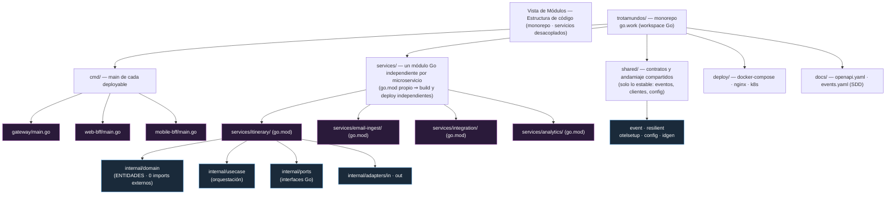
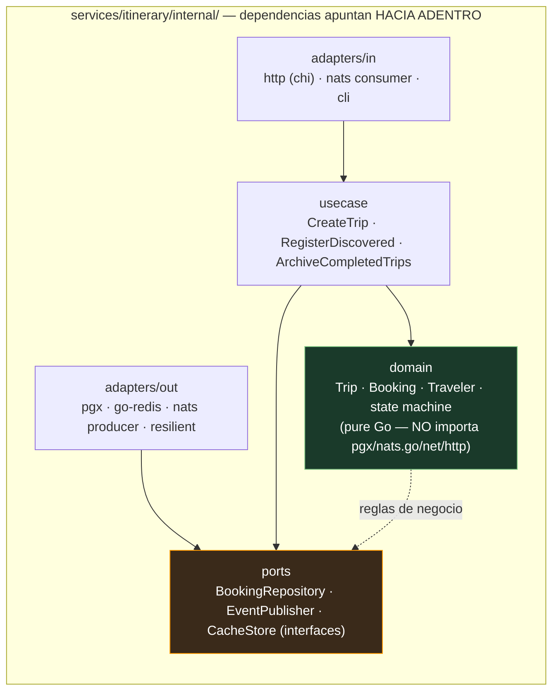

## Propósito de esta vista (module structure, Bass ch.1/22)

Vista de **módulos** (estructura estática, tiempo de diseño): muestra **cómo se organiza el código**
para razonar sobre **modificabilidad**, build y asignación de trabajo. El mensaje central es el
**desacoplamiento**: cada microservicio es un **módulo independiente** (su propio `go.mod`) que se
compila y despliega solo (independent deployability, Newman ch.1), y dentro de él la **arquitectura
hexagonal** aísla la lógica de negocio de la infraestructura.

## 1. Monorepo y límites de módulo

- **Un módulo Go por microservicio** (`services/<nombre>/go.mod`). El `go.work` del raíz los reúne en
  un workspace para construirlos juntas, pero **cada uno sigue siendo una unidad de build/deploy
  independiente** — la fuerza motriz del desacoplamiento.
- **`shared/` solo contiene lo estable**: tipos de eventos, el cliente resiliente, setup de OTel,
  config e IDs. **Nada de lógica de dominio compartida** → si un concepto empieza a compartirse, es
  señal de que debería ser un servicio (Newman ch.5, DRY perils).
- **Sin base de datos compartida** (Newman ch.2, anti-pattern #1): cada servicio es dueño de sus
  tablas; las conexiones entre módulos son contratos (puertos/eventos), no suposiciones sobre el
  interior del otro.

## 2. Estructura hexagonal interna (un servicio típico)

**Regla de desacoplamiento (information hiding, Parnas/Newman ch.1)**: el **dominio no conoce
infraestructura**. Cambiar PostgreSQL→OtraDB, NATS→Kafka o Gmail→Outlook es reemplazar un adaptador
(`adapters/out`) sin tocar `domain` ni `usecase`. Los **puertos** son interfaces que el dominio
define y los adaptadores implementan; el flujo de dependencias va siempre **hacia el centro** (hacia
dominio/puertos), nunca hacia afuera.

## 3. Mecanismos de desacoplamiento (por qué los servicios no se ataran)

| Mecanismo | Qué logra | Referencia |
|-----------|-----------|-----------|
| `go.mod` por servicio | Build/deploy independiente → puedo cambiar Itinerary sin reconstruir los demás | Newman ch.1 |
| Hexagonal (puertos/adaptadores) | Dominio estable; infraestructura intercambiable | ADR-002 |
| Comunicación por eventos (NATS) | Los servicios colaboran sin conocerse (invertir responsabilidad) | ADR-005, Newman ch.4 |
| `shared/` solo contratos | Evita acoplamiento de contenido; se comparte la interfaz, no la implementación | Newman ch.5 |
| Sin DB compartida | Cada servicio es dueño de sus datos; nadie escribe en el interior del otro | Newman ch.2 |
| Contratos generados (OpenAPI/JSON-Schema) | API y eventos versionados; expansion/contract en vez de breaking changes | ADR-006, Newman ch.5 |

## 4. Leyenda

- **azul** = adaptadores (infraestructura, cambia a menudo) · **verde** = dominio (estable) ·
  **naranja** = puertos (interfaces, el contrato) · **morado** = módulos/módulos-raíz · **gris** = árbol de carpetas.
- **Flechas**: dependencia de compilación (apunta hacia el módulo del que se depende). En el hexágono,
  todas apuntan hacia `domain`/`ports` = el centro estable.

> Las vistas complementarias: `vista_cyc.md` (interacción dinámica en runtime) y `vista_despliegue.md`
> (asignación a infraestructura). Detalle por servicio en `microservices/01..07`.
