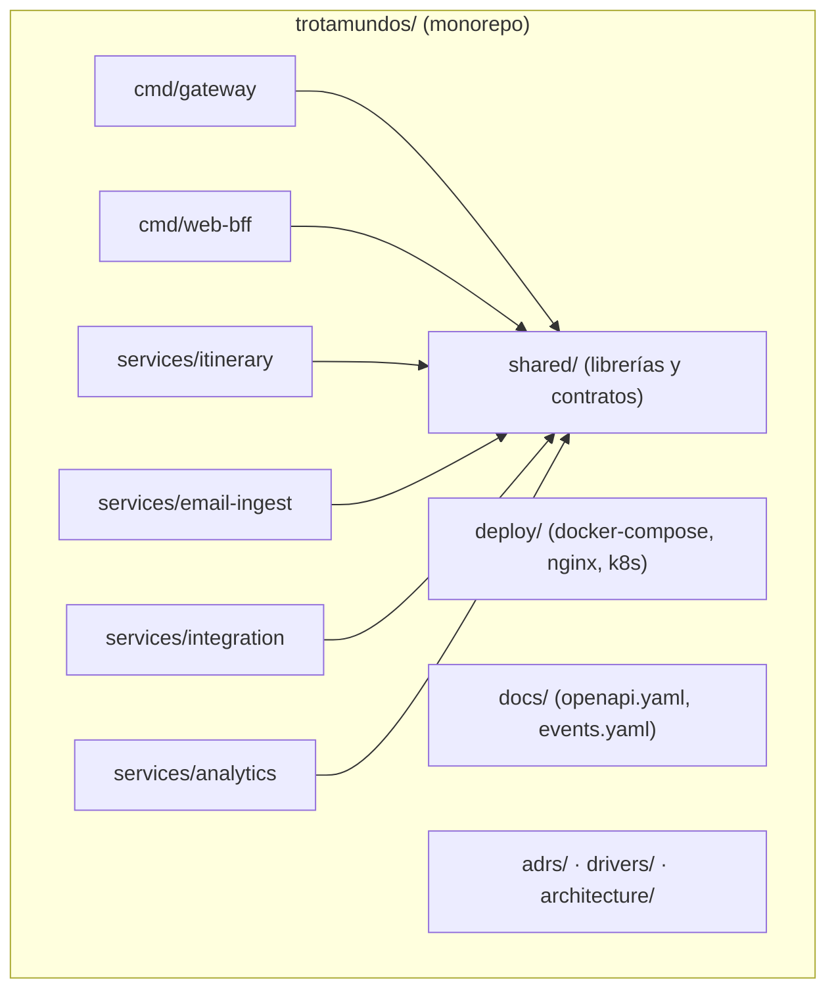
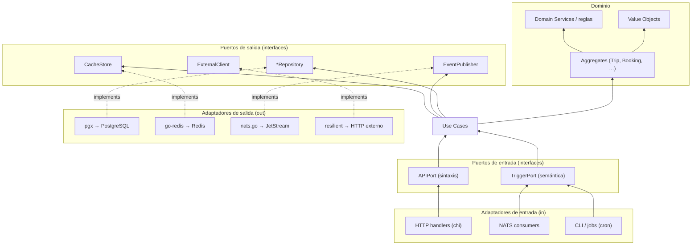
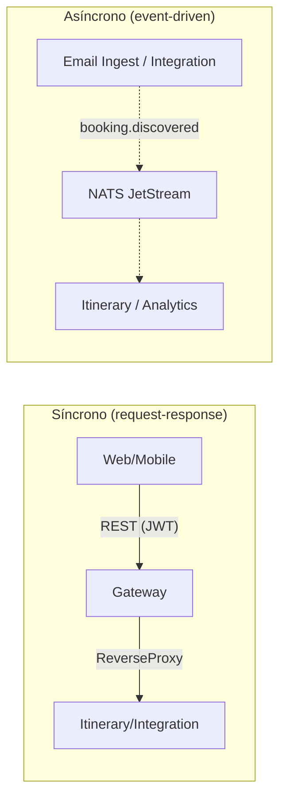

# 01 — Arquitectura global: monorepo, go.work y preocupaciones transversales

Deriva de los ADRs **001** (descomposición), **002** (hexagonal por servicio) y **003** (Go único).
Define el "andamiaje" común a todos los microservicios antes de entrar en detalle por cada uno.

## 1. Estrategia de repositorio

ADR-003 introduce `go.work` (multi-module workspace) → implica **monorepo**. Para un equipo de 3–5
devs (constraint: equipo pequeño, poco tiempo) el monorepo gana: un solo `go.work`, tests cruzados,
y refactorings atómicos de contratos compartidos (esquemas de eventos). Cada servicio es un **módulo
Go independiente** (`go.mod` propio) para conservar la **independencia de deploy** (Newman: core
concept) y permitir el futuro `git mv` + nuevo `go.mod` (ADR-002).



### Layout propuesto

```text
trotamundos/
├── go.work                      # workspace: usa cada servicio + shared
├── cmd/
│   ├── gateway/main.go          # deployable: API Gateway
│   └── web-bff/main.go          # deployable: Web BFF
├── services/
│   ├── itinerary/
│   │   ├── go.mod               # module github.com/trotamundos/itinerary
│   │   ├── cmd/server/main.go
│   │   └── internal/
│   │       ├── domain/          # entidades, VOs, state machine (sin deps externas)
│   │       ├── usecase/         # orquestación (depende solo de puertos)
│   │       ├── ports/           # interfaces Go (in/out)
│   │       └── adapters/
│   │           ├── in/          # http (chi), nats consumer, cli
│   │           └── out/         # pgx, redis, nats producer
│   ├── email-ingest/            # misma estructura hexagonal
│   ├── integration/             # misma estructura hexagonal
│   └── analytics/               # misma estructura hexagonal
├── shared/
│   ├── go.mod                   # module github.com/trotamundos/shared
│   ├── event/                   # tipos + validación de esquemas de eventos (JSON Schema)
│   ├── resilient/               # ResilientClient: breaker+retry+ratelimit (ADR-007)
│   ├── otelsetup/               # config común de OpenTelemetry
│   ├── config/                  # carga de entorno/vault
│   └── idgen/                   # ULID/UUID v7
├── deploy/
│   ├── docker-compose.yml       # Fase 0
│   ├── nginx/conf.d/*.conf      # TLS + routing
│   └── k8s/                     # Fase 2 (K3s)
├── docs/
│   ├── api/openapi.yaml         # spec-driven: rutas del Gateway + BFF
│   └── events/events.yaml       # esquemas JSON de los eventos NATS
└── adrs/ · drivers/ · architecture/   # documentación existente
```

> **Multirepo vs monorepo** (Newman ch.7): el default es multirepo, pero para un MVP con contratos
> en evolución y un equipo pequeño, el monorepo reduce la fricción de mantener `openapi.yaml` y
> `events.yaml` sincronizados con el código. Se revisa a **Fase 2** si la coordinación de deploys
> se vuelve cuello de botella (criterio ADR-012).

## 2. Estructura hexagonal estándar (por servicio)

Deriva de **ADR-002**. Todas las capas viven bajo `internal/`; el dominio no importa nunca
`pgx`, `nats.go`, `net/http` ni otras librerías de infra.



**Dependencia**: las flechas apuntan hacia **donde se depende** (el centro estable). Los adaptadores
`(in)` y `(out)` dependen de los **puertos** (interfaces), no al revés. Los **Use Cases** orquestan
dominio + puertos. El **dominio** no conoce infraestructura.

## 3. Paquetes compartidos (`shared/`)

| Paquete | Responsabilidad | ADR |
|---------|-----------------|-----|
| `shared/event` | Tipos Go de los eventos + validación contra `events.yaml` (JSON Schema) en boot y en CI | 005 |
| `shared/resilient` | `ResilientClient` = CircuitBreaker → Retry → RateLimiter → HTTP (decoradores) | 007 |
| `shared/otelsetup` | Config común de OpenTelemetry (exportador OTLP, sampler, resource) | 006 |
| `shared/config` | Carga de config (env + archivo) y secretos (Fase 2: Vault) | 012 |
| `shared/idgen` | ULID / UUID v7 para IDs de evento idempotentes | — |

> **DRY perils** (Newman ch.5): compartir código entre servicios puede crear **acoplamiento de
> contenido**. `shared/` se limita a **contratos estables** (eventos, clientes resilientes) y a
> "código de andamiaje". Si un paquete de dominio empieza a compartirse, es señal de que ese concepto
> debería ser un **servicio de dominio** (Newman: extraer en Fase 3+).

## 4. Comunicación entre servicios

- **Async por defecto** para propagación de hechos de negocio (`booking.discovered`,
  `booking.cancelled`, `trip.disrupted`, …) sobre **NATS JetStream** (ADR-005). Invertir la
  responsabilidad: los emisores publican **hechos ricos** (todo el payload, no solo IDs), los
  consumidores son dueños de su reacción (Newman ch.4).
- **Sync** solo cuando el llamador necesita el resultado inmediato (p.ej. BFF agregando para render,
  Gateway proxyando una lectura). Siempre con **timeout** y, si es a un tercero, con la cadena de
  resiliencia (ADR-007).
- **Correlation ID** en cada evento y en cada request (cabecera `X-Correlation-ID`), propagado por
  OTel para trazabilidad de extremo a extremo (Newman ch.10).
- **Contratos**: OpenAPI 3.1 para APIs síncronas (`docs/api/openapi.yaml`); JSON Schema para eventos
  (`docs/events/events.yaml`). `oapi-codegen` genera tipos/rutas desde la spec (SDD).



## 5. Preocupaciones transversales (cross-cutting)

### 5.1 Configuración y secretos
- Config por **variables de entorno** + archivo YAML por servicio (`shared/config`).
- Secrets: en Fase 0 pasan por env del `docker-compose.yml` (limitado); **Fase 2** → Vault con
  secretos por instancia, rotación y TTL (Newman ch.11).
- **Config externalizada** (Newman ch.7): el artefacto (binario Go) es único; la config varía por entorno.

### 5.2 Observabilidad
- **Logs**: JSON estructurado con `correlation_id`, `service`, `level` (agregación = prerequisito,
  Newman ch.10).
- **Métricas**: Prometheus en `/metrics` (breaker state, retry count, latencia p99, tasa de
  "no matcheado" del parser, lag de Consumer).
- **Tracing**: OpenTelemetry → OTLP (Fase 1: Grafana Tempo/Jaeger). Cada request y cada evento
  arrastran trace/span ID.
- **SLO de referencia**: disponibilidad 99.9% (~2h11m/mes de caída, QA-8); respuesta web p95 ≤ 800 ms.

### 5.3 Manejo de errores
- Dominio: errores tipados (`ErrBookingNotFound`, `ErrTripNotComplete`) que el adaptador traduce a
  códigos HTTP / eventos de fallo.
- **Idempotencia**: todas las operaciones de escritura expuestas por fuera aceptan una
  `Idempotency-Key` (Redis, TTL 24 h) — crítico para reentregas de eventos y webhooks (ADR-007).

### 5.4 Testing (pirámide, Newman ch.9)
- **Unitarios** (×10): dominio puro, sin infra (la ventaja del hexagonal).
- **De servicio / contrato** (×1): puertos con adaptadores fake; **Consumer-Driven Contracts**
  (Pact) entre BFF/Gateway y servicios de dominio.
- **E2E** (pocos, "training wheels"): `docker compose` con todos los servicios + DBs efímeras.
- **En producción**: smoke tests + verificación de SLO (Newman: MTTR < acumular tests pre-prod).

### 5.5 Build y deploy
- **CI/CD**: GitHub Actions — `push` a `main` → build → test → (Fase 0) SSH al Droplet →
  `docker compose up -d` (ADR-012).
- **Artefacto único** verificado que se promueve igual a todos los entornos (build-once).
- **Trunk-based** (ramas < 1 día). Separamos **deploy** de **release** (feature flags cuando haga
  falta, Newman ch.8).
- **Template de pipeline** compartido para los 6 deployables (mitiga el costo de "6 pipelines",
  ADR-001).

## 6. Mapa de servicios → puertos de salida (resumen)

| Servicio | Repositorio | Cache | Publica | Consuma | Cliente externo |
|----------|-------------|-------|---------|---------|-----------------|
| Itinerary | PostgreSQL | Redis | `booking.confirmed`, `trip.*` | `booking.discovered` | Deep-link (terceros) |
| Email Ingest | PostgreSQL (whitelist) | Redis (dedup) | `booking.discovered` | (webhook Gmail) | Gmail API, IMAP |
| Integration | PostgreSQL | Redis (idempotencia) | `booking.confirmed/cancelled/disrupted` | `booking.discovered` | Aerolíneas/hoteles/rentadoras (resiliente) |
| Analytics | ClickHouse | — | — | *todos los eventos* | — |
| Gateway | — | Redis (rate limit/JWT) | — | — | (proxy) |
| Web BFF | — | — | — | — | Itinerary, Integration (interno) |
