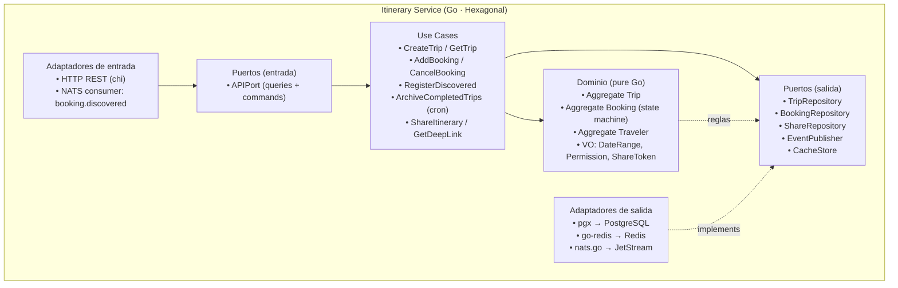
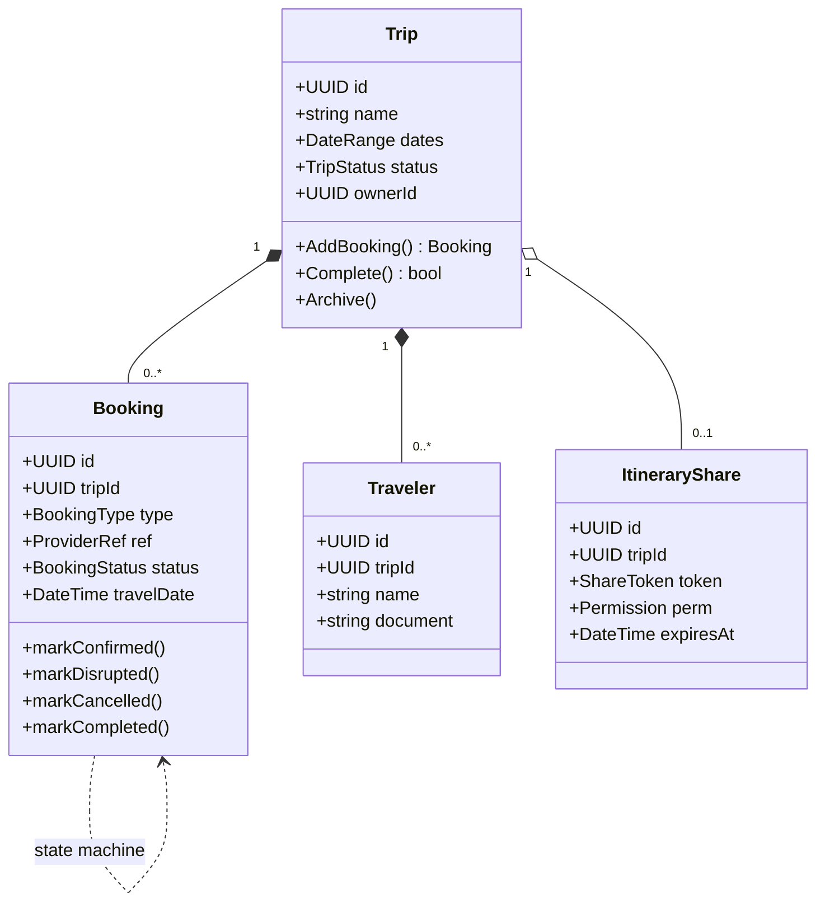
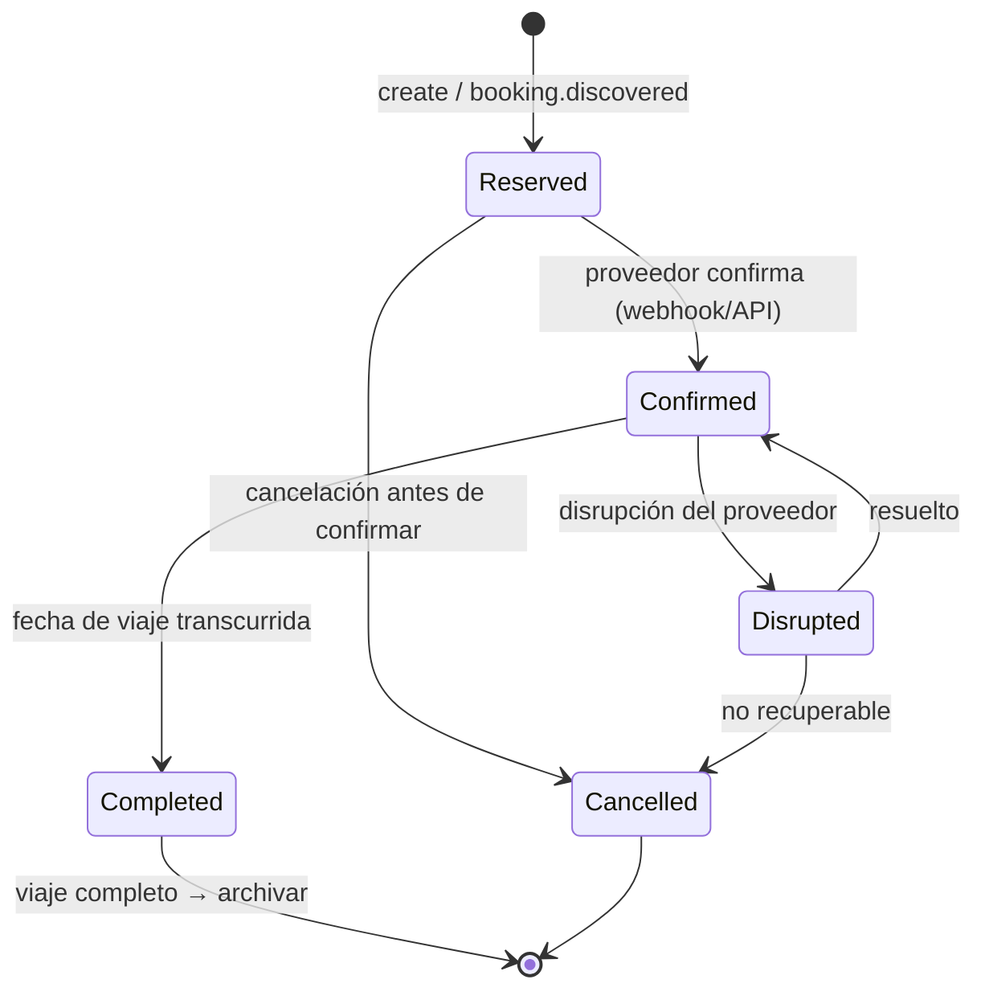
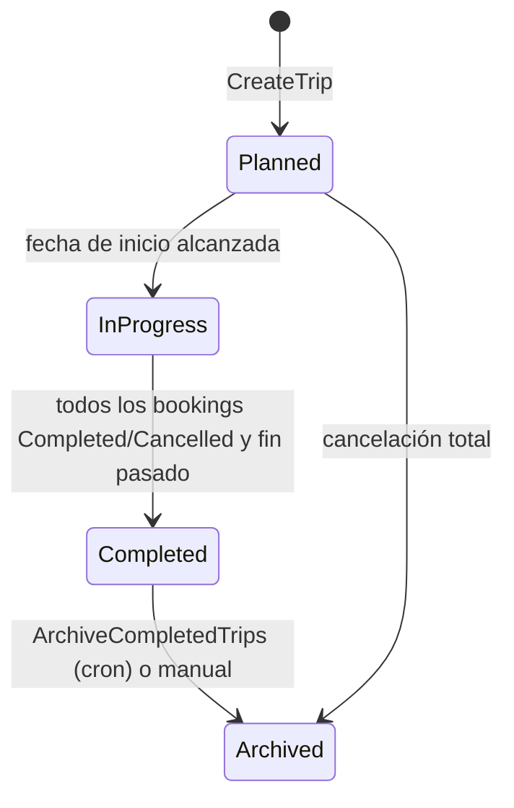
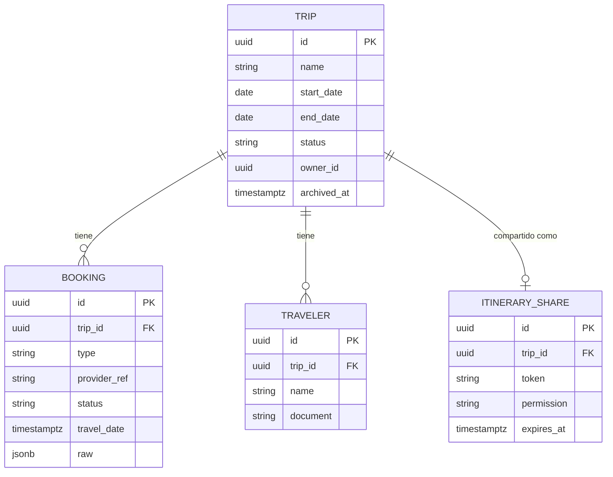
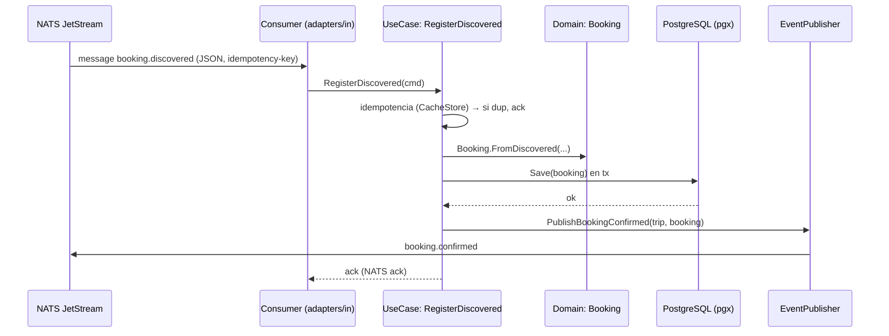
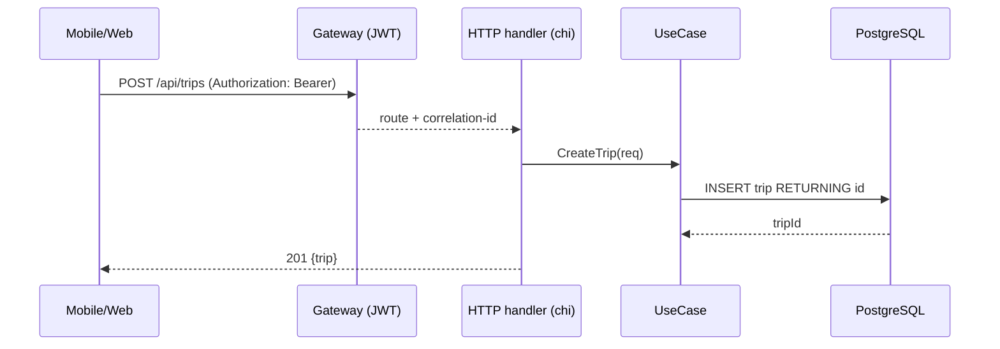
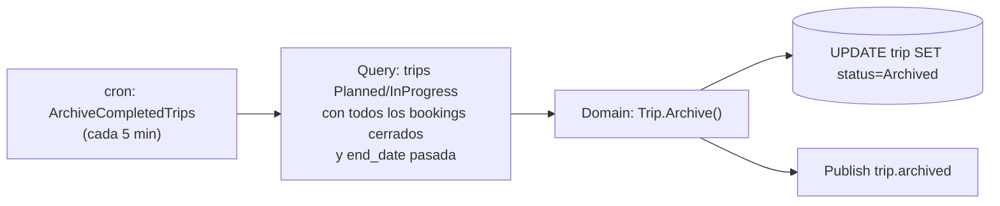

# 02 — Servicio Itinerary (Fase 0)

> **Bounded context**: Viaje, Reserva, Viajero, Ciclo de Vida (+ módulos de Notificaciones y
> User/Perfil en Fase 0, ADR-001).
> **Perfil de carga**: per-request, latencia baja (SLA ≤ 800 ms, QA-6).
> **ADR de origen**: 001, 002. Complementa: 004 (PG/Redis), 005 (eventos), 009 (web).

## 1. Responsabilidad

Es el **servicio central** del sistema. Posee la verdad de:

- **Viajes (Trip)**: agrupación de reservas y viajeros con fechas (FR-5: agrupar por viaje).
- **Reservas (Booking)**: hospedaje y transporte, con estado de ciclo de vida.
- **Viajeros (Traveler)**: quiénes viajan en cada trip.
- **Ciclo de vida**: state machine de booking y de trip; **archivar viajes completos** (FR-5).
- **Compartir itinerario**: enlaces con **permisos de visualización** (QA-10, FR-8).
- **Deep-linking**: redirigir al usuario a apps de terceros para operar sobre sus reservas (FR-6).
- **Notificaciones en Fase 0**: módulo interno que publica necesidades de notificación (se extrae a
  servicio propio en **Fase 1**, ADR-001/08).

## 2. Tecnologías

| Capa | Tecnología | Uso en Itinerary |
|------|-----------|------------------|
| Lenguaje | Go 1.23+ | lógica de servicio |
| HTTP (API síncrona) | `github.com/go-chi/chi/v5` | REST para Web BFF, Mobile (via Gateway) |
| Templates web | `github.com/a-h/templ` | (solo si Itinerary sirve fragmentos; normalmente lo hace el BFF) |
| Persistencia OLTP | `github.com/jackc/pgx/v5` | `trips`, `bookings`, `travelers`, `itinerary_shares` |
| Cache / idempotencia | `github.com/redis/go-redis/v9` | lectura en caliente, `Idempotency-Key`, bloqueo óptimo |
| Eventos | `github.com/nats-io/nats.go` | publica `booking.confirmed`/`trip.*`; consume `booking.discovered` |
| i18n | `github.com/nicksnyder/go-i18n` | mensajes/metadata por región |
| Tracing/metrics | OpenTelemetry + Prometheus | latencia p99, tasa de fallos |

## 3. Estructura (vista de módulos / hexagonal)



## 4. Modelo de dominio

### 4.1 Agregados



### 4.2 State machine de Booking



### 4.3 State machine de Trip



## 5. Modelo de datos (PostgreSQL)



## 6. Puertos e interfaces clave (Go)

```go
// ports de salida (definidos en internal/ports)
type BookingRepository interface {
    Save(ctx context.Context, b domain.Booking) error
    ByTrip(ctx context.Context, tripID uuid.UUID) ([]domain.Booking, error)
}
type EventPublisher interface {
    PublishBookingConfirmed(ctx context.Context, e event.BookingConfirmed) error
    PublishTripArchived(ctx context.Context, e event.TripArchived) error
}
type CacheStore interface {
    SetIDEMPUTENT(ctx context.Context, key, value string, ttl time.Duration) (dup bool, err error)
}

// puerto de entrada (API) expuesto por el adaptador HTTP
type APIPort interface {
    CreateTrip(ctx, req) (TripView, error)
    GetTrip(ctx, id) (TripView, error)
    AddBooking(ctx, tripID, req) (BookingView, error)
    CancelBooking(ctx, bookingID) error
    ShareItinerary(ctx, tripID, perm) (ShareView, error)
}
```

## 7. Flujo funcional

### 7.1 Procesar `booking.discovered` (consumido de NATS)



### 7.2 API síncrona: crear viaje + agregar reserva



### 7.3 Archivar viajes completos (cron)



## 8. Tácticas de calidad (Bass ch.3–4, Newman ch.12)

| Calidad | Táctica aplicada | Dónde |
|---------|------------------|-------|
| **Disponibilidad** (QA-8) | Timeout estricto por request; degradación: si PG cae, 503 claro + cache de lectura en Redis | HTTP handler |
| **Performance** (QA-6 ≤ 800 ms) | Cache de lectura en Redis (TTL corto); índices por `owner_id`; sin N+1 | Use case de lectura |
| **Modificabilidad** (QA-11) | Hexagonal: nuevo tipo de transporte = nuevo `BookingType` + regla, sin tocar adaptadores | Dominio |
| **Testeabilidad** | Dominio puro → unit tests sin DB; use cases con repositorios fake | `internal/` |
| **Seguridad** (QA-10) | `ItineraryShare` con `Permission` (view-only) y `ShareToken` opaco; authz en el use case | ShareItinerary |
| **Consistencia eventual** | `booking.discovered` → `booking.confirmed` por evento; **no** tx distribuida (Newman ch.6) | NATS |

## 9. Módulos Fase 0 que viven dentro de Itinerary (y su futuro)

- **Notificaciones (Fase 0)**: el use case publica `notification.required` (o `trip.disrupted`); un
  adaptador interno manda push/email. En **Fase 1** se extrae a servicio **Notification** (burst opuesto,
  ADR-001) consumiendo esos eventos. Ver `08-servicios-futuros.md`.
- **User/Perfil (Fase 0)**: tabla `users` en PostgreSQL + módulo en Itinerary. En **Fase 2** se extrae
  **Identity** (OAuth, tokens, social). Ver `08-servicios-futuros.md`.

## 10. Riesgos y preguntas abiertas

- **[Open]** Definición exacta de "viaje completo" para el auto-archivo (ver `00` §2.K): se asume
  *todos los bookings cerrados y `end_date` pasada*, con opción manual.
- **[Open]** ¿Pases de embarque QR/boarding passes? No está en los FR actuales (ver `00` §2.L).
- **Riesgo**: el módulo de Notificaciones dentro de Itinerary en Fase 0 introduce un perfil de carga
  "ruidoso" en un servicio de latencia → mitigado por publicación asíncrona (el push no bloquea la API).
