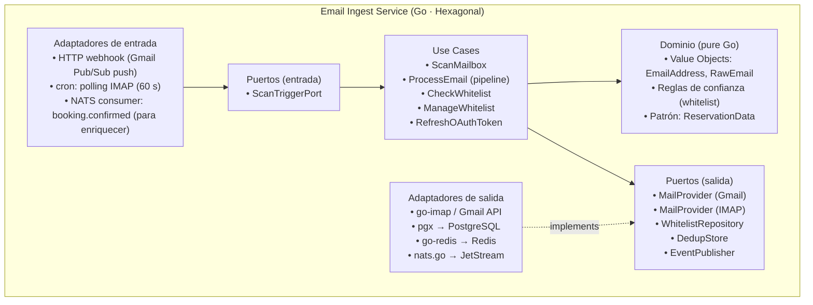
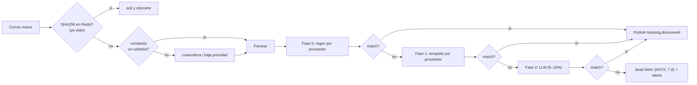
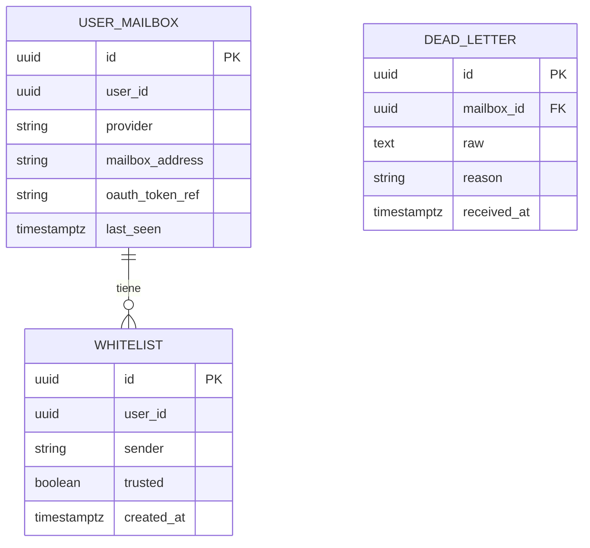
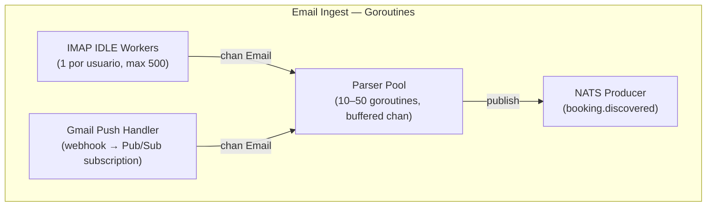
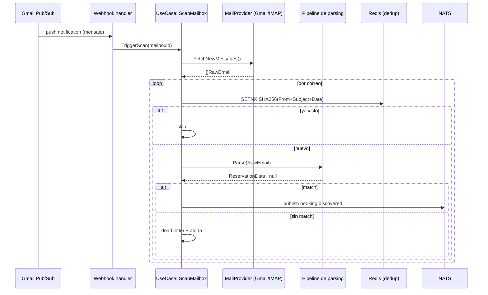

# 03 — Servicio Email Ingest (Fase 0)

> **Bounded context**: Escaneo, Parsing, Whitelist.
> **Perfil de carga**: batch + CPU, bursty (tormentas de correos de cancelación).
> **ADR de origen**: 008. Complementa: 003 (Go), 004 (PG/Redis), 005 (NATS).

## 1. Responsabilidad

- Conectar con las bandejas de los usuarios: **Gmail API** (push vía Pub/Sub + labels), **IMAP
  genérico** (IDLE para push, polling 60 s como fallback), Outlook (XOAUTH2).
- **Deduplicar** correos (SHA256 de `From + Subject + Date`) antes de gastar CPU de parsing.
- Aplicar **whitelist** de remitentes seguros (FR-3): decide confianza / cuarentena.
- **Parsear** reservas no estructuradas en 3 fases: regex (Fase 0) → templates por proveedor (Fase 1)
  → LLM para el 5–10% sin coincidencia (Fase 2).
- Publicar `booking.discovered` para que Itinerary/Integration/Analytics reaccionen.
- **Dead letter**: ningún correo se pierde (stream NATS con retención 7 días).

## 2. Tecnologías

| Capa | Tecnología | Uso |
|------|-----------|-----|
| Lenguaje | Go 1.23+ | servicio |
| IMAP | `github.com/emersion/go-imap/v2` | IDLE (push) + polling 60 s (fallback) |
| Gmail | `google.golang.org/api/gmail/v1` | push vía Pub/Sub + labels |
| OAuth | `golang.org/x/oauth2` | OAuth2 (Gmail) / XOAUTH2 (IMAP) |
| MIME | `net/mail` (stdlib) | parseo de headers y body |
| Dedup / caché | `github.com/redis/go-redis/v9` | SHA256, TTL 7 días |
| Whitelist | `github.com/jackc/pgx/v5` | tabla `whitelists` + caché Redis |
| Eventos | `github.com/nats-io/nats.go` | publica `booking.discovered`; dead letter |
| Scheduling | `github.com/robfig/cron/v3` | polling de respaldo + escaneos periódicos |

## 3. Estructura (vista de módulos / hexagonal)

## 4. Pipeline de parsing (3 fases)

> **Determinismo primero**: regex/templates son gratuitos, testeables y sin latencia. El LLM es el
> último recurso (ADR-008): se agrega solo si la tasa "sin coincidencia" > 10% y el costo/call
> (< $0.01) es aceptable.

## 5. Modelo de datos (PostgreSQL)

> Los correos **crudos** no se persisten en caliente (solo hash + dead letter). El "estado" de la
> reserva vive en Itinerary. Esto aplica **datensparsamkeit** (Newman ch.11): no almacenar PII de
> más (nada que no necesitemos para dedup y auditoría de dead letter).

## 6. Concurrencia (modelo de goroutines)

- **IDLE por usuario**: un worker por bandeja mantiene la conexión viva y recibe empuje en tiempo
  real. Tope de 500 concurrentes → **backpressure** (cola acotada) para mitigar picos (QA-3).
- **Parser Pool**: los correos se encolan a un `chan` procesado por N goroutines (CPU-bound
  limitado). Escalar N = escalar el parser sin tocar Itinerary (independencia de deploy, ADR-001).
- **Retry/backoff** en IMAP/Gmail con jitter; token refresh OAuth2 transparente.

## 7. Flujo funcional: de webhook a evento

## 8. Tácticas de calidad

| Calidad | Táctica | Dónde |
|---------|---------|-------|
| **Performance / picos** (QA-3, QA-5) | Parser pool con cola acotada + backpressure; dedup **antes** de parsear | Pipeline |
| **Disponibilidad** (QA-8) | IDLE con reconexión; polling 60 s como fallback; un proveedor caído no bloquea al otro | Adaptadores |
| **Seguridad** (QA-9) | OAuth2/XOAUTH2 (sin contraseñas en claro); token en secreto por instancia; revocable | Auth |
| **Modificabilidad** (QA-11) | `MailProvider` es puerto → cambiar/aggiungere proveedor = nuevo adaptador | Hexagonal |
| **Testeabilidad** | Parser regex/template = funciones puras → unit tests; pipeline con proveedor fake | `internal/` |
| **No pérdida de datos** | Dead letter en NATS (7 d) + alerta; idempotencia por SHA256 | Pipeline |

## 9. Riesgos y decisiones

- **Dependencia de Google API**: rate limit 250 req/min por usuario → el polling/Gmail push deben
  respetar cuotas (respetar `Retry-After`, backoff exponencial).
- **IMAP sin IDLE**: algunos proveedores no soportan IDLE → fallback a polling 60 s (latencia mayor,
  aceptable para el 5–10% de casos).
- **LLM (Fase 2)**: introduce costo y no-determinismo; se activa con criterio estricto (ADR-008).
- **Whitelist (ver `00` §2.J)**: el parser corre sobre **todo** el correo; la whitelist decide
  confianza (escritura directa) vs cuarentena (requiere confirmación del usuario).
