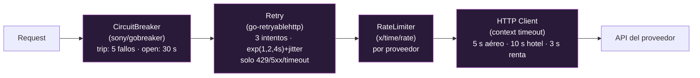
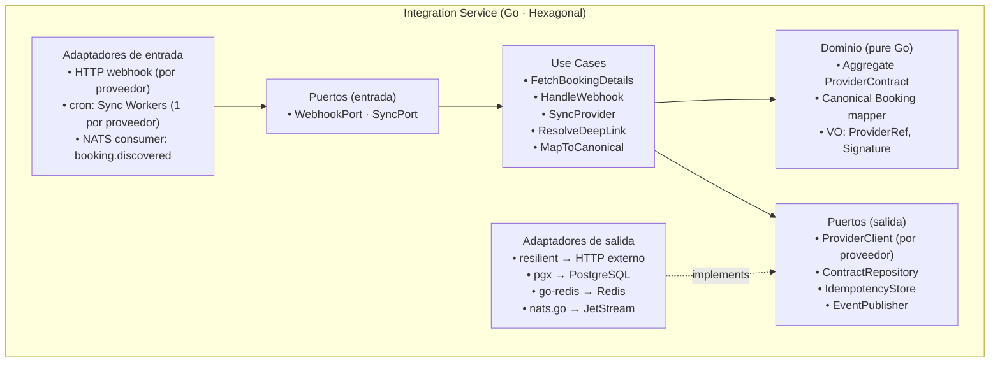
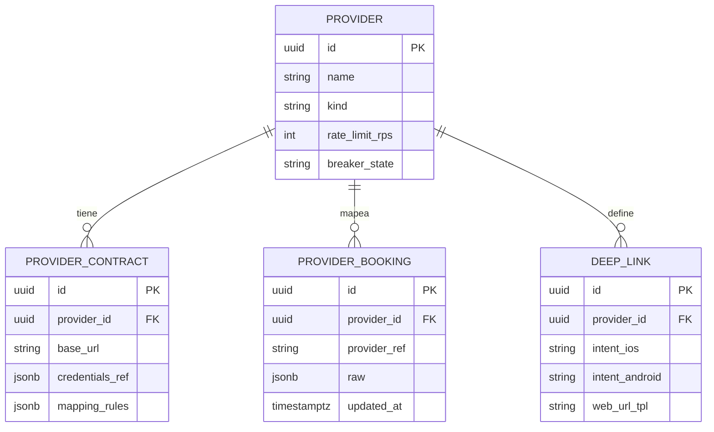
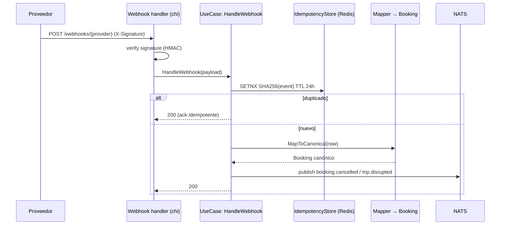
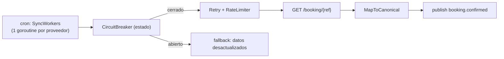

# 04 — Servicio Integration (Fase 0)

> **Bounded context**: Contratos con proveedores, Mapeo, Webhooks.
> **Perfil de carga**: per-request, I/O-bound (llamadas externas a aerolíneas/hoteles/rentadoras).
> **ADR de origen**: 007 (resiliencia). Complementa: 003, 004, 005.

## 1. Responsabilidad

- **Normalizar** las APIs heterogéneas de proveedores (aerolíneas vía **NDC**, hoteles, rentadoras)
  al modelo canónico de Trotamundos (`Booking`).
- Gestionar **contratos/credenciales** por proveedor (endpoints, rate limits, scopes OAuth).
- Procesar **webhooks entrantes** de proveedores (verificación de firma + idempotencia).
- Ejecutar **sincronización programada** (cron) por proveedor para refrescar estado.
- Proveer **deep-linking** (FR-6): resolver a qué app/URL redirigir para operar sobre una reserva.
- Publicar `booking.confirmed` / `booking.cancelled` / `trip.disrupted` tras confirmar con el proveedor.

## 2. Tecnologías

| Capa | Tecnología | Uso |
|------|-----------|-----|
| Lenguaje | Go 1.23+ | servicio |
| HTTP (webhooks + sync API) | `github.com/go-chi/chi/v5` | endpoints de callback + orquestación |
| Cliente resiliente | `github.com/hashicorp/go-retryablehttp` | backoff exponencial + jitter |
| Circuit breaker | `github.com/sony/gobreaker` | aislamiento por proveedor |
| Rate limiter | `golang.org/x/time/rate` | token bucket por proveedor |
| Persistencia | `github.com/jackc/pgx/v5` | `providers`, `provider_contracts`, `provider_bookings`, `deep_links` |
| Idempotencia | `github.com/redis/go-redis/v9` | SHA256 de webhook, TTL 24 h |
| Eventos | `github.com/nats-io/nats.go` | consume `booking.discovered`; publica confirmaciones |
| Tracing/metrics | OpenTelemetry + Prometheus | breaker state, retry count, rate-limit hits |

## 3. Cadena de resiliencia (ADR-007)

Parámetros (ADR-007):

| Parámetro | Valor |
|-----------|-------|
| Breaker: trip | 5 fallos consecutivos |
| Breaker: open | 30 s |
| Retry: intentos | 3 |
| Retry: backoff | Exponencial (1s, 2s, 4s) + jitter ±20% |
| Retry: condiciones | 429, 5xx, timeout (no 4xx) |
| Rate limit | Por proveedor (p.ej. 10 req/s Amadeus, 5 req/s HotelChain) |
| Timeout | 5 s (aerolíneas), 10 s (hoteles), 3 s (rentadoras) |

## 4. Estructura (vista de módulos / hexagonal)

## 5. Modelo de datos (PostgreSQL)

## 6. Flujo funcional

### 6.1 Webhook entrante (p.ej. "vuelo cancelado")

### 6.2 Sincronización programada + llamada resiliente

## 7. Tácticas de calidad

| Calidad | Táctica | Dónde |
|---------|---------|-------|
| **Disponibilidad** (QA-8) | Circuit breaker + bulkhead **por proveedor**: uno caído no tumba el panel (Newman ch.12) | ResilientClient |
| **Performance** (QA-6) | Timeout estricto (budget de operación); rate limit proactivo para no ser throttled | HTTP client |
| **Performance / picos** (QA-5) | Sync asíncrono por cron; no bloquea la API de lectura | SyncWorkers |
| **Integrabilidad** (QA-4, QA-11) | Puerto `ProviderClient` + `mapping_rules` por proveedor → añadir proveedor = nuevo adaptador | Hexagonal |
| **Seguridad** | Verificación de firma HMAC en webhooks; credenciales en secreto (Fase 2: Vault) | Webhook handler |
| **Consistencia eventual** | Webhook/sync → evento; sin tx distribuida con el proveedor (Newman ch.6 "just say no") | NATS |
| **Degradación elegante** | Si todos los proveedores caen → panel muestra "datos desactualizados", no error 500 | Handler |

## 8. Decisiones y riesgos

- **Expansión/contracción** (Newman ch.5) al añadir un proveedor: exponer primero un endpoint nuevo,
  migrar consumidores, retirar el viejo. Nunca versionado paralelo de larga vida.
- **Formato de error no estandarizado** por proveedor → el mapper normaliza a un `BookingError`
  canónico (4xx vs 5xx decide si se reintenta).
- **Deep-linking (FR-6)**: `deep_links` guarda intentos iOS/Android/web; el use case `ResolveDeepLink`
  devuelve la URL/app de destino. Itinerary solo *sabe* que debe redirigir; Integration *sabe* adónde.
- **Riesgo**: un proveedor con API lenta puede agotar el budget de latencia → mitigado por timeout
  estricto + breaker (latencia mata en sistemas distribuidos, Newman ch.12).
