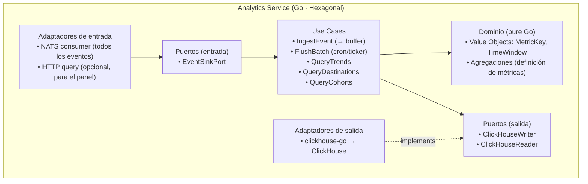
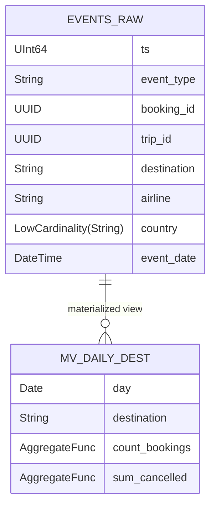
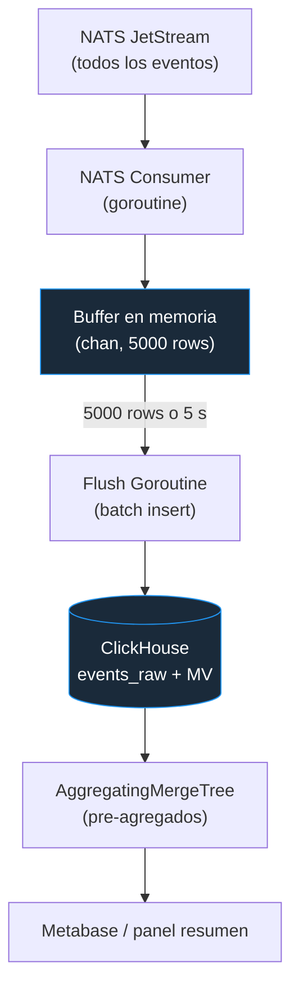
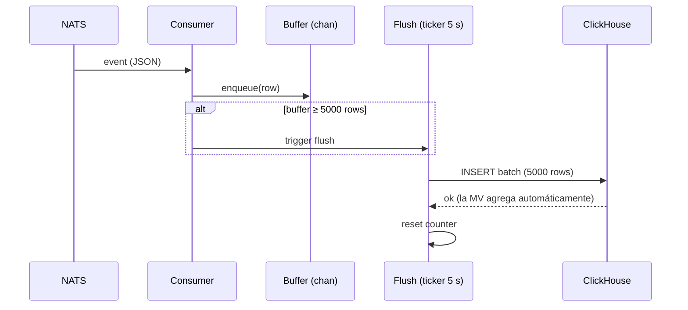
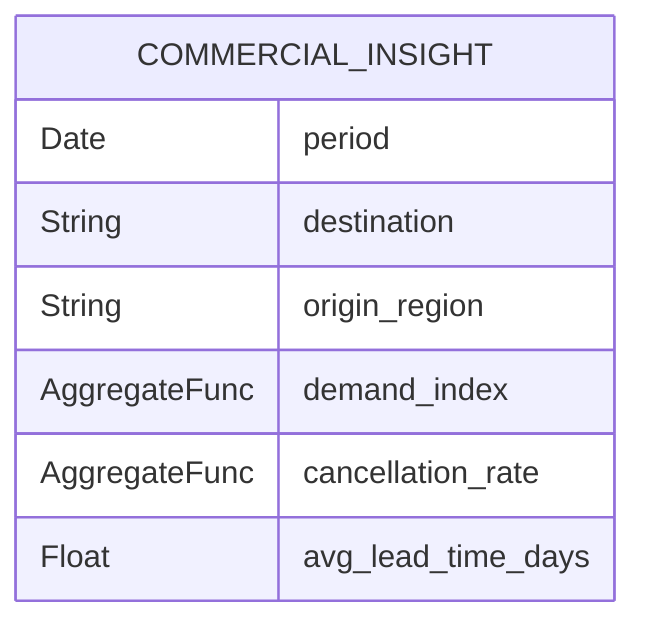

# 05 — Servicio Analytics (Fase 0 → se activa en Fase 1 con ClickHouse)

> **Bounded context**: Tendencias, Destinos, Estadísticas.
> **Perfil de carga**: batch, OLAP, **no** per-request (consultas de 5–30 s).
> **ADR de origen**: 010. Complementa: 004 (ClickHouse), 005 (NATS).

## 1. Responsabilidad

- **Consumir todos los eventos de viaje** de NATS (booking.discovered/confirmed/cancelled,
  trip.disrupted/archived, …).
- **Buffer + batch insert** a ClickHouse (5000 rows o 5 s, lo que ocurra primero).
- Mantener **materialized views** (`AggregatingMergeTree`) para pre-agregados (tendencias, destinos,
  cohortes).
- **Monetización** (FR-9): ofrecer **insights comerciales agregados y anónimos** a terceros
  (aerolíneas, hoteles, destinos turísticos) — demanda por destino/rango, patrones de cancelación,
  tendencias de origen-destino — a partir de los pre-agregados. Es la forma en que el sistema
  monetiza la plataforma con la analítica de datos.
- Exponer datos para **Metabase** (equipo de datos) y, opcionalmente, para las tarjetas de resumen del
  panel (lecturas pre-agregadas).
- Retención de **2 años**; particionamiento mensual; TTL automático.

## 2. Tecnologías

| Capa | Tecnología | Uso |
|------|-----------|-----|
| Lenguaje | Go 1.23+ | servicio |
| Consumo de eventos | `github.com/nats-io/nats.go` | JetStream consumer (todos los eventos) |
| ClickHouse | `github.com/ClickHouse/clickhouse-go/v2` | batch insert + queries analíticas |
| Buffer | `sync` + `time.Ticker` (goroutines) | buffer en memoria (5000 rows / 5 s) |
| Query API | `clickhouse-go/v2` + `context.WithTimeout(30s)` | consultas del equipo de datos |
| Dashboard | Metabase (self-hosted) | queries ad-hoc (no expuesto al usuario) |
| Tracing/metrics | OpenTelemetry + Prometheus | lag del consumer, rows/s, fallos de flush |

## 3. Estructura (vista de módulos / hexagonal)

## 4. Modelo de datos (ClickHouse)

- **`events_raw`** (`MergeTree`): eventos crudos, `ORDER BY (event_date, event_type, destination)`,
  `PARTITION BY toYYYYMM(event_date)`, TTL 2 años.
- **`AggregatingMergeTree`** (materialized views): agregaciones calculadas **en tiempo de inserción**,
  no de consulta (ADR-010).
- **`ReplacingMergeTree`**: para mantener "estado último" de una entidad cuando hace falta (dedup por
  versión).

## 5. Flujo funcional: ingestión batch

## 6. Tácticas de calidad

| Calidad | Táctica | Dónde |
|---------|---------|-------|
| **Performance** (QA-15, QA-6) | Batch insert (10× más rápido que fila a fila); agregación en inserción → las queries pesadas **no** compiten con el SLA de 800 ms del OLTP | Flush + MV |
| **Escalabilidad** (QA-2) | Particionamiento por mes; drop de datos viejos = O(1); particiones independientes | ClickHouse |
| **Disponibilidad** (QA-8) | Buffer en memoria con persistencia de último recurso; si CH cae, el consumer hace backpressure (NATS retiene) | Consumer |
| **Costo** (constraint: presupuesto) | Un sistema más a operar, pero "set and forget" una vez configurado; self-hosted en 2º Droplet | Fase 1 |
| **Retención** (QA, datos) | TTL 2 años + partición mensual → cumplimiento de retención sin DELETE caro | ClickHouse |

### Monetización (FR-9)

Los insights comerciales se calculan sobre **pre-agregados** (materialized views), no sobre
`events_raw`, para que las consultas de terceros sean rápidas y no impacten el OLTP:

- **Use cases**: `QueryDemandTrend`, `QueryCancellationPattern`, `QueryOriginDestination`, todos
  leyendo `AggregatingMergeTree`.
- **Privacidad**: los insights son **agregados y anónimos** (datensparsamkeit, Newman ch.11) — nunca
  se expone dato a nivel de usuario; es la condición para que la monetización sea compatible con
  seguridad (QA-9/QA-10).
- **Exposición**: vía API de solo lectura (con cuota) para partners, y/o export a un data warehouse.

## 7. Decisiones y riesgos

- **No per-request**: Analytics **no** está tras el Gateway para consultas del usuario final en
  tiempo real; se usa para dashboards (Metabase) y para alimentar lecturas pre-agregadas del panel.
  Si el panel necesita métricas en vivo, se le sirve desde materialized views (no desde `events_raw`).
- **ClickHouse sin UPDATE/DELETE eficiente**: no se necesita (append-only + `ReplacingMergeTree`
  para estado). Es una **restricción** que el modelo de datos debe respetar.
- **Migración a Kafka** (ADR-005): solo si el equipo de datos exige replay de > 3 meses o > 100K
  msg/s sostenido. El puerto `EventSinkPort` permite cambiar de NATS a Kafka sin tocar dominio.
- **Riesgo**: el buffer en memoria pierde el último batch si el proceso muere antes del flush →
  mitigado por NATS JetStream (los mensajes se reentregan) y flush frecuente (≤ 5 s).
