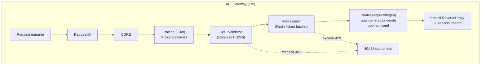
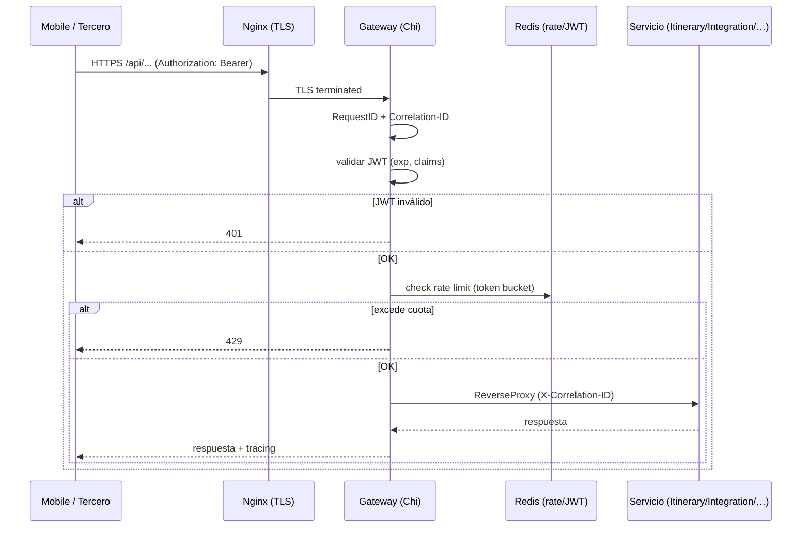

# 06 — API Gateway (Chi + oapi-codegen)

> **Rol**: punto de entrada único para **móviles y terceros**; no es un servicio de dominio.
> **ADR de origen**: 006. Complementa: 003 (Go), 004 (Redis), 009 (web).

## 1. Responsabilidad

- **Routing** único y reverse-proxy hacia los servicios internos (Go → Go, sin capa intermedia).
- **AuthN**: validación de JWT **RS256** (stateless). En **Fase 0** el Gateway **emite y valida** JWT
  firmados asimétricamente (clave privada en secreto), exponiendo su **JWKS** público; los servicios
  verifican con la clave pública, sin secreto compartido ni llamada por request. En **Fase 2** migra a
  **Identity** como IdP OIDC (ADR-014). *(Resuelve la brecha del `00` §2.I.)*
- **AuthZ** básica a nivel de ruta; authz fina en cada servicio (JWT claims).
- **Rate limiting** por usuario/API-key (token bucket en Redis).
- **Tracing**: inyecta/propaga `X-Correlation-ID` y OpenTelemetry.
- **Canary routing** (Fase 1+): dividir tráfico a versiones de servicio.
- En **Fase 2** (K8s): migrar a **Envoy Gateway** sin tocar los servicios (ADR-006).

## 2. Tecnologías

| Capa | Tecnología | Uso |
|------|-----------|-----|
| Framework | `github.com/go-chi/chi/v5` | router + middleware chain |
| Spec-driven | `github.com/oapi-codegen/runtime` | genera rutas y tipos desde `openapi.yaml` |
| Proxy | `net/http/httputil.ReverseProxy` (stdlib) | reverse-proxy a servicios internos |
| Rate limit | `github.com/redis/go-redis/v9` | token bucket distribuido |
| JWT | `github.com/golang-jwt/jwt/v5` | validación/ emisión (Fase 0) |
| Tracing | OpenTelemetry (Go SDK) | span por request |
| TLS | Nginx / Caddy (Fase 0, terminator externo) | Certbot / Let's Encrypt |

## 3. Estructura (cadena de middleware)



## 4. Ciclo de vida de un request



## 5. Puertos e interfaces (Go)

```go
// el gateway es delgado: su "dominio" es la política de middleware
// Fase 0: emite+valida JWT RS256; expone JWKS público para que los servicios verifiquen.
type JWTValidator interface {
    Parse(token string) (claims Claims, err error)   // verifica firma RS256 contra JWKS, exp, aud
    Issue(claims Claims) (token string, err error)   // solo el Gateway emite en Fase 0
}
type JWKSProvider interface {
    Keys() (jwks []PublicKey, err error)             // /.well-known/jwks.json
}
type RateLimiter interface {
    Allow(ctx context.Context, key string) (allowed bool, retryAfter time.Duration, err error)
}
type UpstreamResolver interface { // a qué servicio enruta cada ruta
    Resolve(path string) string // → "itinerary:8081"
}
```

## 6. Tácticas de calidad

| Calidad | Táctica | Dónde |
|---------|---------|-------|
| **Performance** (QA-6) | Go → Go, sin capa intermedia; JWT validación stateless (sin llamada a DB) | Middleware |
| **Seguridad** (QA-9) | AuthN centralizado; rate limit anti-abuso; TLS en el terminator | Gateway |
| **Disponibilidad** (QA-8) | Stateless → escalar horizontalmente trivial; sin estado local | Deploy |
| **Modificabilidad** | `oapi-codegen` genera rutas desde la spec → cambios de API = regenerar + test | Spec-driven |
| **Sin lock-in** | Código Go puro; migrable a Envoy Gateway (Fase 2) sin tocar servicios | ADR-006 |

## 7. Decisiones y riesgos

- **Gateway DIY vs producto** (ADR-006): se elige Chi por control total, cero costo de infra y sin
  lock-in; se mitiga el "no tiene dashboard" con OpenTelemetry + Grafana. Costo: ~300 LOC a mantener.
- **AuthZ descentralizada** (Newman ch.11): el Gateway hace authN; cada servicio verifica claims
  (JWT) para authZ fina → cuidado con el **confused deputy** (no confiar ciegamente en el Gateway).
- **TLS**: en Fase 0 Nginx/Caddy como terminator (el Gateway no hace auto-TLS). En Fase 2 lo maneja
  la infra de K8s (cert-manager).
- **Frontera del BFF (ADR-013, resuelve `00` §2.D)**: el Gateway es el **single entry** de **web,
  mobile y terceros**. Cada experiencia tiene **su propio BFF** tras el Gateway (Web BFF → HTML/htmx,
  Mobile BFF → JSON, ver `07-web-bff.md`). Los BFF agregan datos de Itinerary/Integration por la red
  interna **después** de que el Gateway autorizó al cliente; esas llamadas internas no salen a
  internet. No hay BFF que salte el Gateway.
