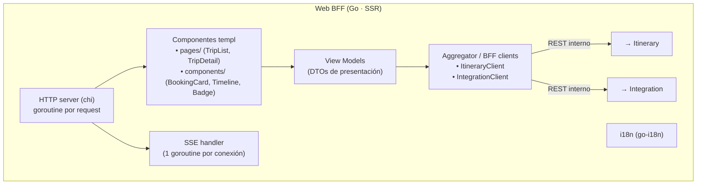
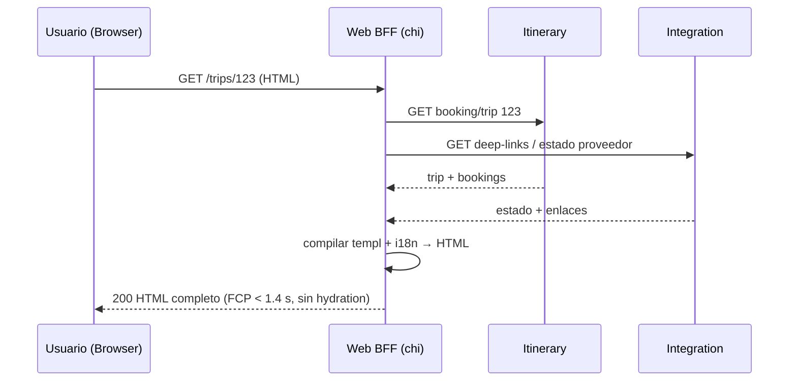
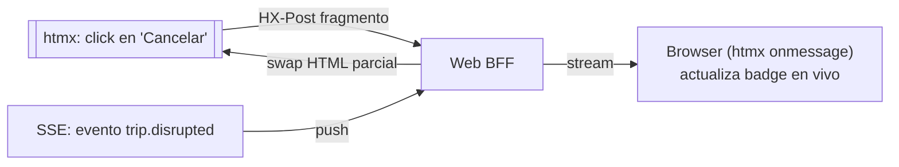
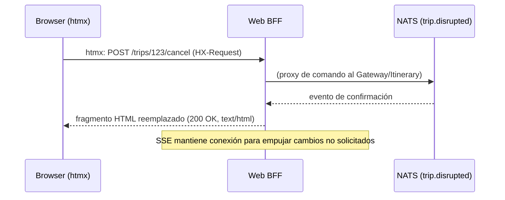
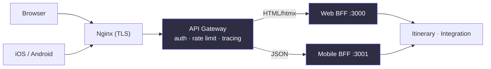

# 07 — Web BFF (templ + htmx + Tailwind)

> **Rol**: frontend server-rendered (Backend For Frontend) para la web. No es servicio de dominio.
> **ADR de origen**: 009. Complementa: 003 (Go), 006 (Gateway), 004 (Redis).

## 1. Responsabilidad

- Servir **HTML renderizado en el servidor** (SSR) con **templ** (templates compilados a `.go`).
- Añadir interactividad sin SPA con **htmx** (~14 KB): swap de fragmentos, **SSE** para live updates,
  polling para notificaciones.
- Compilar **Tailwind CSS** a un archivo estático (sin Node.js en runtime).
- **i18n** multi-región (`go-i18n`).
- **Agregar** datos de Itinerary e Integration para componer cada vista (timeline de viaje, badges
  de estado, notificaciones en vivo).

## 2. Tecnologías

| Capa | Tecnología | Uso |
|------|-----------|-----|
| HTTP server | `github.com/go-chi/chi/v5` | servidor del BFF |
| Templates | `github.com/a-h/templ` | componentes compilados, type-safe |
| Interactividad | `github.com/microcosm-cc/bluemonday` + htmx (CDN/vendor) | swap de fragmentos, SSE |
| CSS | Tailwind CSS 3.x (CLI) | utilidades → build estático |
| i18n | `github.com/nicksnyder/go-i18n` | mensajes por región |
| Cliente de servicios | `net/http` (o stubs generados desde OpenAPI) | llamadas internas a Itinerary/Integration |
| Tracing | OpenTelemetry | span por request de página |

## 3. Estructura (vista de módulos)

## 4. Flujo funcional

### 4.1 Render de página (primera respuesta completa)

### 4.2 Interacción con htmx + live updates con SSE

## 5. Tácticas de calidad

| Calidad | Táctica | Dónde |
|---------|---------|-------|
| **Performance** (QA-7, FCP < 1.4 s) | HTML completo en la primera respuesta, **sin hydration**; CSS estático; sin Node en runtime | SSR |
| **Performance** (QA-6 ≤ 800 ms) | Cache de fragmentos en Redis (TTL corto) para vistas calientes | BFF |
| **Usabilidad** (QA-13) | htmx para interactividad ligera; SSE para notificaciones en vivo | Frontend |
| **Modificabilidad** | `templ` type-safe; componentes aislados; Tailwind sin framework JS pesado | Build |
| **i18n** | `go-i18n` + `templ` → multi-región sin traductor externo | Render |

## 6. Decisiones y riesgos

- **No es SPA** (ADR-009): navegación completa = request al servidor. Se mitiga con htmx swap de
  fragmentos. Criterio de migración a SPA (SvelteKit): edición colaborativa en tiempo real o FCP
  insuficiente por complejidad (no es el caso actual).
- **Live updates**: htmx **SSE** (no WebSocket bidireccional) → suficiente para empujar cambios de
  estado al usuario; el usuario no necesita escribir por el mismo canal.
- **Relación con el Gateway (ADR-013, resuelve `00` §2.D)**: el Web BFF **entra por el Gateway**
  (single entry). El flujo es `browser → Nginx → Gateway → Web BFF → Itinerary/Integration` (red
  interna). El Gateway autoriza al cliente; el BFF agrega para componer la vista. Su hermano, el
  **Mobile BFF** (abajo), hace lo mismo para la app nativa. Ningún BFF salta el Gateway.
- **Riesgo**: ecosistema de componentes frontend más pobre que React → mitigado porque htmx cubre
  ~90% de la interactividad y el caso de uso (gestión de viajes) no lo necesita.

## 8. Mobile BFF (hermano, ADR-013)

El **Mobile BFF** es el BFF de la experiencia nativa (iOS Swift / Android Kotlin). Es un deployable
propio (`chi`, API **JSON**, puerto `:3001`) que vive **tras el Gateway**, junto al Web BFF. Sigue el
mismo patrón hexagonal que el Web BFF pero sirve **JSON optimizado por pantalla de móvil** en lugar de
HTML.

| Dimensión | Web BFF | Mobile BFF |
|-----------|---------|------------|
| Salida | HTML renderizado + htmx/SSE | JSON (REST, payloads agregados) |
| Tecnología | templ + htmx + Tailwind | chi (Go) |
| Consumidor | Browser | App nativa iOS/Android |
| Live updates | htmx SSE | WebSocket / push nativo (ADR-011) |
| Puerto | `:3000` | `:3001` |

**Tecnologías**: Go 1.23+, `chi` (router), clientes generados desde OpenAPI (`oapi-codegen`),
`go-redis` (cache de respuestas), OpenTelemetry. **Tácticas**: agregación en el BFF para reducir
redondeos de ida y vuelta desde el móvil (QA-7 FCP < 1.4 s); cache de payloads calientes en Redis;
mismo contrato OpenAPI compartido con el Web BFF (evita duplicar la lógica de agregación, Newman
ch.5 DRY perils → se comparte vía `shared/`).

> **Por qué un BFF por experiencia y no uno solo**: cada experiencia pide datos distintos y en
> distinto formato; un BFF único obligaría a un payload que sirve a medias a ambas. La duplicación de
> agregación se mitiga compartiendo clientes/contratos, no el deployable.
