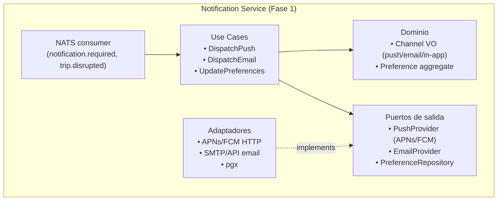
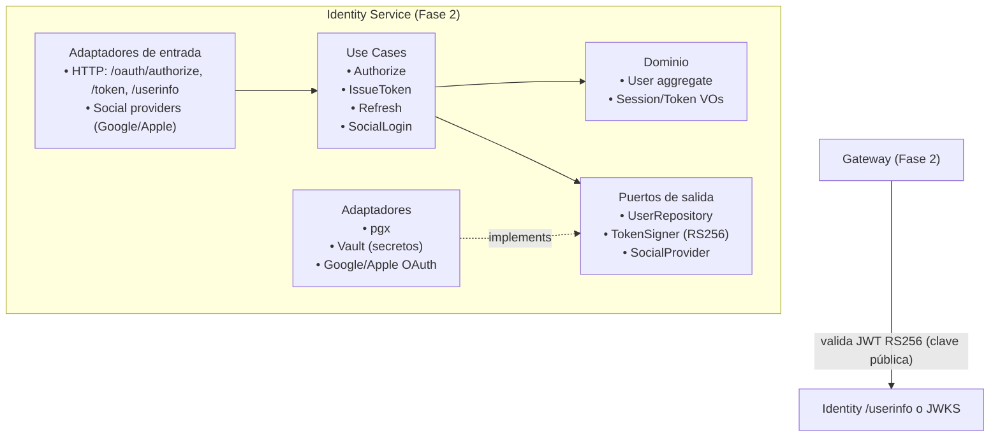
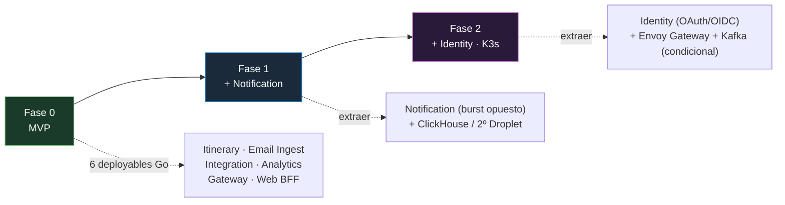

# 08 — Servicios futuros: Notification (Fase 1) e Identity (Fase 2)

> Deriva de **ADR-001** (regla de extracción: 2 de 3 de {escalado diferenciado, deploy independiente,
> aislamiento de fallos}). Estos **no** existen en Fase 0; se extraen de módulos existentes.

## 1. Notification (extracción Fase 1)

Hoy vive como **módulo dentro de Itinerary** (publica `notification.required` / `trip.disrupted`).
Se extrae porque su perfil de carga es **burst opuesto** al de Itinerary (ADR-001): una tormenta de
disrupciones genera 500K notificaciones que no deben competir con la API de latencia.

### 1.1 Responsabilidad
- Enviar **push** (APNs para iOS, FCM para Android), **email** transaccional, y **in-app**.
- Gestionar preferencias del usuario (qué recibe, por canal).
- Consumir eventos de disrupción/cancelación y disparar notificaciones.

### 1.2 Tecnologías
| Capa | Tecnología | Uso |
|------|-----------|-----|
| Lenguaje | Go 1.23+ | servicio |
| Push | APNs (HTTP/2), FCM (HTTP) | notificaciones nativas |
| Email transaccional | Provider SMTP/API (p.ej. Postmark/SES) | correos |
| Consumo | `nats.go` | consumer de `notification.required`, `trip.disrupted` |
| Preferencias | `pgx` → PostgreSQL | `notification_preferences` |

### 1.3 Estructura

### 1.4 Tácticas clave
- **Bulkhead por canal** (Newman ch.12): push, email e in-app aislados; un canal caído no frena los otros.
- **Degradación**: si APNs/FCM caen, encolar y reintentar (NATS retiene); no perder disrupciones críticas.
- **Idempotencia**: dedup por `event_id` para no duplicar notificaciones ante reentregas.
- **Escalado independiente**: escalar Notification a muchas réplicas en picos sin tocar Itinerary.

## 2. Identity (extracción Fase 2)

Hoy **Auth es middleware del Gateway** (JWT HS256, secreto compartido). Se extrae cuando el equipo y
la superficie de auth crecen (OAuth, tokens de refresco, login social).

### 2.1 Responsabilidad
- **AuthN/AuthZ** como servicio: OAuth2 / **OpenID Connect** (IdP).
- Login **social** (Google, Apple, etc.) y credenciales.
- Emisión y **validación** de tokens (JWT RS256 con par de claves pública/privada).
- Gestión de sesiones y **tokens de refresco** (rotación).

### 2.2 Tecnologías
| Capa | Tecnología | Uso |
|------|-----------|-----|
| Lenguaje | Go 1.23+ | servicio |
| Protocolo | OAuth2 + OIDC (`golang.org/x/oauth2`, `coreos/go-oidc`) | login social, tokens |
| JWT | RS256 (par de claves) | tokens firmados asimétricamente |
| Secretos | Vault (Fase 2) | claves, secretos por instancia, rotación |
| Persistencia | `pgx` → PostgreSQL | `users`, `sessions`, `refresh_tokens` |

### 2.3 Estructura

### 2.4 Migración desde Fase 0 (expansión/contracción, Newman ch.5)
1. **Fase 0**: Gateway emite+valida JWT HS256 (secreto compartido). Simple, sin servicio extra.
2. **Fase 2**: nace Identity que emite **RS256** (clave pública para que el Gateway y los servicios
   validen sin secreto compartido). El Gateway cambia su `JWTValidator` de HS256 a verificación RS256
   vía JWKS — **sin tocar los servicios de dominio**.
3. Período de transición: el Gateway acepta ambos formatos (expansión), luego se deja de emitir HS256
   (contracción).

### 2.5 Tácticas clave
- **Secretos por instancia + rotación** (Newman ch.11): claves en Vault, no en el repo.
- **Zero trust / zonas** (Newman ch.11): Identity es la raíz de confianza; servicios validan tokens.
- **Confused deputy** (Newman ch.11): los servicios verifican claims (aud, scope) ellos mismos, no
  confían solo en que el Gateway ya lo hizo.

## 3. Cronología de extracciones

> La extracción sigue la **regla 2-de-3** de ADR-001 y se ejecuta con **strangler/extract** (Newman
> ch.3): `git mv` del módulo + nuevo `go.mod` + nuevo deployable, manteniendo el mismo contrato
> (eventos/API) para no romper a los consumidores.
