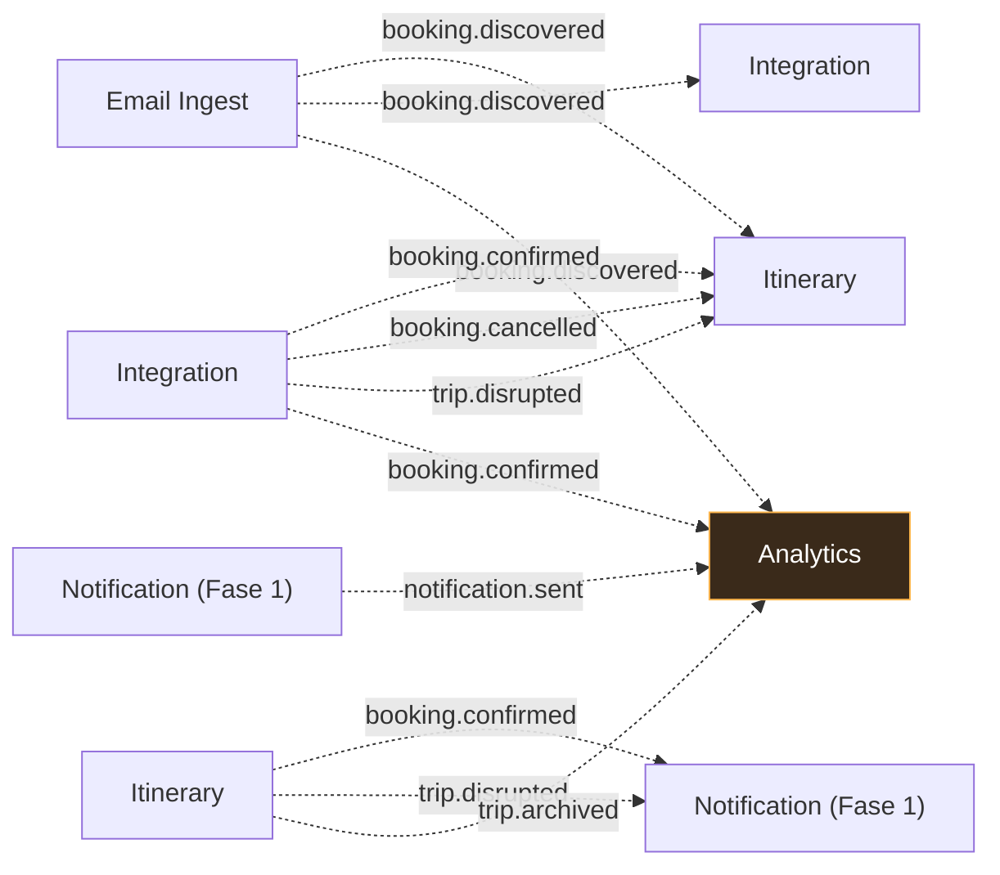
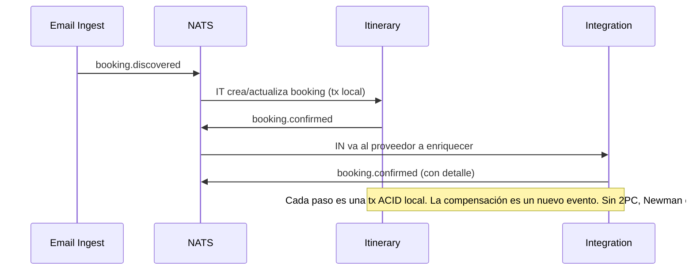

# 09 — Catálogo de eventos (NATS JetStream)

> Deriva de **ADR-005**. Fuente de verdad: `docs/events/events.yaml` (JSON Schema). Los tipos Go se
> generan/consumen desde `shared/event`. Formato de payload: **JSON** (no Avro, por simplicidad; el
> schema se documenta aquí y en `events.yaml`).

## 1. Convenciones de subjects

- Jerarquía `dominio.accion`: `booking.*`, `trip.*`, `user.*`, `notification.*`.
- Wildcards JetStream: `booking.>` (todos los de booking), `booking.confirmed` (exacto).
- Cada evento lleva cabeceras: `correlation-id`, `traceparent` (OTel), `id` (ULID/UUID v7),
  `occurred-at` (RFC3339), `source` (servicio emisor).
- **Hechos ricos**: el payload trae los datos completos necesarios, no solo IDs (Newman ch.4).

## 2. Matriz productor → consumidor



- **Analytics** consume `booking.>`, `trip.>`, `notification.>` (todos los eventos de dominio).
- **Itinerary** consume `booking.discovered` (para crear la reserva a partir del correo).
- **Integration** consume `booking.discovered` (para ir a buscar el detalle al proveedor).
- **Notification** (Fase 1) consume `trip.disrupted`, `booking.cancelled`, `notification.required`.

## 3. Esquemas de eventos (JSON)

### 3.1 `booking.discovered` — publicado por Email Ingest
```json
{
  "id": "01J9Z...ULID",
  "specversion": "1.0",
  "type": "booking.discovered",
  "source": "email-ingest",
  "correlation-id": "…",
  "occurred-at": "2026-10-27T10:00:00Z",
  "payload": {
    "provider": "aerolineaX",
    "provider_ref": "PNR123",
    "type": "transport",
    "passengers": [{ "name": "…", "document": "…" }],
    "segments": [{ "from": "EZE", "to": "GRU", "at": "2026-11-01T22:00:00Z" }],
    "confidence": 0.92,
    "mailbox_id": "…"
  }
}
```

### 3.2 `booking.confirmed` — publicado por Integration (o Itinerary)
```json
{
  "type": "booking.confirmed",
  "source": "integration",
  "payload": {
    "booking_id": "…",
    "trip_id": "…",
    "provider": "aerolineaX",
    "provider_ref": "PNR123",
    "status": "confirmed",
    "confirmed_at": "2026-10-27T10:00:05Z"
  }
}
```

### 3.3 `booking.cancelled`
```json
{
  "type": "booking.cancelled",
  "source": "integration",
  "payload": {
    "booking_id": "…", "trip_id": "…",
    "provider": "hotelY", "cancelled_at": "…", "reason": "user"
  }
}
```

### 3.4 `trip.disrupted`
```json
{
  "type": "trip.disrupted",
  "source": "integration",
  "payload": {
    "trip_id": "…",
    "booking_id": "…",
    "severity": "high",
    "message": "Vuelo cancelado",
    "disrupted_at": "…"
  }
}
```

### 3.5 `trip.archived` — publicado por Itinerary
```json
{
  "type": "trip.archived",
  "source": "itinerary",
  "payload": { "trip_id": "…", "archived_at": "…", "reason": "completed" }
}
```

### 3.6 `notification.required` / `notification.sent`
```json
{ "type": "notification.required", "source": "itinerary",
  "payload": { "trip_id": "…", "channel": ["push", "email"], "template": "trip.disrupted" } }
{ "type": "notification.sent", "source": "notification",
  "payload": { "notification_id": "…", "channel": "push", "status": "delivered" } }
```

## 4. Retención y dead letter (ADR-005)

| Stream | Subjects | Retención | Consumidores |
|--------|----------|-----------|--------------|
| `TRIPS` | `trip.>` | 30 días | Itinerary, Analytics, Notification |
| `BOOKINGS` | `booking.>` | 30 días | Itinerary, Integration, Analytics |
| `EMAIL` | `email.>` (dead letter) | 7 días | (reprocesamiento manual) |
| `NOTIFICATIONS` | `notification.>` | 30 días | Analytics |

- **Dead letter**: un evento/correo que no se puede procesar va a un stream con retención 7 días +
  alerta (Email Ingest para correos sin match; Integration para webhooks inválidos).
- **Idempotencia del consumidor**: cada consumidor dedup por `id` del evento (Redis, TTL 24 h) para
  soportar reentregas de JetStream sin efectos duplicados.

## 5. Patrón de colaboración (saga, no tx distribuida)



## 6. Migración a Kafka (criterio ADR-005)

Si se cumple 2-de-3 (equipo opera Kafka / replay > 3 meses / > 100K msg/s), el puerto
`EventPublisher`/`EventSinkPort` permite sustituir el adaptador NATS por Kafka **sin tocar dominio ni
esquemas** (los subjects se mapean a topics). El catálogo de eventos (esta sección) permanece igual.
