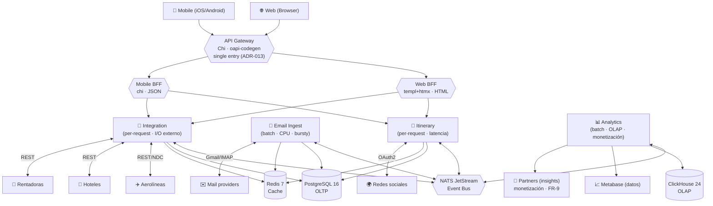

# Trotamundos — Descomposición en Microservicios

Documentación de detalle por microservicio del sistema **Trotamundos** (centralización de
viajes y reservas provenientes de múltiples aplicaciones). Este paquete profundiza el diseño
ya aprobado en los ADRs (`../adrs/`) y las vistas (`../architecture/`), aplicando **ADD**
(Attribute-Driven Design, 4 iteraciones) y **SDD** (Spec-Driven Development) con contratos
OpenAPI / JSON-Schema.

## Cómo leer este paquete

| # | Archivo | Contenido | ADR de origen |
|---|---------|-----------|---------------|
| 00 | [revision-documentacion.md](./00-revision-documentacion.md) | **Auditoría**: inconsistencias y errores ortográficos del diseño previo, con ubicación exacta y corrección propuesta | — |
| 01 | [arquitectura-global.md](./01-arquitectura-global.md) | Layout del monorepo, `go.work`, paquetes compartidos, convenciones transversales (config, logs, tracing, testing) | ADR-001, 002, 003 |
| 02 | [itinerary-service.md](./02-itinerary-service.md) | Servicio **Itinerary** — estructura hexagonal + flujo funcional | ADR-001, 002 |
| 03 | [email-ingest-service.md](./03-email-ingest-service.md) | Servicio **Email Ingest** — escaneo, parsing, whitelist | ADR-008 |
| 04 | [integration-service.md](./04-integration-service.md) | Servicio **Integration** — contratos de proveedor, webhooks, resiliencia | ADR-007 |
| 05 | [analytics-service.md](./05-analytics-service.md) | Servicio **Analytics** — ingestión batch a ClickHouse | ADR-010 |
| 06 | [api-gateway.md](./06-api-gateway.md) | **API Gateway** (Chi + oapi-codegen) — cadena de middleware | ADR-006 |
| 07 | [web-bff.md](./07-web-bff.md) | **Web BFF** (templ + htmx + Tailwind) — render del servidor | ADR-009 |
| 08 | [servicios-futuros.md](./08-servicios-futuros.md) | Extracciones Fase 1 (**Notification**) y Fase 2 (**Identity**) | ADR-001 |
| 09 | [catalogo-eventos.md](./09-catalogo-eventos.md) | Catálogo de eventos NATS JetStream + subjects + esquemas JSON | ADR-005 |

## Microservicios del sistema (Fase 0)

## Trazabilidad de drivers → servicios

| Driver (calidad) | Referencia | Servicio(s) que lo soportan | Táctica principal |
|------------------|-----------|------------------------------|-------------------|
| Escalabilidad 2M usuarios / 15M cuentas (QA-1, QA-2) | `drivers/atributos.md` | Todos, con escalado independiente | Separación de componentes (Fase 0/1/2) |
| Actualización < 5 min de terceros (QA-5) | `drivers/atributos.md` | Integration + Email Ingest → NATS → Itinerary | Event-driven, sin tx distribuida |
| Respuesta web ≤ 800 ms (QA-6) | `drivers/atributos.md` | Gateway + Itinerary + Web BFF | Sin capa intermedia Go→Go; cache Redis |
| FCP mobile < 1.4 s (QA-7) | `drivers/atributos.md` | Web BFF (SSR) + Mobile nativo | Render en primera respuesta, sin hydration |
| Mitigar picos masivos (QA-3) | `drivers/atributos.md` | Email Ingest (parser pool) + Analytics (batch) | Aislamiento + colas/buffer |
| Integración de nuevos medios (QA-11) | `drivers/atributos.md` | Integration + Email Ingest (hexagonal) | Adaptadores por proveedor |
| Acceso seguro a correos (QA-9) | `drivers/atributos.md` | Email Ingest (OAuth2) | Cifrado, secretos por instancia |
| Compartir itinerario con permisos (QA-10) | `drivers/atributos.md` | Itinerary (ItineraryShare) | Authorization en el servicio dueño |
| **Monetización por analítica (FR-9)** | `drivers/requerimientos.md` | Analytics (insights agregados/anónimos a partners) | Pre-agregados en ClickHouse; datos anónimos (QA-9) |

## Convención de versiones y fases

- **Fase 0** = MVP (1 Droplet, Docker Compose, **7 deployables Go**: Gateway, Web BFF, Mobile BFF,
  Itinerary, Email Ingest, Integration, Analytics).
- **Fase 1** = extracción de **Notification** + segundo Droplet (ClickHouse) + Redis/cluster NATS.
- **Fase 2** = extracción de **Identity** + K3s + migración condicional a Kafka.
- Números de puerto de referencia (Fase 0): Gateway `:8080`, Web BFF `:3000`, Mobile BFF `:3001`,
  Itinerary `:8081`, Email Ingest `:8082`, Integration `:8083`, Analytics `:8084`, NATS `:4222/:8222`,
  Redis `:6379`, PostgreSQL `:5432`, ClickHouse `:8123/:9000`.
