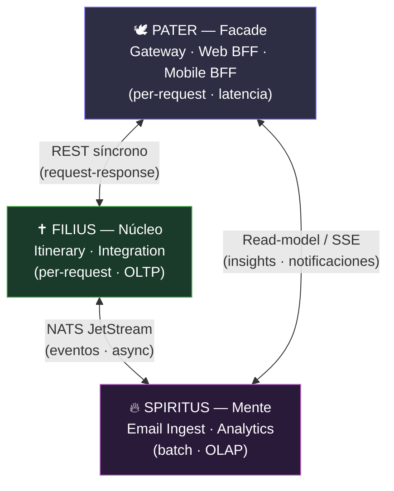
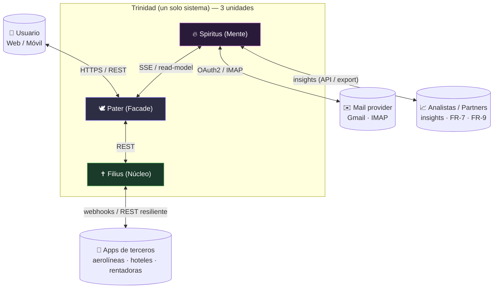

# Trotamundos — Arquitectura «Trinidad» (tres unidades modulares)

> **Rama:** `main-trinity` · **Estatus:** arquitectura **elegida** para Trotamundos.
> Procesa la misma especificación rectora (`../skills/SPEC_ARCHITECTURE.md`, ADD 3.0 + SDD) y los mismos
> drivers (`./drivers/`) que la propuesta de microservicios de `main`, pero elige un **estilo macro
> distinto**: en lugar de *microservicios hexagonales* (7 deployables), la **Santa Trinidad** organiza
> el sistema en **tres unidades modulares** que comparten una sola sustancia (base de código, dominio y
> despliegue) y se diferencian en tres personas (responsabilidades y perfiles de carga distintos). Las
> decisiones técnicas de `main` (stack, hexagonal, contratos) se **conservan y re-particionan**, no se
> descartan.

## 1. Idea central

> *Una sola sustancia, tres personas.*

Trotamundos se organiza en **tres unidades** que están **todas conectadas entre sí** (disposición
**triangular**), pero que **evitan el overhead y la complejidad de los microservicios**:

| Persona | Rol (software) | Contenido (colapsa N servicios en 1 unidad) | Perfil de carga |
|---------|----------------|---------------------------------------------|-----------------|
| **Pater** — *el Rostro* | Presentación y entrada (facade) | API Gateway (Chi) + Web BFF (templ+htmx) + Mobile BFF (chi/JSON) | per-request, latencia (web ≤ 800 ms, FCP móvil < 1.4 s) |
| **Filius** — *el Núcleo* | Dominio operacional transaccional | Itinerary + Integration | per-request, I/O, OLTP (PostgreSQL + Redis) |
| **Spiritus** — *la Mente* | Procesamiento asíncrono y analítica | Email Ingest + Analytics | batch, CPU/OLAP, bursty (NATS + ClickHouse) |

Las tres unidades comparten **una sola base de código** (`go.work`), **un mismo modelo de dominio
subyacente** y **un mismo despliegue** (`docker compose` en un Droplet). No son organizaciones
independientes con su propia DB, su propio registro y su propia orquestación (como en microservicios);
son **tres módulos desplegables** que se comunican por el mínimo de conexiones que la realidad impone.

## 2. El triángulo

Las tres unidades forman un triángulo; **cada arista es un estilo de conexión distinto**, elegido por
la naturaleza de la interacción (no por moda):

- **Pater ↔ Filius — REST síncrono.** El cliente entra por el Rostro, que agrega y renderiza llamando
  al Núcleo para obtener/actualizar reservas e itinerarios.
- **Filius ↔ Spiritus — eventos NATS (async).** El Núcleo publica *hechos* de negocio
  (`booking.confirmed`, `trip.disrupted`); la Mente reacciona (analítica, re-parse de correo). A la
  inversa, Email Ingest publica `booking.discovered` que el Núcleo consume.
- **Spiritus ↔ Pater — read-model / SSE.** El Rostro muestra insights y notificaciones leyendo
  **proyecciones materializadas** de la Mente (ClickHouse), **sin** pasar por el Núcleo OLTP
  (separación CQRS; protege QA-15: analítica pesada sin degradar la operación transaccional).

## 3. Por qué este estilo (resumen de decisión)

La arquitectura de microservicios (rama `main`) es correcta pero **adelanta complejidad** frente a las
restricciones reales del proyecto (**`./drivers/constraints.md`**: equipo pequeño, poco tiempo,
presupuesto limitado). La Trinidad aplica *Just Enough Architecture* y *YAGNI* (Bass ch.20, Regla 3 de
la Spec):

- **7 deployables → 3 unidades.** Se eliminan 4 pipelines, 4 artefactos y 4 puntos de fallo.
- **Sin service mesh, sin K8s, sin descubrimiento de servicios.** Todo resuelve en una red Docker.
- **Comunicación en proceso dentro de cada unidad** (módulos hexagonales): cero saltos de red para lo
  que no necesita separarse.
- **Se conserva todo lo aprendido:** Go, hexagonal, PostgreSQL/Redis/ClickHouse, NATS, Chi, templ/htmx,
  JWT RS256, GitHub Actions, DigitalOcean, Docker Compose. Solo se **re-particiona** la topología.
- **Se conserva la vía de extracción:** si una unidad crece, sus módulos internos se dividen en
  servicios sin tocar el dominio (regla 2-de-de-3, heredada de ADR-001).

## 4. Cómo encaja en el proceso SDD (CON-1 / CON-5)

La Trinidad es una **re-elección de la Iteración I** (estilo de referencia / macro C&C): en vez de
*microservicios*, se elige *monolito modular partido en 3 unidades*. Las iteraciones siguientes se
reutilizan casi intactas:

| Iteración | En la Trinidad |
|-----------|----------------|
| **I** — referencia y estilos | **Re-hecha aquí:** monolito modular trinitario (ADR-101, ADR-102) |
| **II** — funcionalidad y tecnología | Módulos por unidad; stack **idéntico** al de `main` (ADR-102, ADR-103) |
| **III** — trade-offs QA, tácticas | Tácticas de disponibilidad/rendimiento/resiliencia **sin cambios** (se aplican dentro de cada unidad) |
| **IV** — mejoras y prototipo | Prototipo en 3 deployables; extracción futura por módulo (ADR-105) |

## 5. Documentación (misma estructura que la arquitectura original)

| Vista / Decisión | Archivo | Equivalente en `main` |
|------------------|---------|-----------------------|
| Tecnologías (adaptadas) | [tecnologias.md](./tecnologias.md) | `../architecture/tecnologias.md` |
| **Vista de módulos** (estructura de código, modular) | [architecture/vista_modulos.md](./architecture/vista_modulos.md) | `../architecture/vista_modulos.md` |
| **Vista de componentes y conectores** (runtime, cyc) | [architecture/vista_cyc.md](./architecture/vista_cyc.md) | `../architecture/vista_cyc.md` |
| **Vista de despliegue** (asignación a infra) | [architecture/vista_despliegue.md](./architecture/vista_despliegue.md) | `../architecture/vista_despliegue.md` |
| **Detalle por unidad** (código + dominio + contratos) | [units/](./units/README.md) | `../microservices/01..09` |
| **Registro de evolución** (changelog, deuda, transiciones) | [registers/](./registers/README.md) | — (nuevo, conforme a SPEC §5/Paso 8) |
| ADR-101 Trinidad: 3 unidades en vez de N microservicios | [adrs/adr-101-trinidad.md](./adrs/adr-101-trinidad.md) | (adapta ADR-001) |
| ADR-102 Límites de unidad y modularidad interna | [adrs/adr-102-límites-de-unidad.md](./adrs/adr-102-límites-de-unidad.md) | (adapta ADR-001/002/013) |
| ADR-103 Comunicación inter-unidad (triángulo) | [adrs/adr-103-comunicacion-inter-unidad.md](./adrs/adr-103-comunicacion-inter-unidad.md) | (adapta ADR-005/006/013) |
| ADR-104 Capa de datos compartida con segregación por esquema | [adrs/adr-104-capa-datos-compartida.md](./adrs/adr-104-capa-datos-compartida.md) | (adapta ADR-004) |
| ADR-105 Despliegue: 3 contenedores, Docker Compose, DO | [adrs/adr-105-despliegue-trinidad.md](./adrs/adr-105-despliegue-trinidad.md) | (adapta ADR-012) |

## 6. Diagrama de contexto (C4 nivel 1, CON-2)

> Las tres unidades **son un único sistema** frente a sus actores (C4 nivel 1): la división en 3 es
> interna (estructura de módulos/despliegue), no una frontera de sistema.
