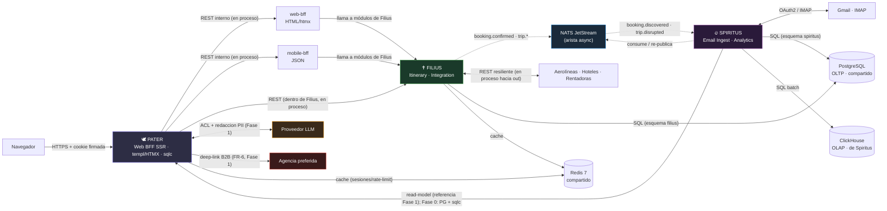
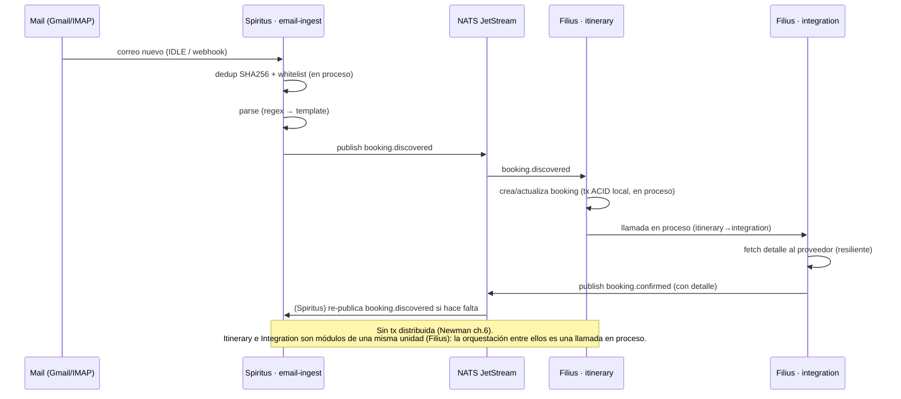
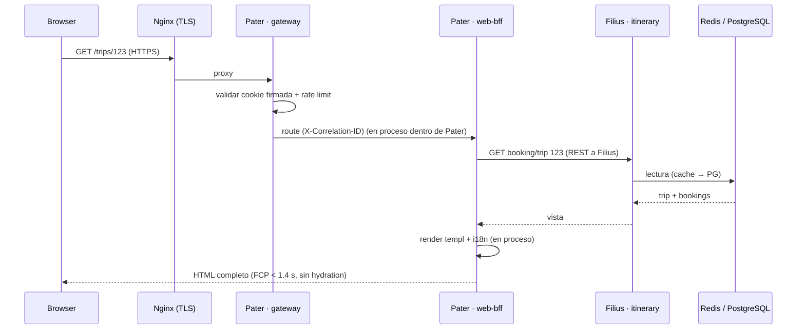
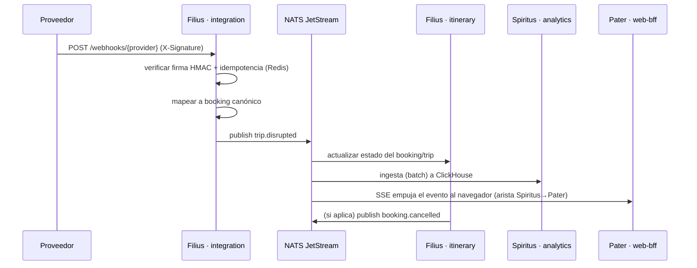
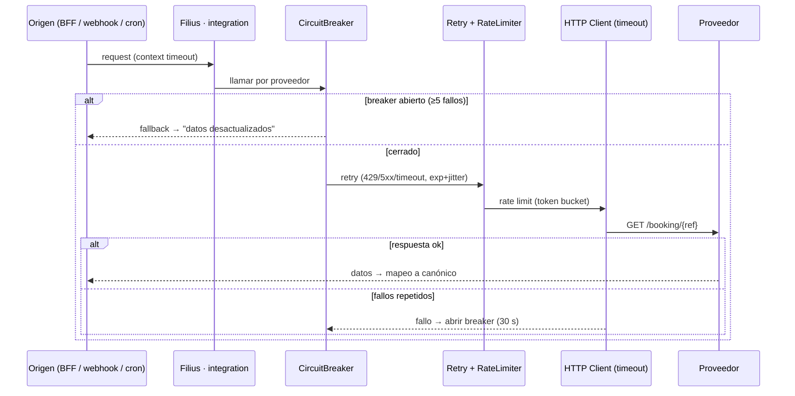
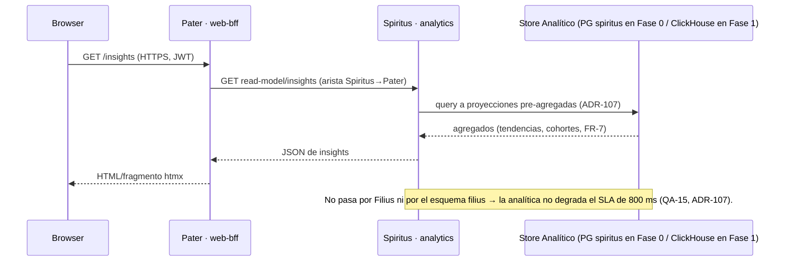

> **ADR-111 (prototipo Fase 0):** la arista REST `Pater↔Filius` del triángulo queda como **contrato de referencia**; en la ejecución real los handlers de Pater consultan PostgreSQL con **sqlc** directamente. NATS sigue solo en `Filius↔Spiritus`.


## Propósito de esta vista (component-and-connector, Bass ch.1/22)

Vista de **Componentes y Conectores (C&C)**: estructura de **runtime**. Muestra **cómo interactúan los
componentes dinámicamente** para ejecutar los escenarios del sistema. La disposición es **triangular**:
las tres unidades conectadas dos a dos, y **cada arista usa un conector distinto** (es la perspectiva en
runtime del *triángulo trinitario* de `vista_modulos.md`):

- **Pater ↔ Filius — REST (referencia Fase 1).** En Fase 0 el handler consulta PostgreSQL con sqlc (ADR-111).
  Dentro de Filius, Itinerary↔Integration se llaman **en proceso** (sin red).
- **Filius ↔ Spiritus — NATS JetStream (asíncrono, event-driven).** Propagación de hechos; cada
  consumidor reacciona por su cuenta (invertir responsabilidad, Newman ch.4).
- **Spiritus ↔ Pater — read-model / SSE (referencia Fase 1).** En Fase 0 el Rostro lee insights con sqlc;
  notificaciones; **sin pasar por el Núcleo OLTP** (CQRS; protege QA-15).

> **Arista inexistente a propósito:** no hay NATS entre Pater y el cliente, ni REST síncrono
> Filius→Spiritus para propagar hechos. La Trinidad **no duplica conectores**: cada par de unidades
> habla exactamente un idioma, el que la interacción exige.

## Escenario 1 — Reserva descubierta por email (flujo event-driven)



## Escenario 2 — Usuario ve su itinerario en la web (síncrono)



## Escenario 3 — Disrupción de proveedor (webhook → notificación al usuario)



## Escenario 4 — Llamada resiliente a proveedor (cadena de protección, dentro de Filius)



## Escenario 5 — Dashboard de insights (lectura analítica sin tocar el OLTP)



## Escenario 6 — Asistente Virtual: consulta, derivación y seguimiento (Fase 1)

```mermaid
sequenceDiagram
    participant U as Viajero (web/movil)
    participant GW as Pater · gateway
    participant AS as Pater · assistant
    participant FI as Filius · assistance/itinerary
    participant N as NATS JetStream
    participant SP as Spiritus · analytics
    participant AG as Agencia preferida (FR-6)
    U->>GW: POST /assistant/messages (JWT + X-Correlation-ID)
    GW->>AS: validar JWT + rate limit (en proceso)
    AS->>AS: IntentClassifier (LLM con ACL/PII redactada → fallback reglas)
    alt consulta de estado / incidencia menor
        AS->>FI: GET /trips/{id} o /bookings/{id} (REST, timeout)
        FI-->>AS: estado canonico (cache → PG esquema filius)
        AS-->>U: SSE/htmx: respuesta en streaming (p95 < 2 s, QA-16)
    else reprogramacion guiada
        AS-->>U: deep-link al proveedor (FR-6) + pasos
        FI-->>N: booking.confirmed (cuando el proveedor confirma)
    else caso complejo → agencia
        AS->>FI: POST /internal/assistance/cases (REST)
        FI->>FI: tx local: filius.assistance_cases (open) + token Redis TTL 15 min
        FI->>N: assistance.handoff_requested
        N->>SP: ingesta → metrica de resolucion (QA-17)
        AS-->>U: deep-link a agencia con context_token (un solo uso)
        AG->>FI: consulta contexto con token → caso handed_off
        FI->>N: assistance.resolved → SP cierra la metrica
    end
    Note over AS,FI: Sin cuarta arista: Pater solo REST; NATS sigue solo Filius↔Spiritus (ADR-103).
```

## Leyenda

- **Flecha sólida** = llamada síncrona (request-response, con timeout). · **Flecha punteada** = evento
  NATS JetStream (asíncrono; el productor publica, el consumidor es dueño de su reacción).
- Cada escenario usa **correlation-id** propagado (OTel) para trazabilidad de extremo a extremo.
- **Dentro de una unidad no hay red:** Itinerary↔Integration (Filius), gateway↔BFF (Pater),
  email-ingest↔analytics (Spiritus) se comunican por **llamada en proceso**. Solo las 3 aristas del
  triángulo cruzan procesos.
- Ver detalle por unidad en `adrs/adr-102` (módulos) y `adrs/adr-103` (conectores).
- **Asistente Virtual (Fase 1, ADR-109/110): no añade conectores.** El LLM y la agencia son actores
  externos; Pater solo habla REST con Filius y Filius publica `assistance.*` en la arista NATS ya existente.
