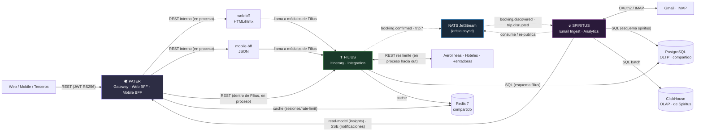
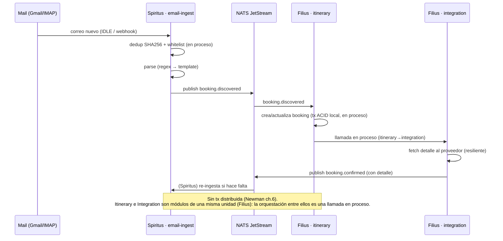
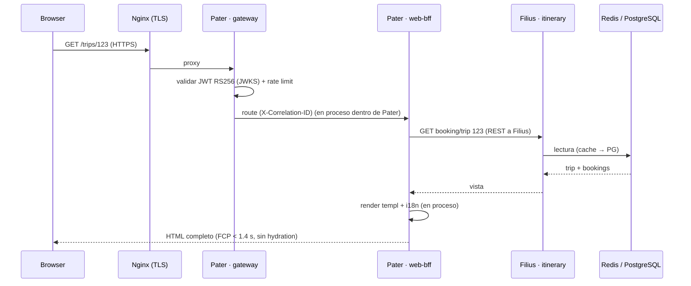
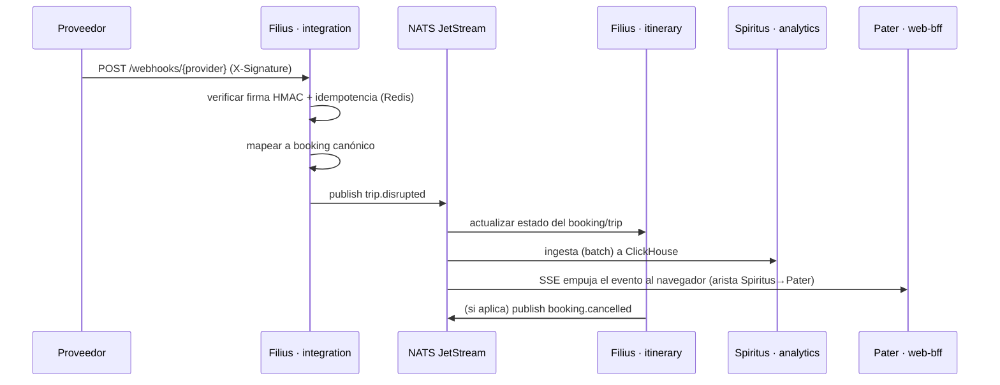
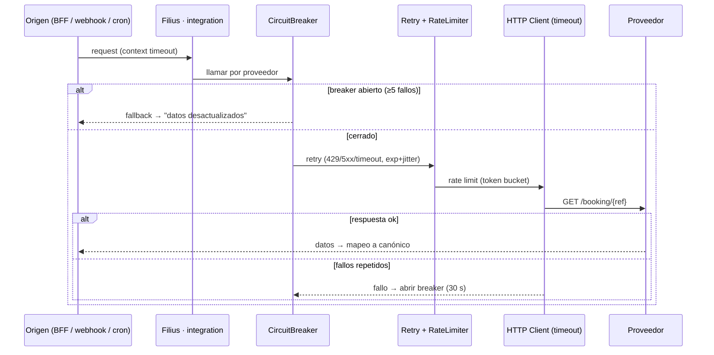
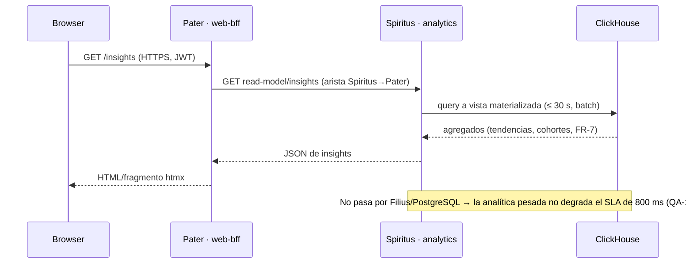

## Propósito de esta vista (component-and-connector, Bass ch.1/22)

Vista de **Componentes y Conectores (C&C)**: estructura de **runtime**. Muestra **cómo interactúan los
componentes dinámicamente** para ejecutar los escenarios del sistema. La disposición es **triangular**:
las tres unidades conectadas dos a dos, y **cada arista usa un conector distinto** (es la perspectiva en
runtime del *triángulo trinitario* de `vista_modulos.md`):

- **Pater ↔ Filius — REST (síncrono, request-response).** Cliente → Gateway → BFF → módulos de Filius.
  Dentro de Filius, Itinerary↔Integration se llaman **en proceso** (sin red).
- **Filius ↔ Spiritus — NATS JetStream (asíncrono, event-driven).** Propagación de hechos; cada
  consumidor reacciona por su cuenta (invertir responsabilidad, Newman ch.4).
- **Spiritus ↔ Pater — read-model / SSE.** El Rostro lee proyecciones analíticas y empuja
  notificaciones; **sin pasar por el Núcleo OLTP** (CQRS; protege QA-15).

> **Arista inexistente a propósito:** no hay NATS entre Pater y el cliente, ni REST síncrono
> Filius→Spiritus para propagar hechos. La Trinidad **no duplica conectores**: cada par de unidades
> habla exactamente un idioma, el que la interacción exige.

## Escenario 1 — Reserva descubierta por email (flujo event-driven)

## Escenario 2 — Usuario ve su itinerario en la web (síncrono)

## Escenario 3 — Disrupción de proveedor (webhook → notificación al usuario)

## Escenario 4 — Llamada resiliente a proveedor (cadena de protección, dentro de Filius)

## Escenario 5 — Dashboard de insights (lectura analítica sin tocar el OLTP)

## Leyenda

- **Flecha sólida** = llamada síncrona (request-response, con timeout). · **Flecha punteada** = evento
  NATS JetStream (asíncrono; el productor publica, el consumidor es dueño de su reacción).
- Cada escenario usa **correlation-id** propagado (OTel) para trazabilidad de extremo a extremo.
- **Dentro de una unidad no hay red:** Itinerary↔Integration (Filius), gateway↔BFF (Pater),
  email-ingest↔analytics (Spiritus) se comunican por **llamada en proceso**. Solo las 3 aristas del
  triángulo cruzan procesos.
- Ver detalle por unidad en `adrs/adr-102` (módulos) y `adrs/adr-103` (conectores).
