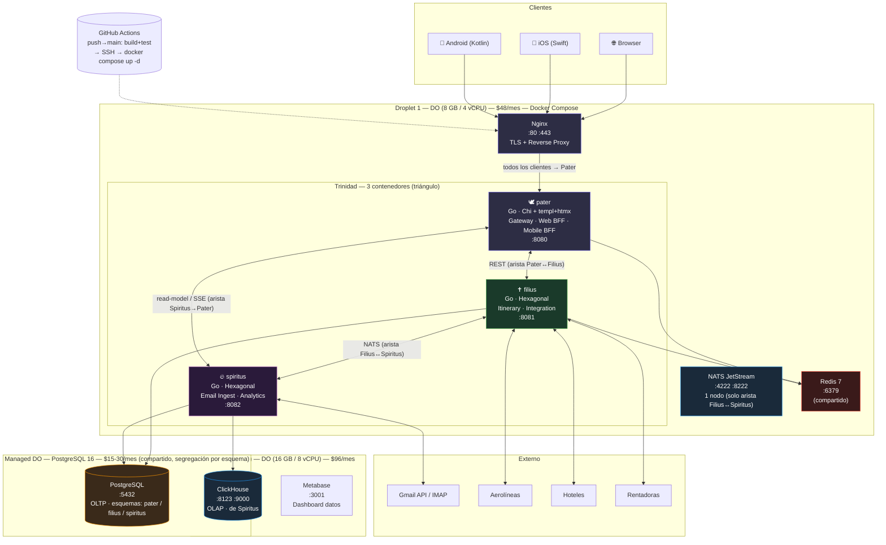
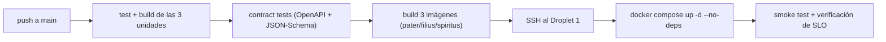

## Propósito de esta vista (allocation / deployment structure, Bass ch.1/22)

Vista de **asignación** (estructura de despliegue): cómo se mapea el código a la infraestructura. La
disposición es **triangular**: **3 contenedores** (`pater`, `filius`, `spiritus`) en un solo Droplet,
conectados dos a dos por una red Docker interna. Se respeta **Docker Compose + GitHub Actions +
DigitalOcean** (ADR-012), simplificando de **7 a 3** imágenes.

## 1. Infraestructura Fase 0 (costo total ~$80/mes, igual que `main`)

| Recurso | Especificación | Costo | Contiene |
|---------|----------------|-------|----------|
| **Droplet 1** | DO 8 GB / 4 vCPU | $48/mes | Nginx + **3 contenedores Trinidad** + NATS + Redis |
| **PostgreSQL** | Managed DO 16 GB RAM | $15–30/mes | OLTP, esquemas separados por unidad (ADR-104) |
| **Droplet 2 (Fase 1)** | DO 16 GB / 8 vCPU | $96/mes | ClickHouse + Metabase (dueño: Spiritus) |

## 2. `docker-compose.yml` (esqueleto Fase 0 — fuente de verdad del despliegue)

```yaml
services:
  nginx:
    image: nginx:1.25
    ports: ["80:80", "443:443"]
    volumes: ["./nginx/conf.d:/etc/nginx/conf.d:ro"]
    depends_on: [pater]

  pater:        # 🕊️ Gateway + Web BFF + Mobile BFF (un binario Go)
    build: { context: ., target: pater }
    environment: [PATER_PG_DSN, PATER_REDIS_URL, JWT_PRIVATE_KEY_FILE]
    depends_on: [filius]            # llama a Filius por REST en la red interna
    restart: unless-stopped

  filius:       # ✝️ Itinerary + Integration (un binario Go)
    build: { context: ., target: filius }
    environment: [FILIUS_PG_DSN, FILIUS_REDIS_URL, NATS_URL]
    depends_on: [nats]
    restart: unless-stopped

  spiritus:     # 🔥 Email Ingest + Analytics (un binario Go)
    build: { context: ., target: spiritus }
    environment: [SPIRITUS_PG_DSN, SPIRITUS_CH_DSN, NATS_URL]
    depends_on: [nats]
    restart: unless-stopped

  nats:         # solo para la arista async Filius↔Spiritus
    image: nats:2.10-alpine
    command: ["-js"]                 # JetStream
    restart: unless-stopped

  redis:
    image: redis:7-alpine
    restart: unless-stopped

# PostgreSQL va como Managed DO (fuera del compose) → respaldo y HA gestionados.
```

> **Un binario Go por unidad** (build-once, Newman ch.7): `cmd/pater`, `cmd/filius`, `cmd/spiritus`.
> Cada uno arrastra sus módulos internos; la config se externaliza por entorno.

## 3. CI/CD — GitHub Actions (3 pipelines con template compartido)



- **Deploy < 2 min** (build + push + `compose up`). Se promueve la **misma imagen verificada** a todos
  los entornos (build-once).
- **Deploy atómico por unidad** con `--no-deps`: puedo desplegar `pater` sin reiniciar `filius` ni
  `spiritus`. Esto conserva la **independencia de deploy** (Newman ch.1) a nivel de unidad.
- **Deploy ≠ release** (Newman ch.8): feature flags cuando hagan falta; Nginx como único borde expuesto.
- **Sin K8s en Fase 0**: cero overhead de orquestación; `restart: unless-stopped` + alertas en
  UptimeRobot (ADR-012).

## 4. Fases siguientes (sin cambiar el estilo)

- **Fase 1**: segundo Droplet para ClickHouse + Metabase (Spiritus lo posee); Redis managed; NATS a 3
  nodos si el volumen lo exige.
- **Fase 2**: K3s + Terraform + ArgoCD. La Trinidad migra **3 despliegues**, no 7. Identity se extrae
  como servicio (deja de emitir JWT el Gateway de Pater; ADR-014).

## 5. Riesgo y mitigación (el costo honesto de la Trinidad)

| Riesgo | Mitigación |
|--------|-----------|
| **Monolito distribuido**: 3 contenedores que se llaman por red pueden dar el peor de ambos mundos si las fronteras están mal (Newman ch.1). | Las fronteras eligen por **perfil de carga + sync/async real** (no por costumbre). Dentro de cada unidad, **todo es en proceso** (cero red). |
| Fallo en cascada por la red interna. | Timeouts en todas las aristas (ADR-103); `filius` degrada a "datos desactualizados"; Redis/PG managed con HA. |
| Escalado: un Droplet no escala horizontalmente. | Cada unidad se escala **verticalmente** (más RAM/CPU) o, en Fase 1, con réplicas de `pater` tras Nginx. Extracción de módulo→servicio si el perfil diverge (ADR-102). |

## 6. Leyenda

- **morado** = Pater (facade) · **verde** = Filius (núcleo) · **magenta** = Spiritus (mente).
- **El triángulo** entre `pater`/`filius`/`spiritus` es la conexión dos a dos sobre la red Docker interna.
- **PostgreSQL** es compartido con esquemas separados; **Redis** es caché compartido; **ClickHouse** es
  exclusivo de Spiritus.
- Vistas complementarias: `vista_modulos.md` (código) y `vista_cyc.md` (runtime).
