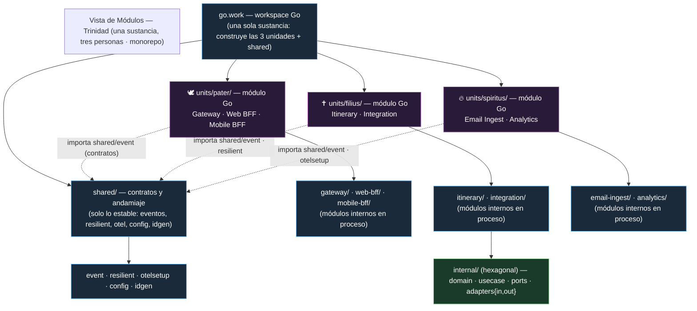
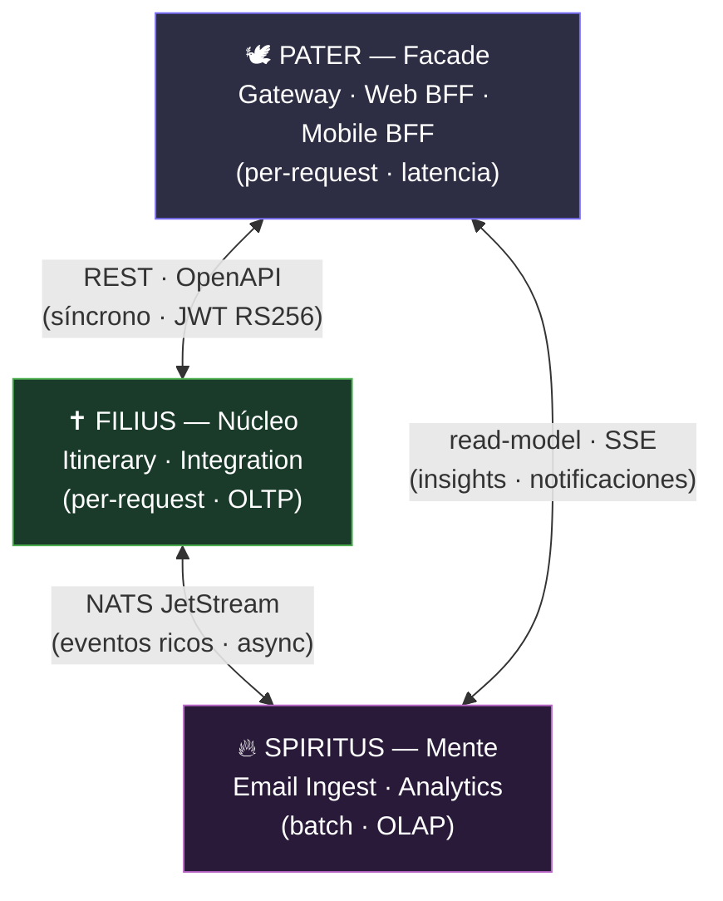
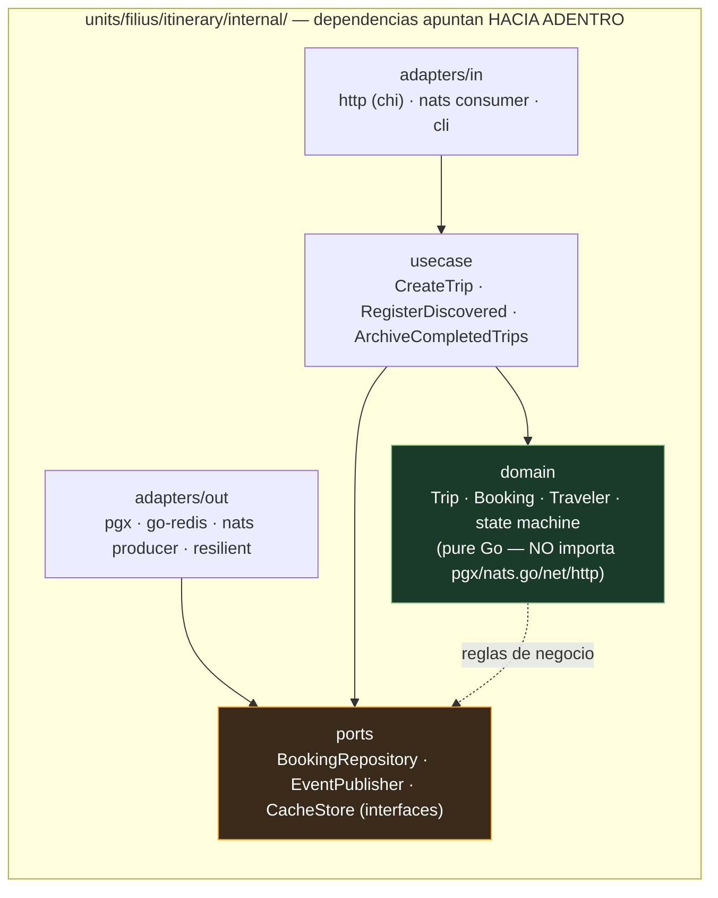

## El triángulo trinitario — las tres unidades interconectadas

> *Una sola sustancia, tres personas.* Las tres unidades forman un **triángulo**: cada par está
> conectado por **exactamente una** arista, elegida por la naturaleza de la interacción. Dentro de cada
> unidad la comunicación es **en proceso** (sin red); **solo las tres aristas cruzan límites de
> proceso**. Este es el diagrama de referencia que comparten las tres vistas (módulos, cyc, despliegue),
> cada una desde su propia perspectiva (dependencia estática / conector en runtime / contenedor).

| Arista | Conector (contrato) | Qué cruza la arista | Por qué este conector |
|--------|---------------------|---------------------|----------------------|
| **Pater ↔ Filius** | REST · OpenAPI (síncrono) | Cliente necesita el resultado ya (itinerarios, reservas) | Baja latencia (QA-6 / QA-7) |
| **Filius ↔ Spiritus** | NATS JetStream (async) | Hechos de negocio (`booking.*`, `trip.*`) | Desacople de picos; cada consumidor reacciona (QA-3 / QA-5) |
| **Spiritus → Pater** | read-model · SSE | Insights y notificaciones (proyecciones analíticas) | CQRS: analítica sin tocar el OLTP (QA-15) |

> **Information hiding (Parnas / Newman ch.2):** lo que cruza una arista es **contrato** (evento
> versionado o endpoint OpenAPI), **nunca** el código interno de la otra unidad. Así el triángulo
> preserva la información oculta *sin* multiplicar bases de datos ni procesos. La dependencia de
> compilación entre unidades se limita a `shared/event` (los tipos del contrato); ver ADR-103 (aristas)
> y ADR-104 (segregación por esquema).

## Propósito de esta vista (module structure, Bass ch.1/22)

Vista de **módulos** (estructura estática, tiempo de diseño): muestra **cómo se organiza el código**
para razonar sobre **modificabilidad**, build y asignación de trabajo. El mensaje central es el
**desacoplamiento por módulos**: cada unidad es un **módulo Go independiente** (`go.mod` propio) que se
compila y despliega solo, y dentro de cada unidad los sub-módulos (Gateway/BFF, Itinerary/Integration,
Email Ingest/Analytics) son **módulos en proceso** — sin salto de red entre ellos.

> **Diferencia clave con `main`:** en la arquitectura de microservicios cada *servicio* era un módulo
> desplegable (7 `go.mod`, 7 deployables). Aquí la **unidad de despliegue** es la **unidad trinitaria**
> (3 `go.mod`, 3 deployables); los servicios anteriores se conservan como **módulos internos** dentro
> de su unidad, preservando la vía de extracción futura (ADR-102).

## 1. Monorepo y límites de módulo (una sustancia, tres personas)

- **Un módulo Go por unidad** (`units/<pater|filius|spiritus>/go.mod`). El `go.work` del raíz los reúne
  en un workspace para construirlos juntos, pero **cada unidad es una unidad de build/deploy
  independiente**.
- **Dentro de cada unidad, sub-módulos por responsabilidad** (no por servicio): `units/filius/itinerary`,
  `units/filius/integration`, etc. Comparten proceso y memoria → **llamada a función, no red**.
- **`shared/` solo contiene lo estable**: tipos de eventos, el cliente resiliente, setup de OTel, config
  e IDs. **Nada de lógica de dominio compartida** → si un concepto empieza a compartirse, es señal de
  que pertenece a una unidad (o debe extraerse), no de que se comparta (Newman ch.5, DRY perils).
- **El dominio viaja dentro de cada unidad**; no hay un «dominio compartido» entre unidades. Lo que una
  unidad necesita de otra pasa por un **contrato** (evento NATS o endpoint REST), nunca por importar su
  código interno.

## 2. Estructura hexagonal interna (un módulo típico — se repite en las 3 unidades)

**Regla de desacoplamiento (information hiding, Parnas/Newman ch.1):** el **dominio no conoce
infraestructura**. Cambiar PostgreSQL→OtraDB, NATS→Kafka o Gmail→Outlook es reemplazar un adaptador
(`adapters/out`) sin tocar `domain` ni `usecase`. El flujo de dependencias va siempre **hacia el
centro** (dominio/puertos), nunca hacia afuera. **Esta regla es idéntica a la de `main`** (ADR-002): la
Trinidad no toca la arquitectura interna de cada módulo, solo cómo se agrupan y comunican.

## 3. Mecanismos de desacoplamiento (¿por qué las unidades no se enredan?)

| Mecanismo | Qué logra | Referencia |
|-----------|-----------|-----------|
| `go.mod` por unidad | Build/deploy independiente → cambio Pater sin reconstruir Filius/Spiritus | ADR-102 |
| Módulos en proceso dentro de la unidad | Cero saltos de red para Itinerary↔Integration (dentro de Filius) | ADR-102 |
| Hexagonal (puertos/adaptadores) por módulo | Dominio estable; infraestructura intercambiable | ADR-002 (heredado) |
| Eventos NATS **solo** en la arista Filius↔Spiritus | Las unidades async colaboran sin conocerse (invertir responsabilidad) | ADR-103, ADR-005 |
| `shared/` solo contratos | Evita acoplamiento de contenido entre unidades | Newman ch.5 |
| Contratos generados (OpenAPI/JSON-Schema) | API y eventos versionados; expansion/contract en vez de breaking changes | ADR-103 |
| Segregación por esquema en PostgreSQL compartido | Cada unidad es dueña de sus tablas; nadie escribe en el interior de otra (ADR-104) | ADR-104 |

## 4. Por qué 3 y no 7 (regla de extracción, heredada de ADR-001)

Un módulo interno se divide en servicio independiente **solo si se cumplen 2 de 3**:

1. Perfil de escalado medible que difiere.
2. Ciclo de deploy independiente (cambia con frecuencia distinta).
3. Un fallo no debería tumbar el resto.

En Fase 0, **Itinerary e Integration** (dentro de Filius) comparten perfil per-request/OLTP → un solo
deployable. Si Integration pasara a cambiar con frecuencia distinta o necesitara aislamiento de fallos,
se divide **sin tocar el dominio** (es ya un módulo hexagonal). Lo mismo para Web/Mobile BFF dentro de
Pater, y para Email Ingest/Analytics dentro de Spiritus.

## 5. Leyenda

- **morado** = unidades (módulos desplegable) · **azul** = `shared/` y módulos raíz (`go.work`, carpetas)
  · **verde** = dominio (estable) · **naranja** = puertos (interfaces, el contrato).
- **Esquema de color del triángulo** (arriba, y común a las tres vistas): **morado = Pater**,
  **verde = Filius**, **magenta = Spiritus**. (En el hexágono el verde significa *dominio*; el contexto
  del diagrama lo distingue: en el triángulo el verde etiqueta a la unidad **Filius**.)
- **Flechas sólidas** = dependencia de compilación (hacia el módulo del que se depende). En el hexágono,
  todas apuntan a `domain`/`ports` = el centro estable.
- **Flechas punteadas** = dependencia de contrato (`shared/event`), no de implementación.

> Vistas complementarias: `vista_cyc.md` (interacción dinámica en runtime, el triángulo de conectores)
> y `vista_despliegue.md` (asignación a infraestructura, el triángulo de contenedores). Detalle por
> unidad en los ADRs `adrs/adr-102` y `adrs/adr-103`.
