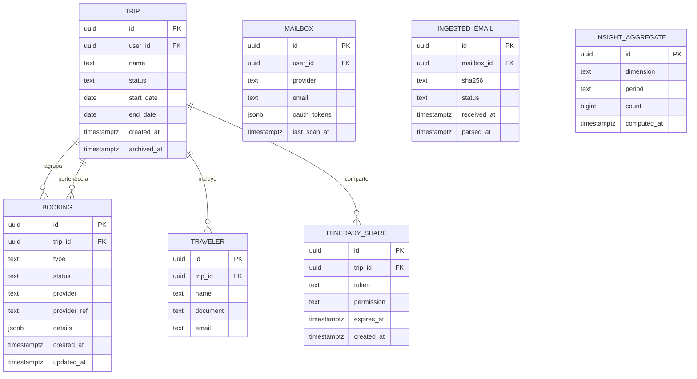
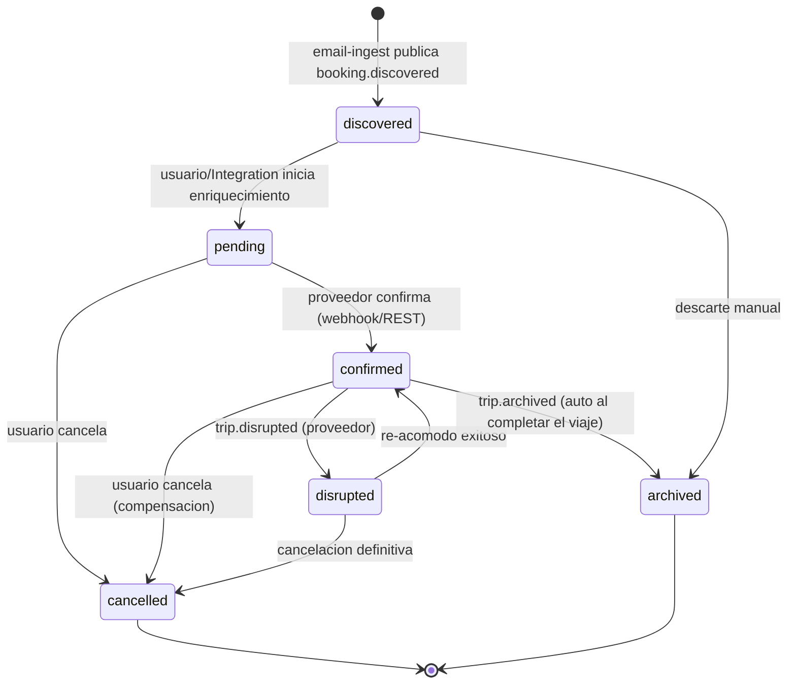

# Trotamundos — Modelo de datos (Trinidad)

> **Rama:** `main` (consolidada) · **Fase:** 0 (MVP). Deriva de ADR-104 (capa de datos compartida con segregación por esquema) y de los bounded contexts de `units/03` (Filius) y `units/04` (Spiritus).

## 1. Principios (ADR-104)

- **Un solo PostgreSQL managed** (DO), con **un esquema por unidad**: `pater`, `filius`, `spiritus`.
- Cada unidad es dueña de sus tablas y **escribe solo en su esquema**. Lo que necesita de otra unidad viene por **contrato** (evento NATS o read-model), nunca por escribir en el esquema ajeno.
- **ClickHouse** (Droplet 2, Fase 1) es exclusivo de Spiritus (OLAP). PostgreSQL solo OLTP.
- **Redis** es caché compartido (sesiones, rate limit, dedup, idempotencia) — sin datos de dominio con dueño único.
- Migración a DBs separadas en Fase 2 si el escalado lo exige (los puertos hexagonales lo absorben, ADR-002).

## 2. Diagrama Entidad-Relación (ERD)



> **Nota:** `MAILBOX`, `INGESTED_EMAIL` viven en el esquema `spiritus`; `INSIGHT_AGGREGATE` vive en ClickHouse (OLAP), no en PostgreSQL. El ERD las muestra juntas para dar la visión completa del dominio.

## 3. DDL — esquema `filius` (dominio operacional, OLTP)

```sql
-- Esquema dueño: Filius (Itinerary + Integration)
CREATE SCHEMA IF NOT EXISTS filius;

CREATE TABLE filius.trips (
    id          UUID PRIMARY KEY DEFAULT gen_random_uuid(),
    user_id     UUID NOT NULL,
    name        TEXT NOT NULL,
    status      TEXT NOT NULL DEFAULT 'upcoming'
                CHECK (status IN ('upcoming','active','archived')),
    start_date  DATE,
    end_date    DATE,
    created_at  TIMESTAMPTZ NOT NULL DEFAULT now(),
    archived_at TIMESTAMPTZ
);
CREATE INDEX idx_trips_user_status ON filius.trips (user_id, status);

CREATE TABLE filius.bookings (
    id           UUID PRIMARY KEY DEFAULT gen_random_uuid(),
    trip_id      UUID NOT NULL REFERENCES filius.trips(id) ON DELETE CASCADE,
    type         TEXT NOT NULL CHECK (type IN ('lodging','transport','car_rental')),
    status       TEXT NOT NULL DEFAULT 'discovered'
                 CHECK (status IN ('discovered','pending','confirmed','cancelled','disrupted','archived')),
    provider     TEXT NOT NULL,
    provider_ref TEXT NOT NULL,
    details      JSONB NOT NULL DEFAULT '{}'::jsonb,
    created_at   TIMESTAMPTZ NOT NULL DEFAULT now(),
    updated_at   TIMESTAMPTZ NOT NULL DEFAULT now(),
    UNIQUE (provider, provider_ref)
);
CREATE INDEX idx_bookings_trip ON filius.bookings (trip_id);
CREATE INDEX idx_bookings_status ON filius.bookings (status);

CREATE TABLE filius.travelers (
    id        UUID PRIMARY KEY DEFAULT gen_random_uuid(),
    trip_id   UUID NOT NULL REFERENCES filius.trips(id) ON DELETE CASCADE,
    name      TEXT NOT NULL,
    document  TEXT,
    email     TEXT
);
CREATE INDEX idx_travelers_trip ON filius.travelers (trip_id);

CREATE TABLE filius.itinerary_shares (
    id          UUID PRIMARY KEY DEFAULT gen_random_uuid(),
    trip_id     UUID NOT NULL REFERENCES filius.trips(id) ON DELETE CASCADE,
    token       TEXT NOT NULL UNIQUE,
    permission  TEXT NOT NULL DEFAULT 'view' CHECK (permission IN ('view')),
    expires_at  TIMESTAMPTZ,
    created_at  TIMESTAMPTZ NOT NULL DEFAULT now()
);
```

## 4. DDL — esquema `spiritus` (ingesta + analítica operacional)

```sql
-- Esquema dueño: Spiritus (Email Ingest + Analytics). ClickHouse es el OLAP real.
CREATE SCHEMA IF NOT EXISTS spiritus;

CREATE TABLE spiritus.mailboxes (
    id            UUID PRIMARY KEY DEFAULT gen_random_uuid(),
    user_id       UUID NOT NULL,
    provider      TEXT NOT NULL CHECK (provider IN ('gmail','imap')),
    email         TEXT NOT NULL,
    oauth_tokens  JSONB,                 -- cifrado en reposo (Fase 2: Vault)
    last_scan_at  TIMESTAMPTZ,
    created_at    TIMESTAMPTZ NOT NULL DEFAULT now(),
    UNIQUE (user_id, email)
);

CREATE TABLE spiritus.ingested_emails (
    id           UUID PRIMARY KEY DEFAULT gen_random_uuid(),
    mailbox_id   UUID NOT NULL REFERENCES spiritus.mailboxes(id) ON DELETE CASCADE,
    sha256       TEXT NOT NULL,          -- dedup
    status       TEXT NOT NULL DEFAULT 'received'
                 CHECK (status IN ('received','parsed','discovered','no_match','failed')),
    received_at  TIMESTAMPTZ NOT NULL DEFAULT now(),
    parsed_at    TIMESTAMPTZ,
    UNIQUE (mailbox_id, sha256)
);
CREATE INDEX idx_ingested_emails_mailbox ON spiritus.ingested_emails (mailbox_id, received_at DESC);

CREATE TABLE spiritus.whitelist_senders (
    id         UUID PRIMARY KEY DEFAULT gen_random_uuid(),
    user_id    UUID NOT NULL,
    sender     TEXT NOT NULL,
    created_at TIMESTAMPTZ NOT NULL DEFAULT now(),
    UNIQUE (user_id, sender)
);
```

## 5. DDL — esquema `pater` (facade: solo read-models y caché referencial)

```sql
-- Esquema dueño: Pater. Contiene solo datos propios del facade (sesiones/rate-limit
-- viven en Redis; aquí solo metadata de templates/render si hace falta).
CREATE SCHEMA IF NOT EXISTS pater;

CREATE TABLE pater.rendered_templates (
    id          UUID PRIMARY KEY DEFAULT gen_random_uuid(),
    template    TEXT NOT NULL,
    locale      TEXT NOT NULL,
    hash        TEXT NOT NULL,
    body        TEXT NOT NULL,
    created_at  TIMESTAMPTZ NOT NULL DEFAULT now(),
    UNIQUE (template, locale, hash)
);
```

## 6. State machine — Booking



**Transiciones y dueño:**
| De | A | Disparador | Dueño | Efecto secundario |
|----|---|------------|-------|-------------------|
| `discovered` | `pending` | `RegisterDiscovered` (Filius) | Filius/itinerary | crea booking + publica `booking.confirmed` tras enriquecer |
| `pending` | `confirmed` | webhook `HandleWebhook` (Filius/integration) | Filius/integration | publica `booking.confirmed` |
| `pending`/`confirmed` | `cancelled` | comando del usuario o compensación | Filius/itinerary | publica `booking.cancelled` |
| `confirmed` | `disrupted` | webhook de disrupción (Filius/integration) | Filius/integration | publica `trip.disrupted` → Spiritus notifica por SSE |
| `disrupted` | `confirmed` | re-acomodo exitoso | Filius/integration | publica `booking.confirmed` |
| cualquiera | `archived` | `ArchiveCompletedTrips` (cron en Filius) | Filius/itinerary | publica `trip.archived` |

**Regla:** toda transición es una **tx ACID local** en el esquema `filius`. No hay tx distribuida; la compensación es un nuevo evento (Newman ch.6).

## 7. ClickHouse (OLAP, exclusivo de Spiritus) — Fase 1

Tablas pre-agregadas (esquema `trotamundos`):
- `events_raw` — ingesta de `booking.>` / `trip.>` (append-only, partición por mes).
- `insights_destinations` — conteo por destino/periodo (materialized view).
- `insights_cancellations` — tasa de cancelación por proveedor/periodo.
- `insights_cohorts` — cohortes de viajeros.

Retención: 24 meses. Acceso solo por Spiritus (read-model a Pater).

## 8. Convenciones de migración

- Migraciones con **golang-migrate** (o `atlas`), una carpeta por esquema: `migrations/filius/`, `migrations/spiritus/`, `migrations/pater/`.
- Toda migración es **forward-only** en Fase 0 (sin down en prod); rollback vía nueva migración.
- Los cambios de esquema que crucen unidades requieren **ADR de revisión** (Regla 2 de la SPEC).
- Seeds de desarrollo en `migrations/<schema>/seed/` (solo dev).

## 9. Trazabilidad

- QA-10 (compartir con permisos) → `itinerary_shares`.
- QA-15 (analítica sin degradar OLTP) → ClickHouse exclusivo de Spiritus.
- FR-2/FR-3 (captura por email) → `mailboxes`, `ingested_emails`, `whitelist_senders`.
- FR-5 (agrupar por viaje, auto-archivar) → `trips.status = archived` + `trip.archived`.
- FR-7/FR-9 (analítica y monetización) → `INSIGHT_AGGREGATE` / ClickHouse.
