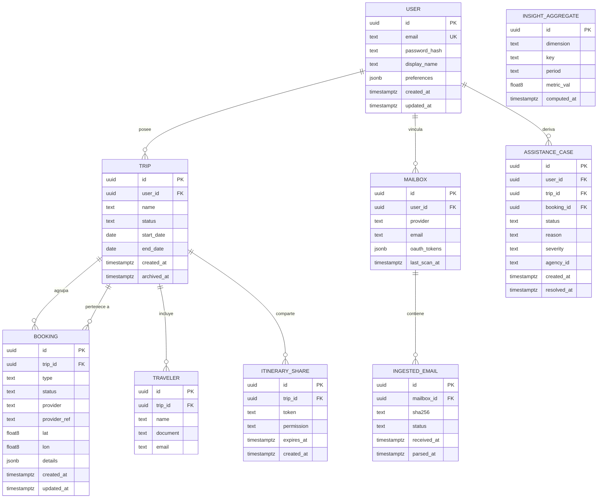
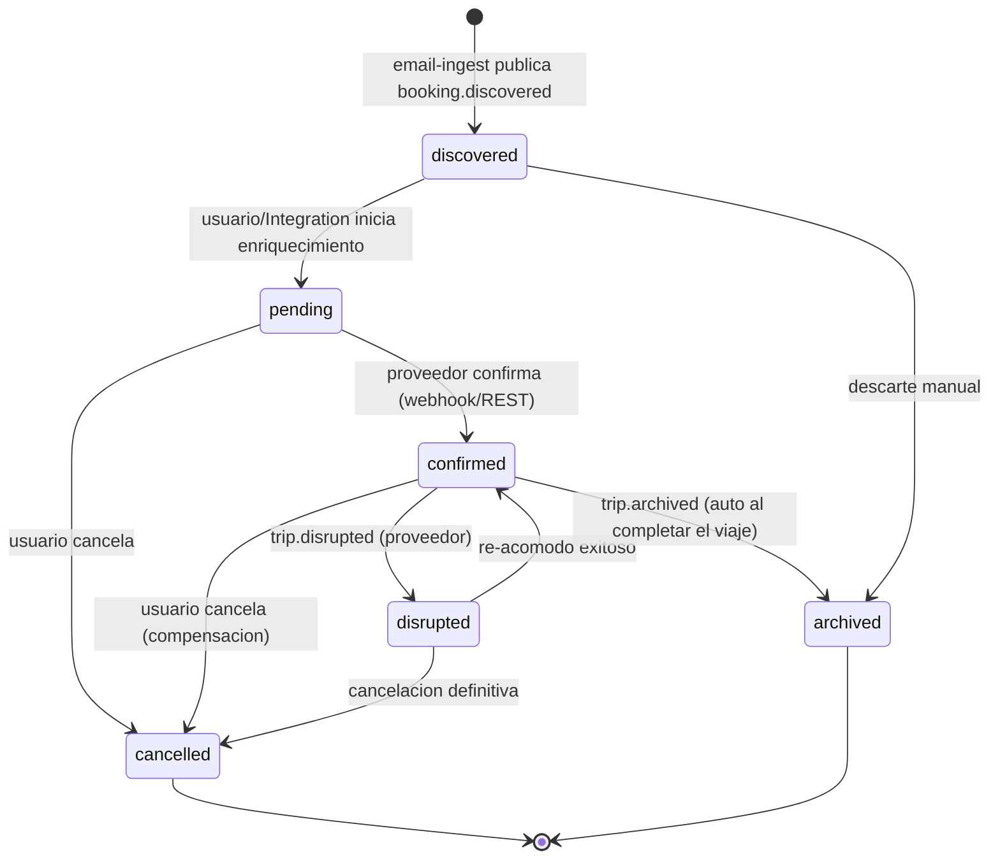
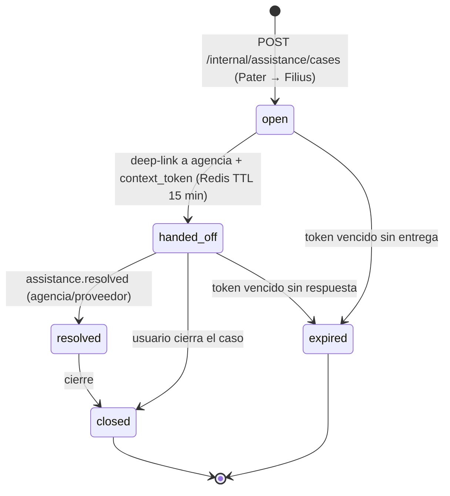

# Trotamundos — Modelo de datos (Trinidad)

> **Rama:** `main` (consolidada) · **Fase:** 0 (MVP). Deriva de ADR-104 (capa de datos compartida con segregación por esquema), ADR-106 (usuarios y preferencias en `filius`), ADR-107 (adaptador analítico PostgreSQL en Fase 0 → ClickHouse en Fase 1), ADR-108 (RBAC por esquema desde Fase 0) y de los bounded contexts de `units/03` (Filius) y `units/04` (Spiritus).

## 1. Principios (ADR-104, ADR-106, ADR-107, ADR-108)

- **Un solo PostgreSQL managed** (DO), con **un esquema por unidad**: `pater`, `filius`, `spiritus`.
- **Aislamiento RBAC por esquema desde Fase 0 (ADR-108):** cada unidad se conecta con su propio rol de base de datos (`pater_app`, `filius_app`, `spiritus_app`) que posee permisos `USAGE, CREATE, SELECT, INSERT, UPDATE, DELETE` **exclusivamente** sobre su esquema. Lo que necesita de otra unidad viene por **contrato** (evento NATS o endpoint REST / read-model), nunca por leer o escribir en el esquema ajeno.
- **Identidad y Preferencias en `filius.users` (ADR-106):** la entidad `users` (con credenciales y `preferences JSONB` indexado con `GIN`) pertenece a **Filius**. **Pater** verifica credenciales llamando a `POST /internal/auth/verify` en **Filius** y emite el JWT RS256.
- **Polimorfismo analítico por fase (ADR-107):** en **Fase 0**, el puerto `AnalyticsRepository` de **Spiritus** utiliza un adaptador PostgreSQL sobre su propio esquema (`spiritus.analytics_events` + `spiritus.insight_aggregates`), manteniendo el costo en ~$80/mes. En **Fase 1** (Droplet 2) se conmuta al adaptador **ClickHouse** sin tocar casos de uso.
- **Redis** es caché compartido (sesiones, rate limit, dedup, idempotencia) — sin datos de dominio con dueño único.
- Migración a DBs separadas en Fase 2 si el escalado lo exige (los puertos hexagonales lo absorben, ADR-002).

## 2. Diagrama Entidad-Relación (ERD)



> **Nota:** `USER`, `TRIP`, `BOOKING`, `TRAVELER`, `ITINERARY_SHARE` viven en el esquema `filius`. `MAILBOX`, `INGESTED_EMAIL` y (en Fase 0, ADR-107) `ANALYTICS_EVENT` e `INSIGHT_AGGREGATE` viven en el esquema `spiritus` (migrando a ClickHouse en Fase 1). El ERD las muestra juntas para dar la visión completa del dominio.

## 2.1. DDL — Roles RBAC por esquema (ADR-108, mitiga DT-01 desde Fase 0)

```sql
CREATE SCHEMA IF NOT EXISTS pater;
CREATE SCHEMA IF NOT EXISTS filius;
CREATE SCHEMA IF NOT EXISTS spiritus;

CREATE ROLE pater_app LOGIN PASSWORD 'pater_dev';
CREATE ROLE filius_app LOGIN PASSWORD 'filius_dev';
CREATE ROLE spiritus_app LOGIN PASSWORD 'spiritus_dev';

REVOKE ALL ON SCHEMA public, pater, filius, spiritus FROM PUBLIC;
GRANT USAGE, CREATE ON SCHEMA pater TO pater_app;
GRANT USAGE, CREATE ON SCHEMA filius TO filius_app;
GRANT USAGE, CREATE ON SCHEMA spiritus TO spiritus_app;
```

## 3. DDL — esquema `filius` (dominio operacional, OLTP, ADR-106)

```sql
-- Esquema dueño: Filius (Itinerary + Integration)
CREATE SCHEMA IF NOT EXISTS filius;

CREATE TABLE filius.users (
    id            UUID PRIMARY KEY DEFAULT gen_random_uuid(),
    email         TEXT NOT NULL UNIQUE,
    password_hash TEXT NOT NULL,
    display_name  TEXT NOT NULL,
    preferences   JSONB NOT NULL DEFAULT '{"locale":"es","currency":"USD","gps_radius_km":50}'::jsonb,
    created_at    TIMESTAMPTZ NOT NULL DEFAULT now(),
    updated_at    TIMESTAMPTZ NOT NULL DEFAULT now()
);
CREATE INDEX idx_users_preferences_gin ON filius.users USING GIN (preferences);

CREATE TABLE filius.trips (
    id          UUID PRIMARY KEY DEFAULT gen_random_uuid(),
    user_id     UUID NOT NULL REFERENCES filius.users(id) ON DELETE CASCADE,
    name        TEXT NOT NULL,
    status      TEXT NOT NULL DEFAULT 'upcoming'
                CHECK (status IN ('upcoming','active','archived')),
    start_date  DATE,
    end_date    DATE,
    created_at  TIMESTAMPTZ NOT NULL DEFAULT now(),
    archived_at TIMESTAMPTZ
);
CREATE INDEX idx_trips_user_status ON filius.trips (user_id, status);
-- Nota Fase 1 (ADR-110): las preferencias `filius.users.preferences` incluyen `preferred_agency_id`.

CREATE TABLE filius.bookings (
    id           UUID PRIMARY KEY DEFAULT gen_random_uuid(),
    trip_id      UUID NOT NULL REFERENCES filius.trips(id) ON DELETE CASCADE,
    type         TEXT NOT NULL CHECK (type IN ('lodging','transport','car_rental')),
    status       TEXT NOT NULL DEFAULT 'discovered'
                 CHECK (status IN ('discovered','pending','confirmed','cancelled','disrupted','archived')),
    provider     TEXT NOT NULL,
    provider_ref TEXT NOT NULL,
    lat          DOUBLE PRECISION,
    lon          DOUBLE PRECISION,
    details      JSONB NOT NULL DEFAULT '{}'::jsonb,
    created_at   TIMESTAMPTZ NOT NULL DEFAULT now(),
    updated_at   TIMESTAMPTZ NOT NULL DEFAULT now(),
    UNIQUE (provider, provider_ref)
);
CREATE INDEX idx_bookings_trip ON filius.bookings (trip_id);
CREATE INDEX idx_bookings_status ON filius.bookings (status);
CREATE INDEX idx_bookings_coords ON filius.bookings (lat, lon) WHERE lat IS NOT NULL AND lon IS NOT NULL;

CREATE TABLE filius.travelers (
    id        UUID PRIMARY KEY DEFAULT gen_random_uuid(),
    trip_id   UUID NOT NULL REFERENCES filius.trips(id) ON DELETE CASCADE,
    name      TEXT NOT NULL,
    document  TEXT,
    email     TEXT
);
CREATE INDEX idx_travelers_trip ON filius.travelers (trip_id);

CREATE TABLE filius.itinerary_shares (
    id          UUID PRIMARY KEY DEFAULT gen_random_uuid(),
    trip_id     UUID NOT NULL REFERENCES filius.trips(id) ON DELETE CASCADE,
    token       TEXT NOT NULL UNIQUE,
    permission  TEXT NOT NULL DEFAULT 'view' CHECK (permission IN ('view')),
    expires_at  TIMESTAMPTZ,
    created_at  TIMESTAMPTZ NOT NULL DEFAULT now()
);

-- Fase 1 (ADR-110): caso de asistencia — dueno Filius (esquema filius)
CREATE TABLE filius.assistance_cases (
    id           UUID PRIMARY KEY DEFAULT gen_random_uuid(),
    user_id      UUID NOT NULL REFERENCES filius.users(id) ON DELETE CASCADE,
    trip_id      UUID REFERENCES filius.trips(id) ON DELETE SET NULL,
    booking_id   UUID REFERENCES filius.bookings(id) ON DELETE SET NULL,
    status       TEXT NOT NULL DEFAULT 'open'
                 CHECK (status IN ('open','handed_off','resolved','closed','expired')),
    reason       TEXT NOT NULL CHECK (reason IN ('complex_request','reschedule_failed','complaint','other')),
    severity     TEXT NOT NULL CHECK (severity IN ('low','medium','high')),
    agency_id    TEXT,
    created_at   TIMESTAMPTZ NOT NULL DEFAULT now(),
    resolved_at  TIMESTAMPTZ
);
CREATE INDEX idx_assistance_cases_user_status ON filius.assistance_cases (user_id, status);
-- El context_token opaco NO se persiste en PG: vive solo en Redis (TTL 15 min, un solo uso).
```

> **Estructura esperada de `filius.bookings.details` (JSONB):** incluye `destination` (IATA/ciudad), `segments` (`[{from, to, at, category}]`) y atributos específicos del medio, mientras que `lat` y `lon` indexan la ubicación principal para consultas de cercanía (`GET /trips/nearby`, `QA-13`).

## 4. DDL — esquema `spiritus` (ingesta + adaptador analítico Fase 0, ADR-107)

```sql
-- Esquema dueño: Spiritus (Email Ingest + Analytics Fase 0). En Fase 1 el OLAP migra a ClickHouse.
CREATE SCHEMA IF NOT EXISTS spiritus;

CREATE TABLE spiritus.mailboxes (
    id            UUID PRIMARY KEY DEFAULT gen_random_uuid(),
    user_id       UUID NOT NULL,
    provider      TEXT NOT NULL CHECK (provider IN ('gmail','imap')),
    email         TEXT NOT NULL,
    oauth_tokens  JSONB,                 -- cifrado en reposo (Fase 2: Vault)
    last_scan_at  TIMESTAMPTZ,
    created_at    TIMESTAMPTZ NOT NULL DEFAULT now(),
    UNIQUE (user_id, email)
);

CREATE TABLE spiritus.ingested_emails (
    id           UUID PRIMARY KEY DEFAULT gen_random_uuid(),
    mailbox_id   UUID NOT NULL REFERENCES spiritus.mailboxes(id) ON DELETE CASCADE,
    sha256       TEXT NOT NULL,          -- dedup
    status       TEXT NOT NULL DEFAULT 'received'
                 CHECK (status IN ('received','parsed','discovered','no_match','failed')),
    received_at  TIMESTAMPTZ NOT NULL DEFAULT now(),
    parsed_at    TIMESTAMPTZ,
    UNIQUE (mailbox_id, sha256)
);
CREATE INDEX idx_ingested_emails_mailbox ON spiritus.ingested_emails (mailbox_id, received_at DESC);

CREATE TABLE spiritus.whitelist_senders (
    id         UUID PRIMARY KEY DEFAULT gen_random_uuid(),
    user_id    UUID NOT NULL,
    sender     TEXT NOT NULL,
    created_at TIMESTAMPTZ NOT NULL DEFAULT now(),
    UNIQUE (user_id, sender)
);

-- Tablas del adaptador PostgresAnalyticsRepo (Fase 0, ADR-107)
CREATE TABLE spiritus.analytics_events (
    event_id       TEXT PRIMARY KEY,
    event_type     TEXT NOT NULL,
    user_id        UUID,
    trip_id        UUID,
    booking_id     UUID,
    provider       TEXT,
    booking_type   TEXT,
    destination    TEXT,
    payload        JSONB NOT NULL DEFAULT '{}'::jsonb,
    occurred_at    TIMESTAMPTZ NOT NULL
);
CREATE INDEX idx_analytics_events_type_date ON spiritus.analytics_events (event_type, occurred_at DESC);
CREATE INDEX idx_analytics_events_user ON spiritus.analytics_events (user_id, occurred_at DESC);

CREATE TABLE spiritus.insight_aggregates (
    id          UUID PRIMARY KEY DEFAULT gen_random_uuid(),
    dimension   TEXT NOT NULL,
    key         TEXT NOT NULL,
    period      TEXT NOT NULL CHECK (period IN ('7d','30d','90d')),
    metric_val  DOUBLE PRECISION NOT NULL DEFAULT 0,
    computed_at TIMESTAMPTZ NOT NULL DEFAULT now(),
    UNIQUE (dimension, key, period)
);
```

## 5. DDL — esquema `pater` (facade: solo read-models y caché referencial)

```sql
-- Esquema dueño: Pater. Contiene solo datos propios del facade (sesiones/rate-limit
-- viven en Redis; aquí solo metadata de templates/render si hace falta).
CREATE SCHEMA IF NOT EXISTS pater;

CREATE TABLE pater.rendered_templates (
    id          UUID PRIMARY KEY DEFAULT gen_random_uuid(),
    template    TEXT NOT NULL,
    locale      TEXT NOT NULL,
    hash        TEXT NOT NULL,
    body        TEXT NOT NULL,
    created_at  TIMESTAMPTZ NOT NULL DEFAULT now(),
    UNIQUE (template, locale, hash)
);
```

## 6. State machine — Booking



**Transiciones y dueño:**
| De | A | Disparador | Dueño | Efecto secundario |
|----|---|------------|-------|-------------------|
| `discovered` | `pending` | `RegisterDiscovered` (Filius) | Filius/itinerary | crea booking + publica `booking.confirmed` tras enriquecer |
| `pending` | `confirmed` | webhook `HandleWebhook` (Filius/integration) | Filius/integration | publica `booking.confirmed` |
| `pending`/`confirmed` | `cancelled` | comando del usuario o compensación | Filius/itinerary | publica `booking.cancelled` |
| `confirmed` | `disrupted` | webhook de disrupción (Filius/integration) | Filius/integration | publica `trip.disrupted` → Spiritus notifica por SSE |
| `disrupted` | `confirmed` | re-acomodo exitoso | Filius/integration | publica `booking.confirmed` |
| cualquiera | `archived` | `ArchiveCompletedTrips` (cron en Filius) | Filius/itinerary | publica `trip.archived` |

**Regla:** toda transición es una **tx ACID local** en el esquema `filius`. No hay tx distribuida; la compensación es un nuevo evento (Newman ch.6).

### 6.1. State machine — AssistanceCase (Fase 1, ADR-110)



El `context_token` **nunca** se persiste en PostgreSQL (solo Redis, TTL 15 min, un solo uso);
la conversación del chat tampoco se persiste. Ningún evento `assistance.*` contiene PII de pasajeros.

## 7. ClickHouse (OLAP, exclusivo de Spiritus) — Fase 1

Tablas pre-agregadas (esquema `trotamundos`):
- `events_raw` — ingesta de `booking.>` / `trip.>` (append-only, partición por mes).
- `insights_destinations` — conteo por destino/periodo (materialized view).
- `insights_cancellations` — tasa de cancelación por proveedor/periodo.
- `insights_cohorts` — cohortes de viajeros.

Retención: 24 meses. Acceso solo por Spiritus (read-model a Pater).

## 8. Convenciones de migración

- Migraciones con **golang-migrate** (o `atlas`), una carpeta por esquema: `migrations/filius/`, `migrations/spiritus/`, `migrations/pater/`.
- Toda migración es **forward-only** en Fase 0 (sin down en prod); rollback vía nueva migración.
- Los cambios de esquema que crucen unidades requieren **ADR de revisión** (Regla 2 de la SPEC).
- Seeds de desarrollo en `migrations/<schema>/seed/` (solo dev).

## 9. Trazabilidad

- QA-10 (compartir con permisos) → `itinerary_shares`.
- QA-15 (analítica sin degradar OLTP) → ClickHouse exclusivo de Spiritus.
- FR-2/FR-3 (captura por email) → `mailboxes`, `ingested_emails`, `whitelist_senders`.
- FR-5 (agrupar por viaje, auto-archivar) → `trips.status = archived` + `trip.archived`.
- FR-7/FR-9 (analítica y monetización) → `INSIGHT_AGGREGATE` / ClickHouse.
- FR-10/FR-11 + QA-16/QA-17 (Fase 1) → `filius.assistance_cases` + `preferred_agency_id` en `filius.users.preferences`; `assistance.*` → Spiritus.
