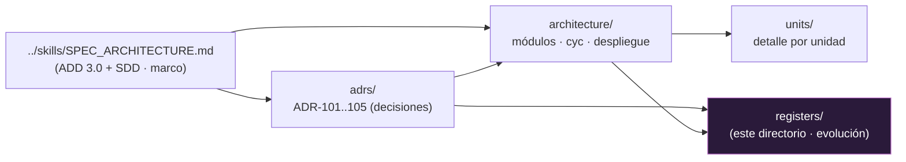

# Trotamundos — Registro de evolución (Trinidad)

> **Rama:** `main-trinity` · **Alcance:** documentación de la arquitectura **elegida** «Trinidad».
> Este directorio es el **registro de evolución** del diseño arquitectónico: un *changelog* de las
> decisiones de documentación, la deuda arquitectónica y los criterios de transición entre iteraciones.

## Para qué sirve (conforme a la SPEC-001)

La **SPEC-001** (`../skills/SPEC_ARCHITECTURE.md`) define en el **Paso 8 (Cierre de Iteración y
Gobernanza)** la consolidación del progreso, el registro de **deuda arquitectónica** (Bass ch.23) y la
**verificación de transición** entre hitos. Este directorio materializa ese cierre de gobernanza para la
Trinidad:

| Archivo | Contenido |
|---------|-----------|
| [registro-evolucion.md](./registro-evolucion.md) | **Changelog** cronológico de los cambios de documentación (vistas, ADRs, estructura), con fecha, artefacto, motivo y trazabilidad a ADR/drivers. |
| [deuda-arquitectonica.md](./deuda-arquitectonica.md) | **Catálogo de deuda arquitectónica** (principal = costo de retire, interés = costo de carga) y **dudas residuales**, según Bass ch.23 y el Paso 8 de la SPEC. |
| [transiciones.md](./transiciones.md) | **Criterios de transición** entre las 4 iteraciones de ADD (CON-5) y entre fases (Fase 0→1→2), con los hitos mínimos del lado de SPEC §8. |

## Convención del changelog

Cada entrada sigue: **fecha · tipo de cambio · artefacto · motivo · trazabilidad (ADR / driver / SPEC) · commit**.
Los cambios de documentación **no** alteran decisiones ya ratificadas sin un ADR nuevo (Regla 2 de la
SPEC: *revisar antes de proponer*). Un cambio que contradiga un ADR aceptado requiere **primero** un ADR
de revisión, y luego se anota aquí.

## Relación con el resto de la documentación

> El registro **no decide** arquitectura; **documenta su evolución** y hace visible la deuda para poder
> retirarla cuando el interés supere al principal (Bass ch.23). Las decisiones viven en `adrs/`; las
> vistas en `architecture/`; el detalle en `units/`.
