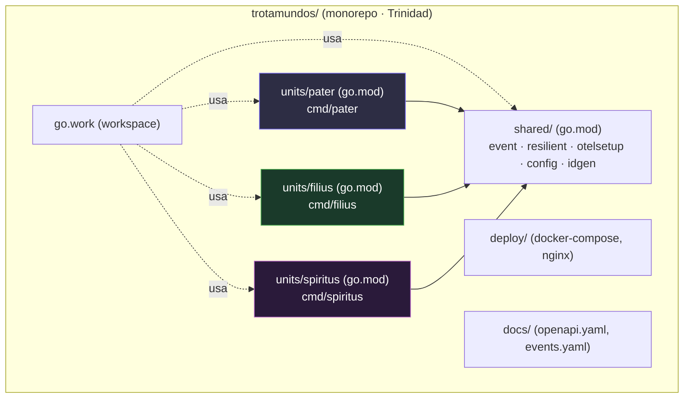
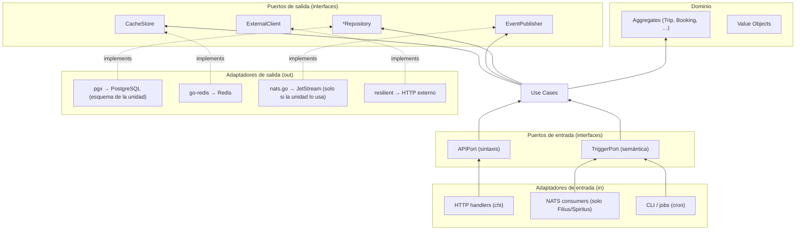
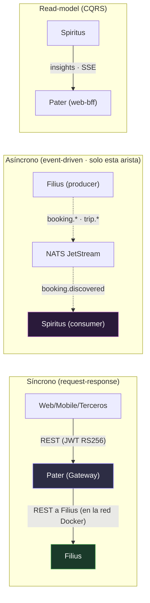

# 01 — Arquitectura global: monorepo, go.work y preocupaciones transversales (Trinidad)

Deriva de los ADRs **102** (límites de unidad y modularidad interna), **104** (capa de datos
compartida con segregación por esquema) y **103** (comunicación inter-unidad). Define el "andamiaje"
común a las tres unidades antes de entrar en detalle por cada una.

## 1. Estrategia de repositorio

La Trinidad elige un **monorepo multi-módulo** (ADR-102): un `go.work` del raíz reúne **tres módulos
Go de unidad** (`units/pater`, `units/filius`, `units/spiritus`), cada uno con su propio `go.mod`, más
un módulo `shared/`. Para un equipo de 3–5 devs (constraint: equipo pequeño, poco tiempo) el monorepo
gana: un solo workspace, tests cruzados y refactorings atómicos de contratos compartidos. Cada unidad
es un **módulo Go independiente** (`go.mod` propio) para conservar la **independencia de deploy** a
nivel de unidad (ADR-105: `docker compose up -d --no-deps <unidad>`) y permitir el futuro `git mv` +
nuevo `go.mod` cuando un módulo interno merezca convertirse en servicio (regla 2-de-3, ADR-102).



### Layout propuesto

```text
trotamundos/
├── go.work                       # workspace: usa las 3 unidades + shared
├── units/
│   ├── pater/                    # module github.com/trotamundos/pater
│   │   ├── go.mod
│   │   ├── cmd/pater/main.go     # deployable: Gateway + Web BFF + Mobile BFF
│   │   └── internal/
│   │       ├── gateway/          # Chi + oapi-codegen (router, auth, rate limit, proxy)
│   │       ├── web-bff/          # templ + htmx + Tailwind (HTML)
│   │       ├── mobile-bff/       # Chi (JSON) para app nativa
│   │       └── domain/…          # (hexagonal, ADR-002 inalterado)
│   ├── filius/                   # module github.com/trotamundos/filius
│   │   ├── go.mod
│   │   ├── cmd/filius/main.go    # deployable: Itinerary + Integration
│   │   └── internal/
│   │       ├── itinerary/        # hexagonal
│   │       └── integration/      # hexagonal
│   └── spiritus/                 # module github.com/trotamundos/spiritus
│       ├── go.mod
│       ├── cmd/spiritus/main.go  # deployable: Email Ingest + Analytics
│       └── internal/
│           ├── email-ingest/     # hexagonal
│           └── analytics/        # hexagonal
├── shared/
│   ├── go.mod                    # module github.com/trotamundos/shared
│   ├── event/                    # tipos + validación de esquemas (JSON Schema) — CONTRATO entre unidades
│   ├── resilient/                # ResilientClient: breaker+retry+ratelimit (ADR-007)
│   ├── otelsetup/                # config común de OpenTelemetry
│   ├── config/                   # carga de entorno/vault
│   └── idgen/                    # ULID/UUID v7
├── deploy/
│   ├── docker-compose.yml        # Fase 0: nginx + pater + filius + spiritus + nats + redis
│   └── nginx/conf.d/*.conf       # TLS + routing (único borde expuesto → Pater)
├── docs/
│   ├── api/openapi.yaml          # spec-driven: rutas del Gateway + BFFs (Pater)
│   └── events/events.yaml        # esquemas JSON de los eventos NATS (arista Filius↔Spiritus)
└── architecture/ · adrs/ · registers/   # vistas, decisiones, registro de evolución
```

> **Por qué 3 módulos y no 7** (ADR-101/102): los servicios de `main` comparten perfil de carga dentro
> de cada unidad (per-request/OLTP en Filius; batch/async en Spiritus; presentación en Pater), así que
> en Fase 0 no merecen procesos separados. Se conserva la **vía de extracción**: si un módulo interno
> diverge en perfil, ciclo de deploy o aislamiento de fallos (2 de 3), se divide en servicio propio sin
> tocar el dominio.

## 2. Estructura hexagonal interna (un módulo típico)

Deriva de **ADR-002** (heredado e inalterado por la Trinidad). Todas las capas viven bajo `internal/`;
el dominio no importa nunca `pgx`, `nats.go`, `net/http` ni otras librerías de infra. La regla es
idéntica a la de `main`: la Trinidad solo cambia **cómo se agrupan** los módulos, no su arquitectura
interna.



**Dependencia**: las flechas apuntan hacia **donde se depende** (el centro estable). Los **Use Cases**
orquestan dominio + puertos. El **dominio** no conoce infraestructura → cambiar PostgreSQL→OtraDB,
NATS→Kafka o Gmail→Outlook es reemplazar un adaptador (`adapters/out`) sin tocar `domain` ni `usecase`.

## 3. Paquetes compartidos (`shared/`)

| Paquete | Responsabilidad | ADR |
|---------|-----------------|-----|
| `shared/event` | Tipos Go de los eventos + validación contra `events.yaml` (JSON Schema) en boot y CI. **Es el único contrato de compilación entre unidades.** | 103 |
| `shared/resilient` | `ResilientClient` = CircuitBreaker → Retry → RateLimiter → HTTP (decoradores) | 103 (ADR-007) |
| `shared/otelsetup` | Config común de OpenTelemetry (exportador OTLP, sampler, resource) | 103 |
| `shared/config` | Carga de config (env + archivo) y secretos (Fase 2: Vault) | 105 (ADR-012) |
| `shared/idgen` | ULID / UUID v7 para IDs de evento idempotentes | — |

> **DRY perils** (Newman ch.5): `shared/` se limita a **contratos estables** y "código de andamiaje".
> **Nada de lógica de dominio compartida**: si un concepto empieza a compartirse entre unidades, es
> señal de que pertenece a una unidad (o debe extraerse), no de que se comparta. Lo que una unidad
> necesita de otra pasa por un **contrato** (evento NATS o endpoint REST), nunca por importar su código
> interno (ADR-103, information hiding).

## 4. Comunicación: el triángulo de conectores

La Trinidad reduce la comunicación inter-unidad a **tres aristas**, cada una con **un único conector**
elegido por la naturaleza de la interacción (Newman ch.4: *communication styles before technology*).
**Dentro de cada unidad no hay red**: los módulos internos se llaman **en proceso** (llamada a función).

| Arista | Conector | Por qué |
|--------|----------|---------|
| **Pater ↔ Filius** | REST · OpenAPI (síncrono, JWT RS256, timeout) | El cliente necesita el resultado ya (QA-6/QA-7) |
| **Filius ↔ Spiritus** | NATS JetStream (eventos ricos, async) | Propagar hechos; cada consumidor reacciona (QA-3, QA-5) |
| **Spiritus → Pater** | read-model (API) + SSE | Mostrar insights/notificaciones sin tocar el OLTP (QA-15, CQRS) |



- **Correlation ID** en cada evento y en cada request (`X-Correlation-ID`), propagado por OTel para
  trazabilidad de extremo a extremo (QA-12, Newman ch.10).
- **Contratos**: OpenAPI 3.1 para las APIs síncronas de Pater (`docs/api/openapi.yaml`); JSON Schema
  para los eventos de la arista Filius↔Spiritus (`docs/events/events.yaml`). `oapi-codegen` genera
  tipos/rutas desde la spec (SDD). Ver [05-catalogo-eventos.md](./05-catalogo-eventos.md).

## 5. Preocupaciones transversales (cross-cutting)

### 5.1 Configuración y secretos
- Config por **variables de entorno** por unidad (`shared/config`), externalizada (Newman ch.7): el
  artefacto (binario Go) es único; la config varía por entorno.
- Secrets: en Fase 0 pasan por env del `docker-compose.yml`; **Fase 2** → Vault con secretos por
  instancia, rotación y TTL (Newman ch.11).

### 5.2 Observabilidad
- **Logs**: JSON estructurado con `correlation_id`, `unit`, `level` (agregación = prerequisito, Newman ch.10).
- **Métricas**: Prometheus en `/metrics` (breaker state, retry count, latencia p99, tasa de
  "no matcheado" del parser, lag de Consumer).
- **Tracing**: OpenTelemetry → OTLP (Fase 1: Grafana Tempo/Jaeger). Cada request y cada evento
  arrastran trace/span ID.
- **SLO de referencia**: disponibilidad 99.9% (~2h11m/mes de caída, QA-8); respuesta web p95 ≤ 800 ms.

### 5.3 Manejo de errores
- Dominio: errores tipados (`ErrBookingNotFound`, `ErrTripNotComplete`) que el adaptador traduce a
  códigos HTTP / eventos de fallo.
- **Idempotencia**: toda operación de escritura expuesta por fuera acepta una `Idempotency-Key`
  (Redis, TTL 24 h) — crítico para reentregas de eventos y webhooks (ADR-103, ADR-007).

### 5.4 Testing (pirámide, Newman ch.9)
- **Unitarios** (×10): dominio puro, sin infra (la ventaja del hexagonal).
- **De servicio / contrato** (×1): puertos con adaptadores fake; **Consumer-Driven Contracts** (Pact)
  entre Pater (Gateway/BFF) y Filius, y entre los consumidores de eventos.
- **E2E** (pocos, "training wheels"): `docker compose` con las 3 unidades + DBs efímeras.
- **En producción**: smoke tests + verificación de SLO (Newman: MTTR < acumular tests pre-prod).

### 5.5 Build y deploy
- **CI/CD**: GitHub Actions — `push` a `main` → build + test + contract tests → **3 imágenes**
  (`pater`/`filius`/`spiritus`) → SSH al Droplet → `docker compose up -d --no-deps <unidad>` (ADR-105).
- **Artefacto único** verificado que se promueve igual a todos los entornos (build-once, Newman ch.7).
- **Trunk-based** (ramas < 1 día). Separamos **deploy** de **release** (feature flags, Newman ch.8).
- **Template de pipeline** compartido para las 3 unidades (mitiga el costo de pipelines, ADR-105).

## 6. Mapa de unidades → puertos de salida (resumen)

| Unidad | Esquema PG | Cache | Publica (NATS) | Consume (NATS) | Cliente externo |
|--------|-----------|-------|----------------|----------------|-----------------|
| **Pater** | (solo lectura de read-model de Spiritus) | Redis (rate limit/JWT/sesiones) | — | — | proxy a Filius; BFFs a Filius |
| **Filius** | `filius` (escribe) | Redis (idempotencia) | `booking.confirmed/cancelled/disrupted`, `trip.*` | `booking.discovered` | Aerolíneas/hoteles/rentadoras (resiliente) |
| **Spiritus** | `spiritus` (escribe) | Redis (dedup) | `booking.discovered` | `booking.*`, `trip.*` | Gmail API, IMAP |

> **PostgreSQL es compartido con esquemas segregados** (ADR-104): cada unidad escribe **solo** en su
> esquema (`pater`/`filius`/`spiritus`); lo que necesita de otra unidad viene por contrato (evento o
> read-model), nunca por escribir en el esquema ajeno. **ClickHouse** es exclusivo de Spiritus (OLAP).
