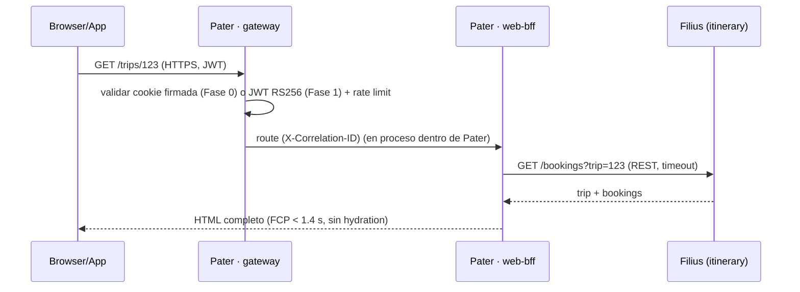

# 02 — Unidad Pater (el Rostro) — Web BFF (Fase 0) · Mobile BFF (Fase 1)

> **Rol**: presentación y entrada (facade). Es la **única** unidad expuesta al borde (atrás de Nginx/TLS).
> **Perfil de carga**: per-request, baja latencia (web ≤ 800 ms, QA-6; FCP móvil < 1.4 s, QA-7).
> **ADR de origen**: 102 (unidad), 111 (sqlc/HTMX/cookie), 112 (mapa real). 103/014/105 describen la referencia Fase 1.
> **ADR-111 (prototipo Fase 0):** los handlers consultan PostgreSQL con **sqlc** directamente y responden HTML/HTMX; no hay API JSON, clientes REST internos ni JWT/JWKS. La sesión es una cookie firmada HttpOnly.
> **Colapsa** los deployables de `main`: API Gateway (ADR-006) + Web BFF (ADR-009) + Mobile BFF (ADR-013),
> ahora **módulos internos en proceso** dentro de `units/pater`. En **Fase 1** se añade `assistant/`
> (Asistente Virtual, ADR-109/110) **sin nuevo deployable ni nueva arista**.

## 1. Responsabilidad

Pater es el **Rostro** del sistema: recibe toda entrada (web, móvil, terceros) y la agrega/renderiza.
En **Fase 0** consulta PostgreSQL con sqlc y renderiza HTML/HTMX (ADR-111); no contiene dominio operacional. La delegación REST en Filius es la referencia Fase 1.

- **gateway/** *(referencia Fase 1)* — punto único de entrada (ADR-013): routing, **validación JWT RS256** (JWKS, ADR-014),
  rate limit por cliente (token bucket, `golang.org/x/time/rate`), proxy inverso hacia Filius,
  inyección de `X-Correlation-ID`. Generado con `oapi-codegen` desde `fase_0/docs/api/openapi.yaml`.
- **web-bff/** — render del servidor con **templ + htmx + Tailwind** (ADR-009): HTML completo en la
  primera respuesta (sin hydration), swap de fragmentos vía htmx, SSE para notificaciones en vivo
  (arista Spiritus→Pater). i18n por región.
- **mobile-bff/** — agregación **JSON** para las apps nativas (Swift/Kotlin) con Chi (ADR-013):
  *one BFF per experience*. Mismos contratos OpenAPI que la web, payload adaptado a móvil.
- **assistant/** (Activo en inicio parcial de Fase 1, ADR-109/113) — Asistente Virtual en `/assistant`: clasificación determinista de intenciones (`RuleBasedClassifier` detrás de `IntentClassifier`), redacción de PII (`RedactPII`), consultas de
  estado, reprogramación guiada (`FR-6`) y derivación de casos complejos (`FR-11`). Usa sesión efímera en Redis (TTL 30 min) y `NotifyFiliusHandoff` (REST `Pater→Filius`).

## 2. Tecnologías

| Capa | Tecnología | Uso en Pater |
|------|-----------|--------------|
| Lenguaje | Go 1.23+ | lógica de facade |
| HTTP server / router | `github.com/go-chi/chi/v5` | routing del gateway y del mobile-bff |
| Codegen | `oapi-codegen` | tipos + rutas desde `openapi.yaml` |
| Templates web | `github.com/a-h/templ` | templates compilados a `.go` (web-bff) |
| Interactividad | htmx 1.9+ | swap de fragmentos, SSE, polling |
| CSS | Tailwind CSS 3.x | utilities → build estático |
| Auth | Cookie firmada HMAC (Fase 0) · JWT RS256 (Fase 1) | `internal/web/session.go`, HttpOnly; ADR-111/014 |
| Rate limit | `golang.org/x/time/rate` | token bucket por cliente/API key |
| Cache | `github.com/redis/go-redis/v9` | sesiones, rate limit, plantillas renderizadas |
| Tracing/metrics | OpenTelemetry + Prometheus | latencia p99, tasa de error, rate-limit hits |

## 3. Estructura (vista de módulos, hexagonal por módulo)

```mermaid
graph TB
    subgraph "units/pater/internal/ — gateway · web-bff · mobile-bff · assistant (Fase 1) (en proceso)"
        IN["Adaptadores de entrada<br/>• HTTP (chi): gateway, web-bff, mobile-bff<br/>• SSE publisher (notificaciones)"]
        PORTSIN["Puertos (entrada)<br/>• APIPort (queries)"]
        • Authenticate<br/>• RateLimit<br/>• RenderTripPage / RenderInsights<br/>• AggregateMobileTrip<br/>• HandleAssistantMessage",
        • FiliusClient (REST)<br/>• ReadModelClient (Spiritus)<br/>• CacheStore<br/>• IntentClassifier (LLM/Reglas)<br/>• SessionStore (Redis TTL)",
        OUT["Adaptadores de salida<br/>• chi (HTTP out)<br/>• go-redis → Redis<br/>• http (REST a Filius, timeout)<br/>• SSE (a web-bff)"]
        IN --> PORTSIN --> UC
        UC --> PORTSOUT
        OUT -. implements .-> PORTSOUT
    end
    style UC fill:#1a3a2a,stroke:#81c784,color:#fff
```

> **Sin dominio propio**: los "use cases" de Pater orquestan **llamadas a Filius** (REST) y **lecturas
> de read-model** (Spiritus). La regla hexagonal (ADR-002) se respeta: el *FiliusClient* es un puerto
> (interfaz) que el adaptador `http` implementa → cambiar el transporte no toca la lógica de agregación.

## 4. Interacción con las otras unidades (aristas del triángulo)

- **Pater → Filius (REST síncrono)**: el gateway proxya / el web-bff y mobile-bff llaman a los endpoints
  de Filius (`GET /bookings/{id}`, `GET /trips/{id}`, comandos de reserva). Siempre con **timeout** de
  contexto y el `X-Correlation-ID` propagado. Si Filius no responde, Pater degrada a "datos
  desactualizados" (no bloquea el render, ADR-103).
- **Spiritus → Pater (read-model / SSE)**: el web-bff consume la API de insights de Spiritus para el
  dashboard (sin pasar por Filius/OLTP, QA-15) y suscribe a **SSE** para empujar notificaciones en vivo
  al navegador (disrupciones, `trip.disrupted`).



## 5. Trazabilidad de drivers

| Driver | Cómo se satisface en Pater |
|--------|----------------------------|
| QA-6 (web ≤ 800 ms) | REST directo a Filius, sin capa intermedia Go→Go innecesaria; cache Redis de plantillas |
| QA-7 (FCP móvil < 1.4 s) | web-bff SSR (HTML en la primera respuesta), mobile-bff JSON ligero |
| QA-9 (acceso seguro) | cookie firmada HttpOnly + `SESSION_SECRET` en Fase 0; JWT/OIDC en Fase 1 |
| QA-12 (trazabilidad) | `X-Correlation-ID` inyectado y propagado por OTel a Filius/Spiritus |
| QA-14 (canales web/móvil) | web-bff (HTML/htmx) y mobile-bff (JSON) como experiencias separadas (ADR-013) |
| QA-16 (respuesta < 2 s, Fase 1) | streaming por SSE/htmx; `IntentClassifier` con timeout + fallback determinista; sin bloquear el render |
| QA-17 (resolución ≥ 70 %, Fase 1) | intenciones resueltas localmente frente a derivaciones; medido por `assistance.*` en Spiritus |

## 6. Flujo de autenticación (cookie firmada en Fase 0; JWT RS256 en Fase 1)

Fase 0: **Pater valida credenciales con sqlc y emite una cookie firmada** (ADR-111). El JWT de ADR-014 queda para Fase 1.

- **Fase 1 (referencia) — Emisión:** `POST /auth/login` en Pater delega la verificación de credenciales a **Filius** mediante una llamada REST interna (`POST /internal/auth/verify`, que consulta `filius.users` sin que Pater toque el esquema `filius`, ADR-106) y emite un JWT RS256 con claims: `sub` (user_id), `email`, `iat`, `exp` (15 min), `jti`.
- **Preferencias del usuario:** `GET / PATCH /users/me/preferences` expone y actualiza el documento `filius.users.preferences` (JSONB: `locale`, `currency`, `gps_radius_km` y `travel_preferences`) delegando por REST interno en Filius (ADR-106).
- **Fase 1 (referencia) — Validación:** cada request al Gateway valida la firma con la clave pública (JWKS en `/.well-known/jwks.json`), verifica `exp` y `iss`, e inyecta `X-User-Id` + `X-Correlation-ID` hacia los BFFs.
- **Fase 1 (referencia) — Refresh:** `POST /auth/refresh` con `refresh_token` (opaco, en Redis, TTL 7 días) → nuevo access token.
- **Fase 1 (referencia):** la clave privada vive en `JWT_PRIVATE_KEY_FILE`; en Fase 2, Vault + OIDC. Fase 0 usa `SESSION_SECRET` (ADR-111).
- **Logout:** `POST /auth/logout` revoca el refresh token en Redis (el access token expira solo).

## 7. Protocolo SSE (notificaciones en vivo)

Endpoint: `GET /insights/stream` (Pater web-bff) → `text/event-stream`.

- **Eventos:** `trip.disrupted`, `booking.cancelled`, `booking.confirmed` (reenviados desde Spiritus/Pater).
- **Formato:** `event: <tipo>\ndata: <json>\nid: <correlation-id>\n\n`.
- **Reconexión:** el cliente envía `Last-Event-ID`; el servidor reenvía desde ese punto (buffer en Redis, TTL 5 min).
- **Fallback:** si SSE no está disponible (proxy antiguo), polling cada 30 s a `/insights`.
- **Heartbeat:** comentario `: keep-alive` cada 15 s para mantener la conexión.

## 8. Convención de errores (envelope)

Toda respuesta de error usa el schema `Error` de OpenAPI:

```json
{ "code": "BOOKING_NOT_FOUND", "message": "…", "correlation_id": "…", "details": { } }
```

- **Códigos:** `UPPER_SNAKE_CASE`, estables (parte del contrato). Lista canónica (ver `01-arquitectura-global.md` §9): `VALIDATION_ERROR`, `UNAUTHORIZED`, `FORBIDDEN`, `NOT_FOUND`, `CONFLICT`, `RATE_LIMITED`, `UPSTREAM_UNAVAILABLE`, `INTERNAL`. Adicionales en Pater: `IDEMPOTENCY_REPLAY`, `UPSTREAM_TIMEOUT`.
- **HTTP status:** 400 (validación), 401 (auth), 403 (permisos), 404 (no encontrado), 409 (conflicto/idempotencia), 502 (upstream), 503 (no disponible), 504 (timeout).
- El `correlation_id` se propaga en el header `X-Correlation-ID` y en el body del error.

## 9. Geolocalización (GPS) — QA-13

Fase 1 (no implementado en Fase 0): **Mobile BFF** (`mobile-bff/`):

- El cliente móvil envía `X-Device-Location: lat,lon` (permiso explícito, solo en foreground).
- Endpoint `GET /trips/nearby?lat=..&lon=..&radius=..` devuelve reservas/viajes cercanos al viajero (usa `filius` + filtro por distancia).
- **Privacidad:** la posición no se persiste; solo se usa en la respuesta. No se envía a terceros.
- **Deep-linking (FR-6):** el Mobile BFF genera URLs de deep-link hacia apps de terceros (aerolíneas, hoteles) con el `provider_ref`.

## 10. Asistente Virtual (Fase 1 — ADR-109/110)

- **Contrato:** `POST /assistant/messages`, `GET /assistant/stream` (SSE), `GET /assistant/cases/{id}`;
  mismo payload JSON para `mobile-bff`, fragmentos htmx para `web-bff`.
- **Flujo (Fase 1):** el Gateway valida el token, aplica rate limit e inyecta `X-Correlation-ID`; `assistant/`
  clasifica la intención y, para **consultas de estado**, llama a Filius por REST con timeout.
- **Reprogramación:** el asistente **no escribe en el proveedor**; entrega un *deep-link* (FR-6) y
  confirma el nuevo estado cuando llega `booking.confirmed` desde Filius.
- **Caso complejo:** `POST /internal/assistance/cases` a Filius + *deep-link* a la agencia preferida
  con `context_token` opaco (Redis, TTL 15 min, un solo uso). Ver `03-filius-nucleo.md` §7.
- **Privacidad:** la sesión de chat y el contexto enviado al LLM son **redactados** y no se persisten
  (Redis con TTL corto); el proveedor externo solo recibe lo mínimo y nunca credenciales ni PII sin
  consentimiento (QA-9). Si el LLM falla: circuit breaker → clasificador de reglas → opción de derivación.
- **Errores:** mismos códigos del envelope (`VALIDATION_ERROR`, `RATE_LIMITED`, `UPSTREAM_UNAVAILABLE`);
  añade `ASSISTANT_DEGRADED` cuando se responde con el fallback determinista.

> Vistas complementarias: `../architecture/vista_cyc.md` (escenarios 2, 3 y 6 en runtime) y
> `../architecture/vista_despliegue.md` (contenedor `pater` tras Nginx). Detalle de eventos en
> [05-catalogo-eventos.md](./05-catalogo-eventos.md).
