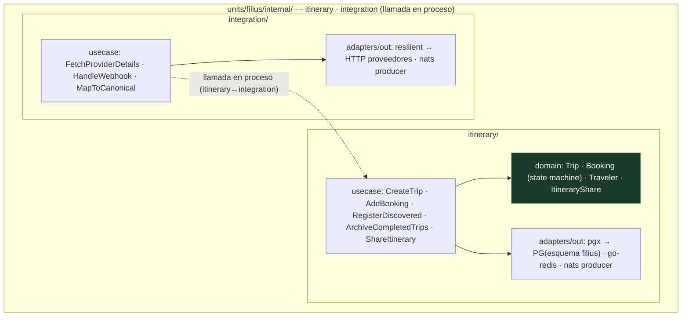
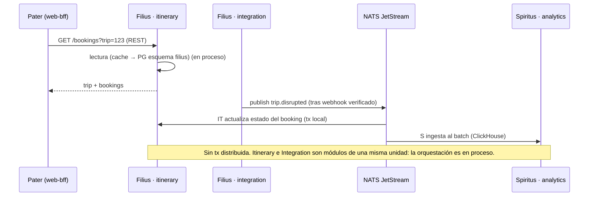

# 03 — Unidad Filius (el Núcleo) — Itinerary · Integration

> **Rol**: dominio operacional transaccional (OLTP).
> **Perfil de carga**: per-request, I/O (SLA ≤ 800 ms, QA-6).
> **ADR de origen**: 102 (unidad), 103 (aristas REST con Pater y NATS con Spiritus). Complementa: 104 (esquema PG), 014 (JWT RS256 para autenticación).
> **Colapsa** los deployables de `main`: Itinerary (ADR-001) + Integration (ADR-007), ahora **módulos
> internos en proceso** dentro de `units/filius`.

## 1. Responsabilidad

Filius es el **Núcleo** transaccional del sistema. Posee la verdad de las reservas y los viajes y es el
encargado de enriquecerlas con los proveedores externos.

- **itinerary/** — el módulo central (bounded context: Viaje, Reserva, Viajero, Ciclo de Vida):
  - **Viajes (Trip)**: agrupación de reservas y viajeros (FR-5: agrupar por viaje, auto-archivar al finalizar).
  - **Reservas (Booking)**: hospedaje y transporte, con state machine de ciclo de vida.
  - **Viajeros (Traveler)**; **compartir itinerario** con permisos de visualización (QA-10, FR-8);
    **deep-linking** a apps de terceros (FR-6).
  - Publica `booking.confirmed` / `trip.*`; consume `booking.discovered` (crea la reserva desde el correo).
- **integration/** — adaptación a proveedores heterogéneos (aerolíneas, hoteles, rentadoras):
  - Contratos de proveedor (REST/NDC), **webhooks** firmados (HMAC), y la **cadena de resiliencia**
    (circuit breaker → retry → rate limit, ADR-007).
  - Llama a Itinerary **en proceso** (dentro de Filius) para actualizar el booking tras enriquecerlo.
  - Publica `booking.confirmed` / `booking.cancelled` / `trip.disrupted`.

## 2. Tecnologías

| Capa | Tecnología | Uso en Filius |
|------|-----------|---------------|
| Lenguaje | Go 1.23+ | lógica de dominio y integración |
| HTTP (API síncrona) | `github.com/go-chi/chi/v5` | REST para Pater (lecturas/comandos) |
| Persistencia OLTP | `github.com/jackc/pgx/v5` | esquema `filius`: `trips`, `bookings`, `travelers`, `itinerary_shares` |
| Cache / idempotencia | `github.com/redis/go-redis/v9` | lectura en caliente, `Idempotency-Key`, bloqueo óptimo |
| Eventos | `github.com/nats-io/nats.go` | publica `booking.*`/`trip.*`; consume `booking.discovered` (arista con Spiritus) |
| Resiliencia | `shared/resilient` (gobreaker+retry+ratelimit) | llamadas a proveedores (integration) |
| i18n | `github.com/nicksnyder/go-i18n` | mensajes/metadata por región |
| Tracing/metrics | OpenTelemetry + Prometheus | latencia p99, breaker state, retry count |

## 3. Estructura (dos módulos hexagonales en proceso)

> **Itinerary↔Integration es una llamada a función**, no un salto de red: comparten proceso y memoria
> dentro de `filius` (ADR-102). Esto elimina el overhead de red que `main` pagaba entre dos servicios
> con perfil de carga idéntico. La state machine del booking vive en `itinerary/domain`; la
> idempotencia de webhooks en Redis.

## 4. Interacción con las otras unidades (aristas del triángulo)

- **Pater → Filius (REST)**: Pater lee/escribe a través de los endpoints de Itinerary.
- **Filius → Spiritus (NATS JetStream, async)**: Filius **publica** hechos ricos (`booking.confirmed`,
  `trip.disrupted`, `booking.cancelled`); Spiritus los **consume** para analítica y re-ingesta. A la
  inversa, Spiritus publica `booking.discovered` que Itinerary consume. Es la **única** arista que usa
  NATS (ADR-103). Sin tx distribuida: cada paso es una tx ACID local en el esquema `filius` (Newman ch.6).

## 5. Trazabilidad de drivers

| Driver | Cómo se satisface en Filius |
|--------|------------------------------|
| QA-1/QA-2 (escalabilidad) | perfil OLTP aislado en su propia unidad → escala vertical / réplicas (Fase 1) |
| QA-3 (picos masivos) | desacoplado de Spiritus por la arista async (el batch no bloquea el núcleo) |
| QA-5 (< 5 min de terceros) | webhooks + `booking.discovered` → actualización event-driven |
| QA-6 (web ≤ 800 ms) | lecturas en cache Redis → PG; REST directo a Pater |
| QA-9/QA-4 (integración heterogénea) | adaptadores por proveedor + cadena de resiliencia (ADR-007) |
| QA-10 (compartir con permisos) | `ItineraryShare` con `ShareToken` y permisos de visualización |
| QA-11 (nuevos medios) | nuevo adaptador de proveedor sin tocar dominio (hexagonal) |

> Vistas complementarias: `../architecture/vista_cyc.md` (escenarios 1, 3 y 4) y `../architecture/vista_despliegue.md`
> (contenedor `filius`). Catálogo de eventos: [05-catalogo-eventos.md](./05-catalogo-eventos.md).
