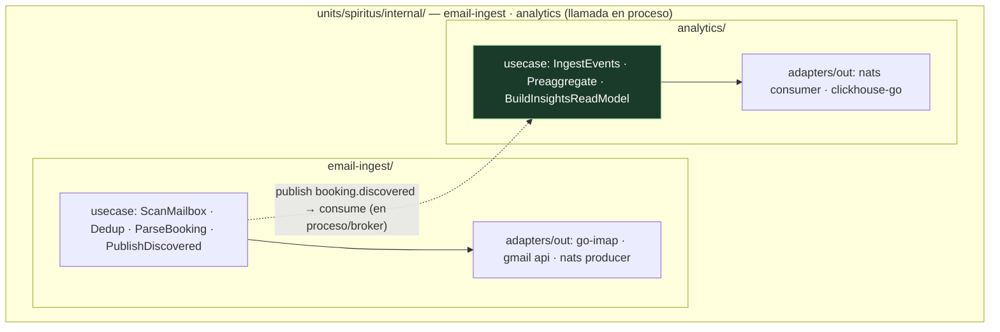
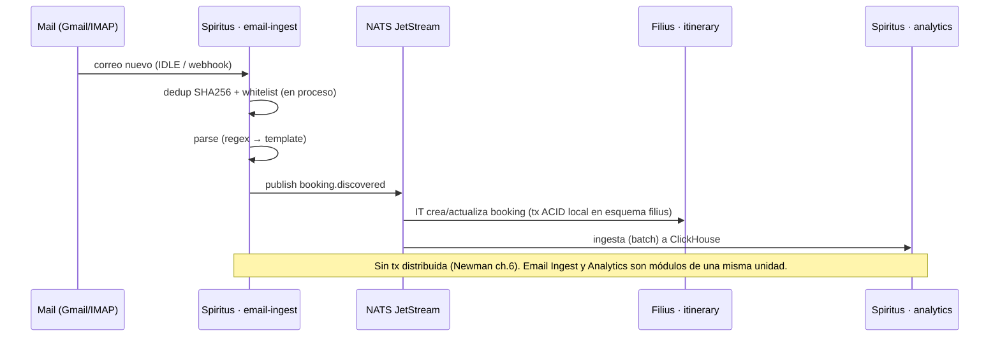

# 04 — Unidad Spiritus (la Mente) — Email Ingest · Analytics

> **Rol**: procesamiento asíncrono y analítica.
> **Perfil de carga**: batch, CPU/OLAP, **bursty** (QA-3).
> **ADR de origen**: 102 (unidad), 103 (aristas NATS con Filius y read-model/SSE con Pater). Complementa: 104 (ClickHouse exclusivo), 104 (esquema PG).
> **Colapsa** los deployables de `main`: Email Ingest (ADR-008) + Analytics (ADR-010), ahora **módulos
> internos en proceso** dentro de `units/spiritus`.

## 1. Responsabilidad

Spiritus es la **Mente**: captura reservas desde el correo, procesa hechos en batch y produce la capa
analítica que alimenta insights y monetización. Está **aislada del núcleo OLTP** para que su carga
bursty de CPU no degrade el SLA de 800 ms (QA-15, CQRS).

- **email-ingest/** — captura automática de reservas desde correo (FR-2, FR-3):
  - Conexión **IMAP** (genérico) y **Gmail API** (push + labels), OAuth2 (QA-9).
  - **Dedup** SHA256 + **whitelist** de remitentes (Redis); parseo por reglas (regex → template) con
    `net/mail`; publica `booking.discovered` (arista con Filius).
  - Pool de parsers para absorber picos (QA-3). Corre en **cron/IDLE/webhook**, no per-request.
- **analytics/** — ingestión **batch** a **ClickHouse** (OLAP, dueño exclusivo de Spiritus):
  - Consuma **todos** los eventos de dominio (`booking.>`, `trip.>`) y los pre-agrega.
  - Sirve el **read-model** de insights a Pater (dashboard, FR-7) y a partners anónimos (FR-9, monetización).
  - Expone métricas de lag de consumidor y tasa de "no matcheado" del parser.

## 2. Tecnologías

| Capa | Tecnología | Uso en Spiritus |
|------|-----------|-----------------|
| Lenguaje | Go 1.23+ | lógica de ingesta y analítica |
| IMAP | `github.com/emersion/go-imap` | conexión IMAP (Outlook, genérico) |
| Gmail API | `google.golang.org/api/gmail` | push + labels |
| OAuth2 | `golang.org/x/oauth2` | auth con Gmail / social |
| MIME parsing | `net/mail` (stdlib) | headers y body |
| Eventos | `github.com/nats-io/nats.go` | consume `booking.discovered`; publica `booking.discovered`/re-ingesta (arista Filius↔Spiritus) |
| OLAP | `github.com/ClickHouse/clickhouse-go/v2` | batch insert + queries analíticas a ClickHouse |
| Cache | `github.com/redis/go-redis/v9` | dedup de correos |
| Dashboard | Metabase (Fase 1) | queries ad-hoc del equipo de datos |
| Tracing/metrics | OpenTelemetry + Prometheus | lag de consumidor, tasa de parseo |

## 3. Estructura (dos módulos hexagonales en proceso)

> **email-ingest↔analytics es una llamada en proceso** dentro de `spiritus`. En la práctica, el
> flujo descansa sobre NATS (email-ingest publica `booking.discovered`, analytics puede re-consumir
> para re-ingesta), pero **no hay borde de red entre los dos módulos**: pertenecen a la misma unidad
> (ADR-102). ClickHouse lo posee exclusivamente Spiritus (QA-15).

## 4. Interacción con las otras unidades (aristas del triángulo)

- **Filius ↔ Spiritus (NATS JetStream, async)**: la única arista con NATS. Spiritus **consume**
  `booking.*`/`trip.*` de Filius (para analítica) y **publica** `booking.discovered` que Itinerary
  consume. Invertir la responsabilidad: emisores publican hechos ricos, consumidores reaccionan (Newman ch.4).
- **Spiritus → Pater (read-model / SSE)**: el analytics sirve el read-model de insights a Pater (sin
  pasar por Filius/PostgreSQL, QA-15) y empuja notificaciones por SSE para disrupciones en tiempo casi real.

## 5. Trazabilidad de drivers

| Driver | Cómo se satisface en Spiritus |
|--------|-------------------------------|
| QA-2/QA-3 (picos) | pool de parsers + batch; unidad aislada → el bursty de CPU no tumbará a Pater/Filius |
| QA-5 (< 5 min) | `booking.discovered` → Filius actualiza en segundos vía NATS |
| QA-9 (correo seguro) | OAuth2, dedup, whitelist; secretos por instancia |
| QA-15 (analítica sin degradar OLTP) | ClickHouse exclusivo + read-model servido a Pater, fuera del OLTP |
| FR-7 (recopilación analítica) | pre-agregados en ClickHouse (tendencias, cohortes) |
| FR-9 (monetización) | insights agregados/anónimos a partners vía read-model (datos anónimos, QA-9) |

> Vistas complementarias: `../architecture/vista_cyc.md` (escenario 5, dashboard de insights) y
> `../architecture/vista_despliegue.md` (contenedor `spiritus` + Droplet 2 de ClickHouse). Catálogo de
> eventos: [05-catalogo-eventos.md](./05-catalogo-eventos.md).
