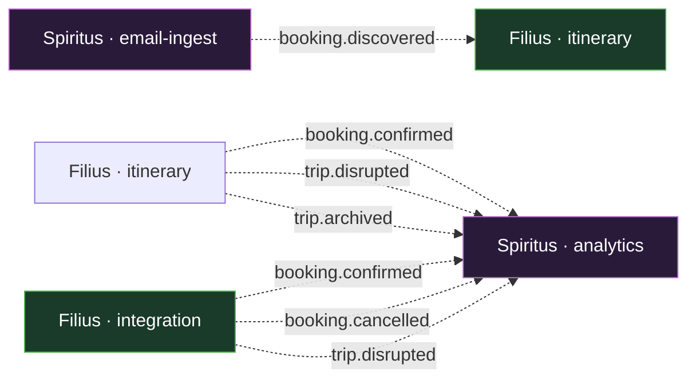
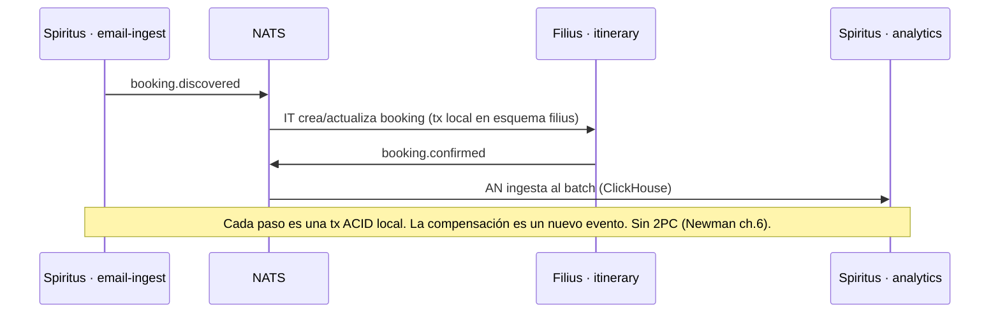

# 05 — Catálogo de eventos (NATS JetStream · arista Filius↔Spiritus)

> Deriva de **ADR-103** (comunicación inter-unidad) y **ADR-104** (datos). Fuente de verdad:
> `docs/events/events.yaml` (JSON Schema). Los tipos Go se generan/consumen desde `shared/event`.
> Formato de payload: **JSON** (no Avro, por simplicidad).
>
> **Restricción trinitaria (ADR-103):** NATS JetStream se usa **solo en la arista Filius↔Spiritus**.
> Pater, el Gateway y los BFF **no** publican ni consumen eventos (leen por REST o read-model). Esto
> reduce el catálogo de subjects y consumidores frente a `main`.

## 1. Convenciones de subjects

- Jerarquía `dominio.accion`: `booking.*`, `trip.*`.
- Wildcards JetStream: `booking.>` (todos los de booking), `booking.confirmed` (exacto).
- Cada evento lleva cabeceras: `correlation-id`, `traceparent` (OTel), `id` (ULID/UUID v7),
  `occurred-at` (RFC3339), `source` (unidad emitora: `filius` o `spiritus`).
- **Hechos ricos**: el payload trae los datos completos necesarios, no solo IDs (Newman ch.4).

## 2. Matriz productor → consumidor (una sola arista)



- **Filius consume** `booking.discovered` (Spiritus lo publica al descubrir un correo) → Itinerary
  crea/actualiza la reserva.
- **Spiritus consume** `booking.>` y `trip.>` (Filius los publica) → Analytics ingesta al batch y
  construye el read-model de insights.
- **Notification** (Fase 1) será un **módulo dentro de Spiritus** que consume `trip.disrupted`,
  `booking.cancelled` → publica `notification.sent`. No es un servicio independiente en Fase 0.

## 3. Esquemas de eventos (JSON)

### 3.1 `booking.discovered` — publicado por **Spiritus** (email-ingest)
```json
{
  "id": "01J9Z...ULID",
  "specversion": "1.0",
  "type": "booking.discovered",
  "source": "spiritus",
  "correlation-id": "…",
  "occurred-at": "2026-10-27T10:00:00Z",
  "payload": {
    "provider": "aerolineaX",
    "provider_ref": "PNR123",
    "type": "transport",
    "passengers": [{ "name": "…", "document": "…" }],
    "segments": [{ "from": "EZE", "to": "GRU", "at": "2026-11-01T22:00:00Z" }],
    "confidence": 0.92,
    "mailbox_id": "…"
  }
}
```

### 3.2 `booking.confirmed` — publicado por **Filius** (integration o itinerary)
```json
{
  "type": "booking.confirmed",
  "source": "filius",
  "payload": {
    "booking_id": "…", "trip_id": "…",
    "provider": "aerolineaX", "provider_ref": "PNR123",
    "status": "confirmed", "confirmed_at": "2026-10-27T10:00:05Z"
  }
}
```

### 3.3 `booking.cancelled`
```json
{
  "type": "booking.cancelled",
  "source": "filius",
  "payload": {
    "booking_id": "…", "trip_id": "…",
    "provider": "hotelY", "cancelled_at": "…", "reason": "user"
  }
}
```

### 3.4 `trip.disrupted`
```json
{
  "type": "trip.disrupted",
  "source": "filius",
  "payload": {
    "trip_id": "…", "booking_id": "…",
    "severity": "high", "message": "Vuelo cancelado", "disrupted_at": "…"
  }
}
```

### 3.5 `trip.archived` — publicado por **Filius** (itinerary)
```json
{
  "type": "trip.archived",
  "source": "filius",
  "payload": { "trip_id": "…", "archived_at": "…", "reason": "completed" }
}
```

### 3.6 `notification.sent` — publicado por **Spiritus** (Fase 1, módulo notification)
```json
{ "type": "notification.sent", "source": "spiritus",
  "payload": { "notification_id": "…", "channel": "push", "status": "delivered" } }
```

## 4. Retención y dead letter (ADR-103)

| Stream | Subjects | Retención | Consumidores |
|--------|----------|-----------|--------------|
| `TRIPS` | `trip.>` | 30 días | Filius (itinerary), Spiritus (analytics) |
| `BOOKINGS` | `booking.>` | 30 días | Filius (itinerary), Spiritus (analytics) |
| `EMAIL` | `email.>` (dead letter) | 7 días | (reprocesamiento manual) |
| `NOTIFICATIONS` | `notification.>` | 30 días | Spiritus (analytics) |

- **Dead letter**: un correo sin match (email-ingest) o un webhook inválido (integration) va a un
  stream con retención 7 días + alerta.
- **Idempotencia del consumidor**: cada consumidor dedup por `id` del evento (Redis, TTL 24 h) para
  soportar reentregas de JetStream sin efectos duplicados (ADR-103).

## 5. Patrón de colaboración (saga, no tx distribuida)



## 6. Migración a Kafka (criterio ADR-103)

Si se cumple 2-de-3 (equipo opera Kafka / replay > 3 meses / > 100K msg/s), el puerto
`EventPublisher`/`EventSinkPort` de Filius y Spiritus permite sustituir el adaptador NATS por Kafka
**sin tocar dominio ni esquemas** (los subjects se mapean a topics). El catálogo de eventos (esta
sección) permanece igual; solo cambia el adaptador de la arista Filius↔Spiritus.
