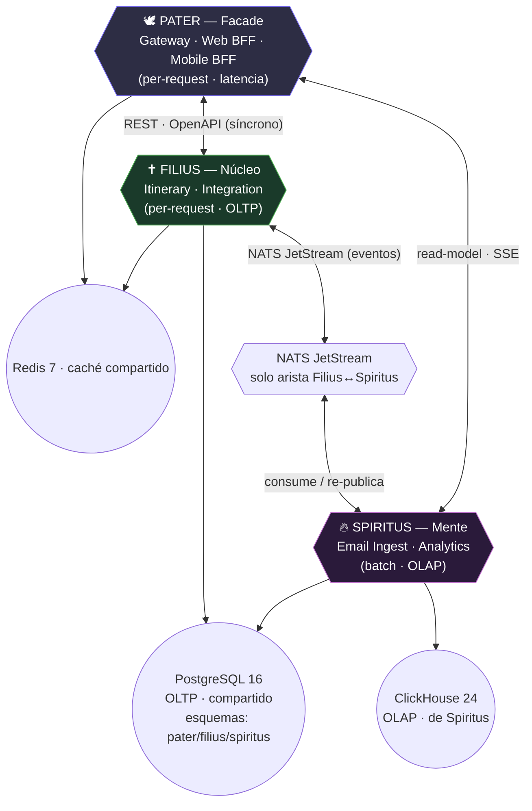

# Trotamundos — Detalle por unidad (Trinidad)

Profundiza el diseño ya aprobado en los ADRs trinitarios (`../adrs/`, ADR-101..105) y las vistas
(`../architecture/`), aplicando **ADD** (Attribute-Driven Design, 4 iteraciones) y **SDD**
(Spec-Driven Development) con contratos OpenAPI / JSON-Schema. Mismo nivel de detalle que el paquete de servicios de la rama `main` (consolidado ahora en este directorio), pero **re-particionado en 3 unidades** en lugar de 7
microservicios.

## Cómo leer este paquete

| # | Archivo | Contenido | ADR de origen |
|---|---------|-----------|---------------|
| 00 | [README.md](./README.md) | Índice y trazabilidad de drivers → unidades | ADR-101 |
| 01 | [01-arquitectura-global.md](./01-arquitectura-global.md) | Layout del monorepo (`go.work` + 3 `go.mod` de unidad), `shared/`, preocupaciones transversales (config, logs, tracing, testing) | ADR-102, ADR-104 |
| 02 | [02-pater-facade.md](./02-pater-facade.md) | Unidad **Pater** (el Rostro) — Gateway · Web BFF · Mobile BFF | ADR-102, ADR-103 |
| 03 | [03-filius-nucleo.md](./03-filius-nucleo.md) | Unidad **Filius** (el Núcleo) — Itinerary · Integration | ADR-102, ADR-103 |
| 04 | [04-spiritus-mente.md](./04-spiritus-mente.md) | Unidad **Spiritus** (la Mente) — Email Ingest · Analytics | ADR-102, ADR-103 |
| 05 | [05-catalogo-eventos.md](./05-catalogo-eventos.md) | Catálogo de eventos NATS JetStream — **solo la arista Filius↔Spiritus** | ADR-103, ADR-104 |

## Las tres unidades del sistema (Fase 0)

## Trazabilidad de drivers → unidades

| Driver (calidad) | Referencia | Unidad(s) que lo soportan | Táctica principal |
|------------------|-----------|---------------------------|-------------------|
| Escalabilidad 2M usuarios / 15M cuentas (QA-1, QA-2) | `../drivers/atributos.md` | Las 3, con escalado independiente por perfil de carga | Separación de unidades por carga (Pater/Filius/Spiritus) |
| Actualización < 5 min de terceros (QA-5) | `../drivers/atributos.md` | Spiritus (email) + Filius → NATS → Filius | Event-driven, sin tx distribuida |
| Respuesta web ≤ 800 ms (QA-6) | `../drivers/atributos.md` | Pater + Filius | REST directo Pater→Filius; cache Redis |
| FCP mobile < 1.4 s (QA-7) | `../drivers/atributos.md` | Pater (Web BFF SSR + Mobile BFF) | Render en primera respuesta, sin hydration |
| Mitigar picos masivos (QA-3) | `../drivers/atributos.md` | Spiritus (parser pool + batch) | Aislamiento de la Mente del núcleo (arista async) |
| Analítica sin degradar lo transaccional (QA-15) | `../drivers/atributos.md` | Spiritus (ClickHouse) + Pater (read-model) | CQRS: lecturas analíticas fuera del OLTP |
| Integración de nuevos medios (QA-11) | `../drivers/atributos.md` | Filius (Integration) + Spiritus (Email Ingest) | Adaptadores por proveedor (hexagonal) |
| Acceso seguro a correos (QA-9) | `../drivers/atributos.md` | Spiritus (Email Ingest, OAuth2) | Cifrado, secretos por instancia |
| Compartir itinerario con permisos (QA-10) | `../drivers/atributos.md` | Filius (Itinerary, ItineraryShare) | Authorization en el módulo dueño |
| **Monetización por analítica (FR-9)** | `../drivers/requerimientos.md` | Spiritus (Analytics → read-model a partners) | Pre-agregados en ClickHouse; datos anónimos |

## Convención de versiones y fases

- **Fase 0** = MVP (1 Droplet, Docker Compose, **3 deployables Go**: `pater`, `filius`, `spiritus`).
- **Fase 1** = segundo Droplet (ClickHouse + Metabase, dueño: Spiritus) + Redis/NATS managed; extracción de **Notification** como módulo de Spiritus.
- **Fase 2** = K3s + Terraform + ArgoCD; extracción de **Identity** (deja de emitir JWT el Gateway de Pater, ADR-104); extracción de módulo→servicio cuando el perfil diverja (regla 2-de-3, ADR-102).
- Puertos de referencia (Fase 0): **Pater** `:8080`, **Filius** `:8081`, **Spiritus** `:8082`, NATS `:4222/:8222`, Redis `:6379`, PostgreSQL `:5432`, ClickHouse `:8123/:9000`.

> **Diferencia clave con `main`:** en microservicios cada servicio era un deployable (7 `go.mod`, 7
> imágenes). Aquí la **unidad de despliegue** es la **unidad trinitaria** (3 `go.mod`, 3 imágenes); los
> servicios anteriores sobreviven como **módulos internos** dentro de su unidad, con vía de extracción
> futura (ADR-102). NATS ya **no** lo consumen Pater ni el Gateway: queda restringido a la arista
> Filius↔Spiritus (ADR-103).
